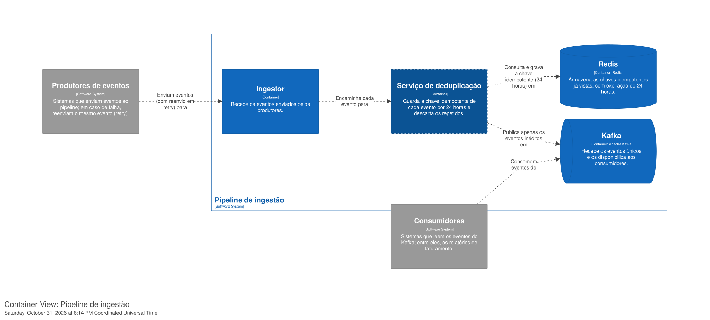
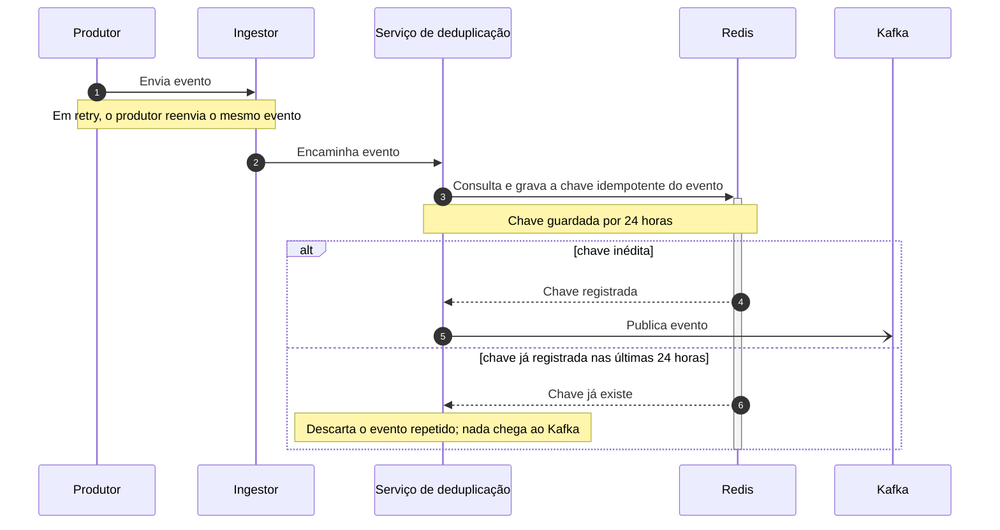

# Serviço de deduplicação de eventos · DD-2026-(a definir)

| | |
|---|---|
| **Documento** | DD-2026-(a definir) |
| **Estado** | Rascunho |
| **Autores** | Rafael Nunes |
| **Revisores** | (a definir) |
| **Criado em** | 2026-10-31 |
| **Última atualização** | 2026-10-31 |

## Motivação

O pipeline de ingestão recebe eventos duplicados dos produtores: quando um envio falha, o produtor reenvia o mesmo evento em retry, e o pipeline aceita as duas cópias. No mês passado medimos 4% de duplicatas no total ingerido.

As duplicatas chegam aos consumidores e inflam os relatórios de faturamento. O financeiro já reclamou duas vezes do problema, o que torna a correção urgente.

## Proposta

Vamos criar um serviço de deduplicação entre o ingestor e o Kafka. Para cada evento que recebe, o serviço guarda a chave idempotente do evento no Redis por 24 horas. Se a chave já existe no Redis, o serviço descarta o evento como repetido; se não existe, registra a chave e publica o evento no Kafka. Chave idempotente é o identificador que marca duas cópias do mesmo evento como iguais, de modo que o reenvio em retry carrega a mesma chave do envio original.

O principal custo da proposta é um salto a mais no caminho crítico da ingestão. Estimamos +5 ms de latência por evento, e o time aceitou esse custo em troca de resolver a duplicação em um único ponto do pipeline.

### Arquitetura



<details>
<summary>Fonte do diagrama (Structurizr DSL)</summary>

```
workspace "Pipeline de ingestão de eventos" "Serviço de deduplicação entre o ingestor e o Kafka." {

    !identifiers hierarchical

    model {
        produtores = softwareSystem "Produtores de eventos" "Sistemas que enviam eventos ao pipeline; em caso de falha, reenviam o mesmo evento (retry)." {
            tags "External"
        }

        pipeline = softwareSystem "Pipeline de ingestão" "Recebe os eventos dos produtores e os entrega no Kafka para os consumidores." {
            ingestor = container "Ingestor" "Recebe os eventos enviados pelos produtores."
            dedup = container "Serviço de deduplicação" "Guarda a chave idempotente de cada evento por 24 horas e descarta os repetidos." {
                tags "Novo"
            }
            redis = container "Redis" "Armazena as chaves idempotentes já vistas, com expiração de 24 horas." "Redis" {
                tags "Database"
            }
            kafka = container "Kafka" "Recebe os eventos únicos e os disponibiliza aos consumidores." "Apache Kafka" {
                tags "Queue"
            }
        }

        consumidores = softwareSystem "Consumidores" "Sistemas que leem os eventos do Kafka; entre eles, os relatórios de faturamento." {
            tags "External"
        }

        produtores -> pipeline.ingestor "Enviam eventos (com reenvio em retry) para"
        pipeline.ingestor -> pipeline.dedup "Encaminha cada evento para"
        pipeline.dedup -> pipeline.redis "Consulta e grava a chave idempotente (24 horas) em"
        pipeline.dedup -> pipeline.kafka "Publica apenas os eventos inéditos em"
        consumidores -> pipeline.kafka "Consomem eventos de"
    }

    views {
        systemContext pipeline "SystemContext" {
            include *
            autoLayout lr
        }

        container pipeline "Containers" {
            include *
            autoLayout lr
        }

        styles {
            element "Element" {
                background #1168bd
                color #ffffff
            }
            element "Novo" {
                background #0b5394
                border dashed
            }
            element "Database" {
                shape cylinder
            }
            element "Queue" {
                shape pipe
            }
            element "External" {
                background #999999
                color #ffffff
            }
        }
    }

    configuration {
        scope softwaresystem
    }
}
```

</details>

Os produtores continuam enviando eventos ao ingestor, como hoje. O ingestor passa a encaminhar cada evento ao serviço de deduplicação (o container com borda tracejada, o único elemento novo) em vez de publicar direto no Kafka. O serviço consulta e grava a chave idempotente no Redis, que mantém cada chave por 24 horas, e publica no Kafka apenas os eventos que ainda não tinham chave registrada. Os consumidores, entre eles os relatórios de faturamento, seguem lendo do Kafka sem nenhuma mudança e passam a receber cada evento uma só vez dentro da janela de 24 horas.

O diagrama não indica a tecnologia do ingestor nem do serviço de deduplicação, nem o protocolo de cada integração, porque esta versão do documento ainda não os registrou.

### Fluxo de um evento



O produtor envia o evento ao ingestor (passo 1), que o encaminha ao serviço de deduplicação (2). O serviço consulta e grava a chave idempotente no Redis (3). Quando a chave é inédita, o Redis a registra (4) e o serviço publica o evento no Kafka (5). Quando a chave já estava registrada nas últimas 24 horas, o caso do reenvio em retry, o serviço descarta o evento (6 e 7) e nada chega ao Kafka.

O diagrama mostra o caminho feliz. Ele não mostra a resposta devolvida ao ingestor e ao produtor nem o comportamento quando o Redis não responde (Perguntas abertas, itens 1 e 2).

### Trade-offs da solução

- ✓ A deduplicação acontece em um único ponto do pipeline. Nenhum consumidor precisa implementar nada.
- ✓ A chave fica no Redis por 24 horas, independente do processo produtor, então o reenvio após um reinício do produtor também é descartado dentro da janela.
- ✗ Mais um salto no caminho crítico da ingestão: estimamos +5 ms de latência por evento.
- ✗ O caminho de ingestão passa a depender do Redis. O comportamento da ingestão quando o Redis não responde está em aberto (Perguntas abertas, item 1).
- ✗ A janela é de 24 horas: um reenvio que chegue mais de 24 horas depois do original não é reconhecido como duplicata.

### Alternativas consideradas

| Alternativa | Por que foi descartada |
|---|---|
| Não fazer nada | As duplicatas seguem em 4% e os relatórios de faturamento continuam inflados. O financeiro já reclamou duas vezes. |
| Deduplicar no consumidor | Cada consumidor teria que reimplementar a mesma lógica. |
| Usar a idempotência nativa do produtor Kafka | Não cobre o reenvio entre reinícios do produtor. |
| **Serviço de deduplicação com Redis (escolhida)** | Resolve a duplicação em um único ponto e cobre o reenvio após reinício do produtor, ao custo de +5 ms no caminho crítico. |

## Riscos

Seção pendente: o autor ainda não listou os riscos desta proposta e suas mitigações. As perguntas que preenchem esta seção estão em Perguntas abertas (itens 1 e 2).

## Plano de rollout

Seção pendente: o autor ainda não definiu as fases de entrada em produção, o critério de avanço e o de rollback. A pergunta correspondente está em Perguntas abertas (item 3).

## Métricas de sucesso

- Taxa de duplicatas abaixo de 0,1% do total ingerido, contra os 4% medidos no mês passado, usando a mesma medição que produziu o número atual (ver Perguntas abertas, item 4).
- Latência adicionada pelo serviço de deduplicação, medida em produção, para confirmar a estimativa de +5 ms por evento.

## Perguntas abertas

1. O que o serviço faz quando o Redis não responde: deixa o evento passar (e aceita duplicatas nesse período) ou segura a ingestão? Esta decisão define o principal risco da proposta e sua mitigação.
2. Qual é a chave idempotente de cada evento? Todos os produtores já a enviam hoje, ou ela precisa ser definida ou derivada do evento? Há reenvio que chegue mais de 24 horas depois do original?
3. Como a proposta entra em produção: em fases (por produtor, por tipo de evento, em modo de observação sem descartar), com qual critério de avanço e qual rollback?
4. Como foram medidos os 4% de duplicatas do mês passado, para repetir a mesma medição na meta de 0,1%?
5. Quem revisa o documento: os times que operam o ingestor, o Kafka e o Redis, e o financeiro como parte interessada nos relatórios?
