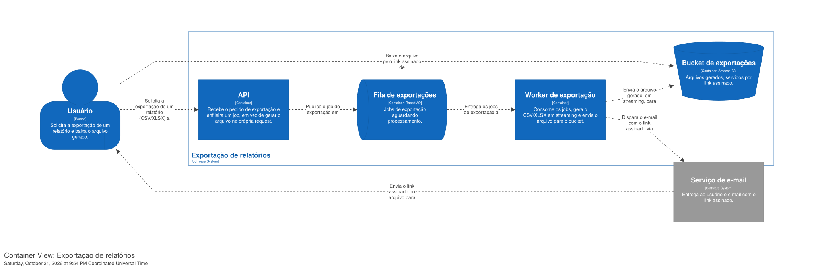
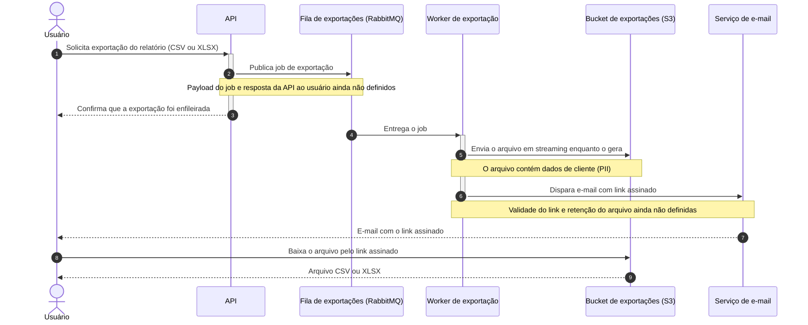

# Exportação de relatórios em background

| | |
|---|---|
| **Documento** | DESIGN-DOC |
| **Estado** | Rascunho |
| **Título** | Exportação de relatórios em background |
| **Autores** | *(a preencher)* |
| **Revisores** | Time de Plataforma (fila compartilhada), Time de Segurança (link assinado com PII) |
| **Criado em** | 2026-10-31 |
| **Última atualização** | 2026-10-31 |
| **Tags** | relatórios, exportação, fila, rabbitmq, s3 |

## Glossário

- **BI**: business intelligence; aqui, uma ferramenta externa de relatórios e dashboards.
- **Gateway**: a camada na frente da API que encerra qualquer request com mais de 30 segundos.
- **Job de exportação**: a mensagem enfileirada que descreve um pedido de exportação para o worker processar.
- **Link assinado**: URL que autoriza o download de um arquivo específico do bucket sem exigir login. A validade do link é uma das questões em aberto.
- **PII**: informação pessoal identificável. Os relatórios exportados contêm dados de cliente.
- **Streaming**: geração do arquivo em partes, enviadas ao bucket conforme são produzidas, em vez de montar o arquivo inteiro antes de enviá-lo.
- **Worker**: processo separado da API que consome a fila e executa os jobs de exportação.

## Visão geral

Hoje a API gera os relatórios dentro da própria request, e as exportações grandes estouram o timeout de 30 segundos do gateway. Este documento propõe mover a geração para um worker em background. A API passa a enfileirar um job no RabbitMQ, o worker gera o CSV ou XLSX em streaming e envia o arquivo ao S3, e o usuário recebe por e-mail um link assinado para baixar o arquivo quando a geração termina.

A mudança troca o download imediato por um caminho único e assíncrono para toda exportação, pequena ou grande. O objetivo é zerar os timeouts de exportação e sustentar relatórios de 100 mil linhas.

## Escopo e contexto

- A API gera o arquivo do relatório na própria request e o entrega na resposta.
- O gateway encerra requests que passam de 30 segundos.
- Cerca de 12% das exportações acima de 50 mil linhas falham por esse timeout.
- O suporte abre ticket sobre essas falhas toda semana.
- A infraestrutura já tem RabbitMQ em uso, como fila compartilhada entre times.

## Objetivos e fora de escopo

Objetivos:

1. Zerar as falhas de exportação por timeout, tirando a geração do arquivo do caminho da request. A linha de base é a de hoje, 12% de falha nas exportações acima de 50 mil linhas.
2. Sustentar exportações de 100 mil linhas, gerando o arquivo em streaming no worker.

Fora de escopo:

- Manter um caminho síncrono para exportações pequenas. Toda exportação passa pelo fluxo assíncrono, para haver um caminho só.
- Gerar relatórios por uma ferramenta de BI externa (ver Alternativas consideradas).

## A solução

### Visão geral da solução

A solução separa o pedido da geração. A API recebe o pedido de exportação e publica um job na fila de exportações, no RabbitMQ que a infraestrutura já tem. Um worker separado consome a fila, gera o CSV ou XLSX em streaming e envia o arquivo para um bucket no S3. Ao terminar, o usuário recebe por e-mail um link assinado para baixar o arquivo.

O trade-off central é a perda do download imediato. Exportações pequenas, que hoje saem na hora, passam a chegar por e-mail como as grandes. O time aceitou esse custo para ter um caminho só, em vez de manter dois fluxos (síncrono para relatórios pequenos, assíncrono para grandes) e a bifurcação por tamanho que viria com eles.

### Arquitetura



<details>
<summary>Fonte do diagrama (Structurizr DSL)</summary>

```
workspace "Exportação de relatórios em background" "Geração assíncrona de relatórios CSV/XLSX fora da request da API." {

    !identifiers hierarchical

    model {
        usuario = person "Usuário" "Solicita a exportação de um relatório e baixa o arquivo gerado."

        exportacao = softwareSystem "Exportação de relatórios" "Gera relatórios CSV/XLSX em background e entrega um link assinado por e-mail." {
            api = container "API" "Recebe o pedido de exportação e enfileira um job, em vez de gerar o arquivo na própria request."
            fila = container "Fila de exportações" "Jobs de exportação aguardando processamento." "RabbitMQ" {
                tags "Queue"
            }
            worker = container "Worker de exportação" "Consome os jobs, gera o CSV/XLSX em streaming e envia o arquivo para o bucket."
            bucket = container "Bucket de exportações" "Arquivos gerados, servidos por link assinado." "Amazon S3" {
                tags "Storage"
            }
        }

        email = softwareSystem "Serviço de e-mail" "Entrega ao usuário o e-mail com o link assinado." {
            tags "External"
        }

        usuario -> exportacao.api "Solicita a exportação de um relatório (CSV/XLSX) a"
        exportacao.api -> exportacao.fila "Publica o job de exportação em"
        exportacao.fila -> exportacao.worker "Entrega os jobs de exportação a"
        exportacao.worker -> exportacao.bucket "Envia o arquivo gerado, em streaming, para"
        exportacao.worker -> email "Dispara o e-mail com o link assinado via"
        email -> usuario "Envia o link assinado do arquivo para"
        usuario -> exportacao.bucket "Baixa o arquivo pelo link assinado de"
    }

    views {
        systemContext exportacao "SystemContext" {
            include *
            autoLayout lr
        }

        container exportacao "Containers" {
            include *
            autoLayout lr
        }

        styles {
            element "Element" {
                background #1168bd
                color #ffffff
            }
            element "Person" {
                shape person
            }
            element "Queue" {
                shape pipe
            }
            element "Storage" {
                shape bucket
            }
            element "External" {
                background #999999
                color #ffffff
            }
        }
    }

    configuration {
        scope softwaresystem
    }
}
```

</details>

O diagrama mostra os quatro contêineres do serviço e um sistema externo:

- **API**: continua atendendo o pedido de exportação, mas em vez de gerar o arquivo publica um job na fila e responde ao usuário sem o arquivo.
- **Fila de exportações**: uma fila no RabbitMQ compartilhado, que guarda os jobs até o worker consumi-los.
- **Worker de exportação**: consome a fila, gera o CSV ou XLSX em streaming e envia o arquivo ao bucket; ao terminar, dispara o e-mail com o link assinado.
- **Bucket de exportações**: o bucket no S3 onde os arquivos ficam, servidos ao usuário por link assinado.
- **Serviço de e-mail**: leva o link assinado até o usuário. O documento ainda não define qual serviço faz esse envio (ver Questões em aberto).

O gateway não aparece no diagrama porque é uma preocupação de deployment, não um contêiner do serviço. Ele continua na frente da API, mas deixa de estar no caminho da geração do arquivo. A API e o worker aparecem sem tecnologia, e as setas sem protocolo, porque a conversa não os estabeleceu; são lacunas a preencher, não decisões tomadas. O diagrama também não mostra de onde o worker lê os dados do relatório, pelo mesmo motivo.

### Fluxo de uma exportação



Nos passos 1 a 3, o usuário pede a exportação, a API publica o job e responde de imediato, sem o arquivo; a request termina muito antes dos 30 segundos do gateway. Nos passos 4 a 6, o worker recebe o job, gera o arquivo em streaming direto para o bucket e dispara o e-mail com o link assinado. Nos passos 7 a 9, o usuário recebe o e-mail e baixa o arquivo pelo link.

O diagrama cobre só o caminho feliz. O que acontece quando a geração falha, quando o envio ao bucket falha ou quando o e-mail não chega ainda não foi definido, e está registrado em Questões em aberto; nenhum desses ramos foi desenhado para não inventar comportamento.

### Dados e sua sensibilidade

Os relatórios exportados contêm dados de cliente (PII). Hoje o arquivo sai na resposta da request. Com a mudança, esses dados passam a existir também em repouso, como objeto no bucket do S3, e o acesso a eles passa por um link assinado que trafega por e-mail. Esse é o ponto que o time de Segurança precisa revisar: por quanto tempo o link vale, por quanto tempo o arquivo fica no bucket e o que impede o reuso do link por alguém que não o usuário que pediu a exportação. Nenhum desses três pontos está decidido.

## Trade-offs da solução escolhida

- ✓ Tira a geração do arquivo do caminho da request. O timeout de 30 segundos do gateway deixa de limitar o tamanho do relatório, o que ataca diretamente os 12% de falha acima de 50 mil linhas.
- ✓ Um caminho só para toda exportação, sem bifurcação por tamanho.
- ✓ Reaproveita o RabbitMQ que já existe na infraestrutura; não introduz um broker novo.
- ✗ O usuário perde o download imediato. Exportações pequenas, que hoje funcionam na hora, passam a chegar por e-mail. O time aceitou esse custo em troca do caminho único.
- ✗ Carga nova numa fila compartilhada com outros times, o que torna o time de Plataforma parte da decisão.
- ✗ Dados de cliente passam a ficar em repouso no S3, acessíveis por um link assinado que trafega por e-mail, o que torna o time de Segurança parte da decisão.
- ✗ Mais partes móveis. A entrega passa a depender do worker, do bucket e do envio de e-mail, e uma falha em qualquer um deles precisa de um tratamento que ainda não foi definido.

## Alternativas consideradas

| Alternativa | O que resolve | O que custa | Decisão |
|---|---|---|---|
| Não fazer nada | Nada muda para o usuário de exportações pequenas | Mantém os 12% de falha acima de 50 mil linhas e os tickets semanais do suporte | ✗ Descartada |
| Gerar síncrono com timeout maior | Menos exportações estouram o limite | Só empurra o problema para um limite maior; relatórios maiores voltam a estourar | ✗ Descartada |
| Ferramenta de BI externa | Tira a geração do nosso código | Custo da ferramenta e exposição de dado de cliente a um terceiro | ✗ Descartada |
| Worker em background com fila, S3 e link por e-mail | Zera os timeouts e sustenta 100 mil linhas | Perda do download imediato; fila compartilhada; PII em repouso atrás de link assinado | ✓ Escolhida |

Não fazer nada não é aceitável porque o problema já tem custo recorrente: 12% das exportações grandes falham e o suporte abre ticket toda semana. Aumentar o timeout foi descartado porque não muda a natureza do problema, só o ponto em que ele reaparece. A ferramenta de BI externa foi descartada por custo e porque colocaria dado de cliente fora da empresa.

## Preocupações transversais

### Plataforma (fila compartilhada)

A fila de exportações vai viver no RabbitMQ que outros times já usam. O time de Plataforma precisa avaliar a carga que os jobs de exportação adicionam e como isolar esse tráfego do dos outros consumidores (fila própria, limites, prioridade). O documento ainda não traz o volume esperado de jobs nem o tamanho das mensagens.

### Segurança (link assinado com PII)

Os arquivos no bucket contêm PII e são acessados por link assinado enviado por e-mail. O time de Segurança precisa definir a validade do link, a retenção dos arquivos no bucket e as proteções contra uso do link por quem não pediu a exportação. Ver a seção Dados e sua sensibilidade.

## Questões em aberto

1. Quem assina como autor e quem são os revisores nomeados em Plataforma e em Segurança.
2. Qual tecnologia roda a API e o worker, e qual protocolo cada seta do diagrama usa.
3. De onde o worker lê os dados do relatório (a mesma base que a API usa hoje?).
4. O que a API responde ao usuário depois de enfileirar o job, e se o usuário consegue acompanhar o estado da exportação enquanto espera o e-mail.
5. Qual serviço envia o e-mail e se ele já existe na infraestrutura.
6. Validade do link assinado, retenção dos arquivos no bucket e proteções contra reuso do link (Segurança).
7. Volume esperado de jobs e tamanho das mensagens, e como a fila se isola das demais no RabbitMQ compartilhado (Plataforma).
8. O que acontece quando a geração, o envio ao bucket ou o e-mail falham: retentativa, aviso ao usuário, ou os dois.
9. Como medir o objetivo em produção (taxa de exportações que falham por timeout) e como verificar o limite de 100 mil linhas antes de publicar.
10. Se a mudança entra de uma vez ou em etapas, e qual é o caminho de volta se der problema.
