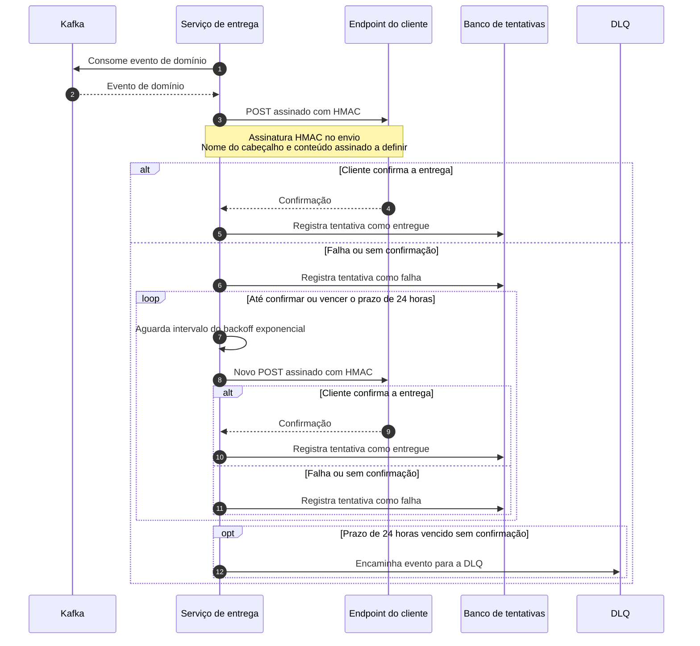

# Serviço de webhooks de saída

| | |
|---|---|
| **Estado** | Rascunho |
| **Autores** | A definir (ver Perguntas em aberto) |
| **Revisores** | A definir. Sugestão: Segurança, pelas chaves HMAC, e os times donos dos serviços que hoje fazem o POST por conta própria |
| **Criado** | 2026-11-20 |
| **Última atualização** | 2026-11-20 |
| **Tags** | webhooks, eventos, kafka, postgres |

## Glossário

- Webhook: chamada HTTP que um sistema nosso faz ao endpoint de um cliente externo para avisar que algo aconteceu.
- Evento de domínio: mensagem publicada no Kafka que descreve um fato ocorrido em um dos nossos serviços.
- Tentativa de entrega: uma chamada de envio de um evento ao endpoint do cliente, com o resultado registrado.
- Backoff exponencial: espera entre tentativas que cresce a cada falha.
- HMAC: assinatura calculada com uma chave secreta, que permite ao cliente conferir a origem do envio.
- DLQ (dead-letter queue): destino dos eventos cuja entrega não aconteceu dentro do prazo de retry.
- SaaS: serviço de terceiros contratado como produto pronto, em geral cobrado por uso.

## Visão geral

Hoje, cada serviço que precisa avisar um cliente externo faz o POST por conta própria. Não há retry e não há log central, então, quando o endpoint do cliente cai, o evento se perde, e o time só descobre a perda pelo suporte. A proposta é um serviço de entrega único para esse fim. Ele consome os eventos de domínio que já existem no Kafka, envia cada um ao endpoint do cliente com assinatura HMAC, reenvia as falhas com backoff exponencial por até 24 horas e encaminha para a DLQ o que não for entregue nesse prazo. Cada tentativa fica registrada no Postgres.

## Contexto

Os eventos de domínio já são publicados no Kafka. Hoje, cada serviço que avisa um cliente externo faz o POST diretamente, sem retry e sem log central. Quando o endpoint do cliente está indisponível, a tentativa falha e nenhum mecanismo a repete. A perda só aparece quando o suporte recebe a reclamação do cliente.

## Objetivos e fora do escopo

Objetivos:

- Nenhum evento perdido por indisponibilidade do endpoint do cliente.
- Visibilidade de cada tentativa de entrega.

Mecanismo: retentativas com backoff exponencial por até 24 horas, registro de cada tentativa no Postgres e encaminhamento para a DLQ quando o prazo se esgota.

Fora do escopo: ainda não definido. Ver Perguntas em aberto.

## A solução

Um serviço de entrega consome os eventos de domínio do Kafka. Para cada evento, ele faz um POST assinado com HMAC no endpoint do cliente e grava o resultado da tentativa no Postgres. Uma falha volta para nova tentativa, com intervalo crescente, enquanto o prazo de 24 horas não vence. Vencido o prazo sem confirmação, o evento vai para a DLQ.

### Arquitetura


*Renderizar no passo manual, a partir do DSL dobrado abaixo.*

<details>
<summary>Diagram source (Structurizr DSL)</summary>

```
workspace "Serviço de webhooks de saída" "Entrega eventos de domínio a endpoints de clientes externos e registra cada tentativa." {

    !identifiers hierarchical

    model {
        servicosDominio = softwareSystem "Serviços de domínio" "Publicam os eventos de domínio que disparam webhooks."
        kafka = softwareSystem "Kafka" "Barramento onde os eventos de domínio já são publicados."
        endpointCliente = softwareSystem "Endpoint do cliente" "Recebe os envios assinados com HMAC." {
            tags "External"
        }

        sistemaWebhooks = softwareSystem "Serviço de webhooks de saída" "Entrega os eventos aos clientes e registra cada tentativa." {
            entrega = container "Serviço de entrega" "Consome eventos, faz o POST assinado e agenda as novas tentativas."
            tentativas = container "Banco de tentativas" "Registra cada tentativa de entrega e o seu resultado." "Postgres" {
                tags "Database"
            }
            dlq = container "DLQ" "Guarda os eventos cujo prazo de retry se esgotou."
        }

        servicosDominio -> kafka "Publica eventos de domínio em"
        sistemaWebhooks.entrega -> kafka "Consome eventos de domínio de"
        sistemaWebhooks.entrega -> sistemaWebhooks.tentativas "Grava o resultado de cada tentativa em"
        sistemaWebhooks.entrega -> endpointCliente "Envia POST assinado com HMAC para"
        sistemaWebhooks.entrega -> sistemaWebhooks.dlq "Encaminha eventos com retry esgotado para"
    }

    views {
        systemContext sistemaWebhooks "Contexto" {
            include *
            autoLayout
        }

        container sistemaWebhooks "Containers" {
            include *
            autoLayout
        }

        styles {
            element "External" {
                background #999999
                color #ffffff
            }
            element "Database" {
                shape Cylinder
            }
        }
    }
}
```

</details>

O serviço de entrega fica entre o Kafka e os endpoints dos clientes. Os serviços de domínio publicam eventos no Kafka, e o serviço de entrega os consome. Ele envia o POST assinado ao endpoint do cliente e grava o resultado de cada tentativa no banco de tentativas, em Postgres. Eventos com retry esgotado seguem para a DLQ. A tecnologia do serviço de entrega e a natureza da DLQ ainda não foram definidas, por isso o diagrama não as informa.

### Fluxo de entrega com retry



O diagrama segue um evento do Kafka até o seu destino. O serviço de entrega consome o evento (passos 1 e 2) e faz o primeiro POST assinado (passo 3). Se o cliente confirmar, a tentativa fica registrada como entregue. Se não confirmar, a falha fica registrada e o serviço repete o POST com intervalos crescentes, até a confirmação ou até o prazo de 24 horas vencer. Vencido o prazo sem confirmação, o evento vai para a DLQ. O diagrama não fixa os intervalos do backoff nem o critério de confirmação do cliente. Ambos estão em Perguntas em aberto.

## Trade-offs da solução escolhida

- ✓ Retentativas com backoff exponencial dão ao cliente até 24 horas para voltar antes de o envio ser abandonado.
- ✓ Cada tentativa fica registrada no Postgres, com o resultado, o que sustenta a visibilidade pedida no objetivo.
- ✓ O envio deixa de depender de cada serviço implementar o próprio POST, com retry e log.
- ✗ A entrega deixa de ser imediata em alguns casos, porque o evento passa pela fila do Kafka antes do POST. O time aceita esse atraso.

## Alternativas consideradas

- Manter o POST manual em cada serviço (fazer nada). Descartada: o cenário atual segue igual, sem retry e sem log central, com eventos perdidos quando o endpoint do cliente cai e descobertos pelo suporte.
- SaaS de webhooks. Descartada por dois motivos: o custo cresce a cada evento enviado, e o payload sairia da nossa borda para um terceiro.
- Serviço próprio de entrega, consumindo os eventos do Kafka. Escolhida, com o trade-off de atraso descrito acima.

## Preocupações transversais

Segurança. Cada envio é assinado com HMAC. Quem gera e guarda a chave de cada cliente, e como ela é rotacionada, ainda não foi definido. Ver Perguntas em aberto.

Carga nos clientes. As retentativas chegam ao endpoint do cliente repetidamente durante até 24 horas. O volume e a taxa máxima por cliente ainda não foram definidos.

Dados. O conteúdo do evento pode ser gravado no Postgres junto com a tentativa. Se for, o tempo de retenção e a sensibilidade dos dados precisam de definição antes da implementação.

## Observabilidade e testes

Cada tentativa fica registrada no Postgres, com o resultado. Esse registro é a base da visibilidade que o objetivo pede. Ainda não se definiu quais painéis, alertas e métricas o time vai usar, nem como o serviço será testado antes de entrar em produção.

## Perguntas em aberto

1. Como medir o objetivo "nenhum evento perdido"? Uma opção é o percentual de eventos entregues dentro do prazo de 24 horas.
2. Quais eventos de domínio entram no serviço, e o que fica fora do escopo?
3. Quais são a base, o fator e o teto do backoff exponencial?
4. Quais respostas do cliente contam como entrega confirmada?
5. A entrega precisa preservar a ordem dos eventos, por cliente ou por agregado?
6. Quando uma tentativa chega ao cliente, mas a confirmação se perde, o cliente recebe o mesmo evento de novo? Se sim, ele precisa de um identificador para deduplicar?
7. Quem gera, guarda e rotaciona a chave HMAC de cada cliente? Qual é o cabeçalho da assinatura, e o que ela cobre?
8. A DLQ é um tópico do Kafka ou um armazenamento próprio? Quem reprocessa os eventos que caem nela?
9. O conteúdo do evento é gravado no Postgres? Por quanto tempo as tentativas são mantidas? Qual é o volume de eventos e de clientes?
10. Qual é a tecnologia do serviço de entrega?
11. Quantos serviços fazem o POST por conta própria hoje, e como cada um migra? O serviço entra em produção de uma vez ou por etapas, e existe plano de volta?
12. Quem são os autores e os revisores do documento?
