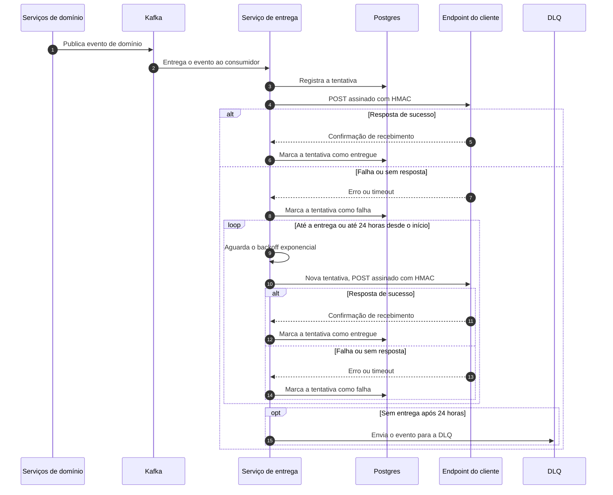

# Serviço de webhooks de saída

| | |
|---|---|
| **Documento** | Design doc sem ID |
| **Estado** | Rascunho |
| **Título** | Serviço de webhooks de saída |
| **Autores** | A definir |
| **Revisores** | A definir. Sugestão: Segurança (assinatura HMAC e payload que sai da borda) e Plataforma (operação do Kafka e do Postgres) |
| **Criado** | 2026-11-20 |
| **Última atualização** | 2026-11-20 |
| **Tags** | webhooks, mensageria, entrega |

## Glossário

- **Backoff exponencial**: intervalo entre tentativas de reenvio que cresce a cada falha.
- **DLQ (dead-letter queue)**: fila para onde vão os eventos que esgotaram o prazo de entrega.
- **HMAC**: código de autenticação calculado com uma chave secreta, que permite ao cliente verificar a origem e a integridade de cada requisição.
- **SaaS**: serviço de software hospedado por terceiros e cobrado por uso.
- **Webhook**: requisição HTTP que nós enviamos ao endpoint de um cliente quando algo acontece.

## Visão geral

Hoje, cada serviço que precisa avisar um cliente externo faz a chamada HTTP por conta própria, sem reenvio e sem registro central. Quando o endpoint do cliente cai, o evento se perde, e a equipe só descobre o problema pelo suporte.

Este documento propõe um serviço único de entrega de webhooks. Ele consome os eventos de domínio que já existem no Kafka, registra cada tentativa no Postgres, envia o POST assinado com HMAC ao endpoint do cliente e reenvia com backoff exponencial por até 24 horas. Esgotado esse prazo, o evento vai para a DLQ.

## Contexto e escopo

- Os serviços já publicam eventos de domínio no Kafka.
- Cada serviço que precisa avisar um cliente externo faz o POST por conta própria. Não há reenvio nem log central dessas chamadas.
- Quando o endpoint do cliente está indisponível, o evento se perde. A perda é descoberta pelo suporte, não pelo sistema.
- Para o histórico de entregas, a equipe depende do suporte para saber o que aconteceu com cada evento.

## Objetivos e fora de escopo

**Objetivos**

1. Nenhum evento se perde por indisponibilidade do endpoint do cliente.
2. Cada tentativa de entrega fica visível: a equipe consulta o que foi enviado, quando, e com qual resultado.

A métrica que mostra se esses objetivos foram atingidos ainda não foi definida (ver Questões em aberto).

**Fora de escopo**

A ser definido (ver Questões em aberto).

## O desenho

### Visão da solução

Um serviço de entrega consome os eventos de domínio do Kafka. Para cada evento a entregar, ele registra a tentativa no Postgres, envia o POST assinado com HMAC ao endpoint do cliente e, se a entrega falhar, agenda uma nova tentativa com backoff exponencial. Quando as tentativas se esgotam em 24 horas, o evento segue para a DLQ.

A proposta tira dos serviços de domínio a chamada direta aos clientes e concentra no serviço de entrega a lógica de reenvio, assinatura e registro. O ganho é não perder eventos por indisponibilidade do cliente. O custo aceito é que a entrega deixa de ser imediata em alguns casos, porque passa pela fila.

### Arquitetura


_Imagem a renderizar na revisão manual a partir do DSL abaixo._

<details>
<summary>Fonte do diagrama (Structurizr DSL)</summary>

```
workspace "Webhooks de saída" "Entrega de eventos de domínio a endpoints de clientes externos." {

    model {
        clienteExterno = softwareSystem "Endpoint do cliente" "Recebe o POST assinado com HMAC." "External"

        plataforma = softwareSystem "Plataforma" "Emite eventos de domínio e entrega webhooks." {
            servicosDominio = container "Serviços de domínio" "Publicam eventos de domínio."
            kafka = container "Kafka" "Barramento de eventos de domínio já existente." "Kafka"
            servicoEntrega = container "Serviço de entrega de webhooks" "Consome eventos, registra cada tentativa, envia o POST assinado e reenvia com backoff exponencial por até 24 horas."
            postgres = container "Postgres" "Registra cada tentativa de entrega." "Postgres"
            dlq = container "DLQ" "Recebe eventos sem entrega após 24 horas."
        }

        servicosDominio -> kafka "Publica eventos de domínio"
        servicoEntrega -> kafka "Consome eventos de domínio"
        servicoEntrega -> postgres "Grava cada tentativa"
        servicoEntrega -> clienteExterno "Envia POST assinado com HMAC"
        servicoEntrega -> dlq "Envia o evento sem entrega após 24 horas"
    }

    views {
        container plataforma "Containers" {
            include *
            autoLayout lr
        }

        styles {
            element "External" {
                background #999999
            }
        }
    }
}
```

</details>

O diagrama mostra cinco containers e um sistema externo. Os serviços de domínio publicam eventos no Kafka, que já existe. O serviço de entrega, que é o componente novo, consome esses eventos e grava cada tentativa no Postgres. Ele faz o POST assinado com HMAC ao endpoint do cliente externo. Quando a entrega não se confirma, o próprio serviço reagenda a tentativa. Um evento que não é entregue em 24 horas segue para a DLQ.

### Fluxo de entrega com retry



O fluxo começa quando um serviço de domínio publica o evento no Kafka (passos 1 e 2). O serviço de entrega registra a primeira tentativa e envia o POST assinado (passos 3 e 4). Se o cliente confirma o recebimento, a tentativa é marcada como entregue e o fluxo termina. Se a tentativa falha, o serviço entra no laço de reenvio: aguarda o intervalo do backoff, tenta de novo e registra o resultado de cada tentativa. O laço termina com a entrega ou com o prazo de 24 horas. Sem entrega até esse prazo, o evento vai para a DLQ.

O diagrama não define o intervalo inicial do backoff, o número máximo de tentativas, o timeout de cada POST, nem o que conta como resposta de sucesso. Essas definições estão em Questões em aberto.

## Trade-offs da solução escolhida

- ✓ Um cliente indisponível por até 24 horas não faz o evento se perder: ele é reenviado ou, no fim do prazo, vai para a DLQ.
- ✓ Cada tentativa fica registrada no Postgres, então a equipe consulta o histórico sem depender do suporte.
- ✓ A lógica de reenvio, assinatura e registro fica em um lugar só, em vez de repetida em cada serviço que chama clientes.
- ✗ **Aceito:** a entrega deixa de ser imediata em alguns casos, porque o evento passa pela fila e pelo serviço de entrega antes de chegar ao cliente.
- ✗ Passa a existir mais um componente no caminho dos eventos destinados a clientes externos.

## Alternativas consideradas

### Não fazer nada

Manter cada serviço com o próprio POST mantém o problema que motiva o documento: eventos perdidos quando o endpoint do cliente cai, e descoberta tardia pelo suporte. Por isso a alternativa foi descartada.

### SaaS de webhooks

Um serviço terceirizado de webhooks foi descartado por dois motivos: cobra por evento e faria o payload sair da nossa borda. Os ganhos que pesaram a favor da alternativa não foram registrados (ver Questões em aberto).

## Impactos transversais

### Segurança

Cada requisição sai assinada com HMAC. Onde a chave fica guardada, quem a gera, como o cliente a recebe e como ela é rotacionada não foram definidos (ver Questões em aberto).

### Privacidade

O payload sai da nossa borda rumo aos endpoints dos clientes externos. Esse ponto motivou a rejeição do SaaS e pede revisão do conteúdo do payload pela equipe de privacidade (ver Questões em aberto).

### Clientes externos

Os reenvios chegam aos endpoints dos clientes, inclusive depois de uma indisponibilidade. A forma de reconhecer uma entrega repetida do lado do cliente ainda não foi definida (ver Questões em aberto).

## Testabilidade e observabilidade

A visibilidade de cada tentativa é um dos objetivos, e o registro no Postgres é o mecanismo previsto para isso. Ainda não foram definidos os testes antes do lançamento, nem as métricas e alertas em produção (ver Questões em aberto).

## Questões em aberto

1. Qual métrica mostra que os dois objetivos foram atingidos? Por exemplo, a porcentagem de eventos entregues dentro das 24 horas.
2. Quais eventos de domínio entram na entrega, e como um evento se associa a cada cliente destinatário?
3. O que conta como entrega bem-sucedida (quais códigos de resposta), e qual é o timeout de cada POST?
4. Qual é a política de backoff: intervalo inicial, fator de crescimento, teto por tentativa e jitter?
5. A contagem das 24 horas começa na primeira tentativa ou na publicação do evento?
6. Como o cliente reconhece um reenvio duplicado? O POST carrega um identificador do evento?
7. Qual tecnologia implementa o serviço de entrega e a DLQ?
8. O que acontece com um evento na DLQ: reprocessamento manual, descarte ou alerta?
9. Onde fica a chave HMAC, quem a gera, como o cliente a recebe e com que frequência ela é rotacionada?
10. Quais dados o payload carrega, e há dado pessoal nele?
11. Quais campos tem o registro de cada tentativa, e por quanto tempo ele fica guardado?
12. Quais outras alternativas foram consideradas além de não fazer nada e do SaaS?
13. Quais ganhos do SaaS pesaram a favor dele, e quais custos a equipe aceita além da latência?
14. Como e em que ordem os serviços atuais que fazem o POST por conta própria passam para o serviço de entrega?
15. Quem são os autores e os revisores deste documento, e qual time será dono do serviço?
