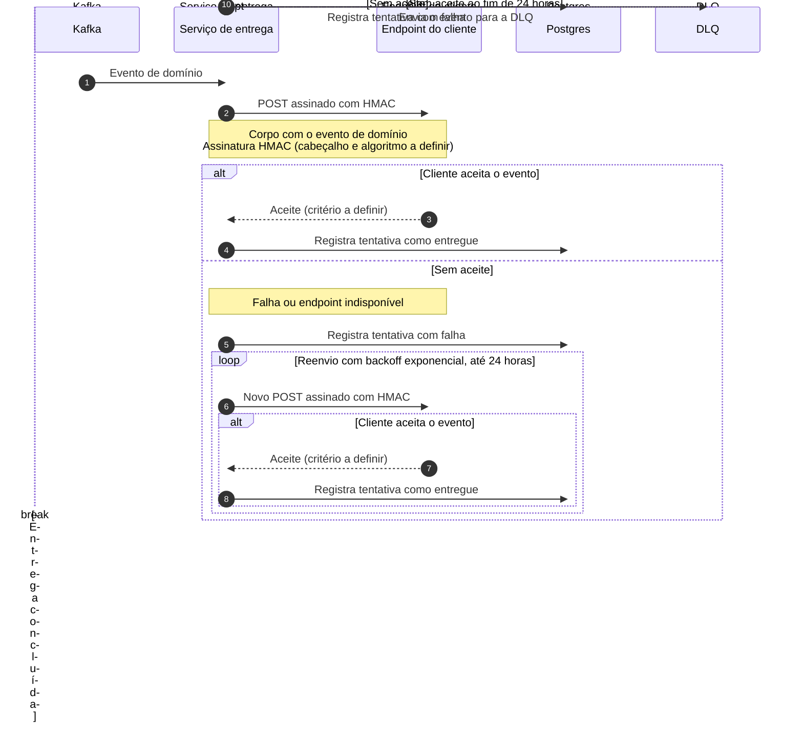

# Serviço de entrega de webhooks de saída

| | |
|---|---|
| **Documento** | Design doc |
| **Estado** | Rascunho |
| **Autores** | A confirmar |
| **Revisores** | A confirmar |
| **Criado** | 2026-11-20 |
| **Última atualização** | 2026-11-20 |
| **Tags** | webhooks, kafka, integrações, entrega |

## Glossário

- **HMAC**: código de autenticação calculado sobre o corpo do POST com um segredo compartilhado, que permite ao cliente verificar a origem e a integridade da mensagem.
- **DLQ** (dead letter queue): destino dos eventos que esgotaram o prazo de reenvio, guardados para análise.
- **SaaS**: serviço de terceiros, hospedado fora da nossa infraestrutura e cobrado por uso.

## Visão geral

Hoje, cada serviço que precisa avisar um cliente externo faz o POST por conta própria, sem retentativa e sem registro central. Quando o endpoint do cliente está indisponível, o evento se perde, e a equipe só descobre o problema pelo suporte.

Este documento propõe um serviço único de entrega de webhooks. Ele consome os eventos de domínio que já circulam no Kafka, registra cada tentativa no Postgres, envia um POST assinado com HMAC ao endpoint do cliente e reenvia com backoff exponencial por até 24 horas. Se nenhuma tentativa for aceita nesse prazo, o evento segue para a DLQ.

## Contexto

- Os serviços já publicam eventos de domínio no Kafka.
- Cada serviço que avisa um cliente externo faz o POST diretamente, sem retentativa e sem log central.
- Quando um endpoint de cliente cai, o evento se perde, e o suporte é quem percebe a perda.

## Objetivos e fora de escopo

Objetivos:

- Nenhum evento perdido por indisponibilidade do endpoint do cliente.
- Visibilidade de cada tentativa de entrega.

Mecanismos que sustentam os objetivos: reenvio com backoff exponencial por até 24 horas, envio à DLQ depois desse prazo e registro de cada tentativa no Postgres.

Fora de escopo: não definido. Ver Perguntas em aberto, item 8.

## Desenho

### Arquitetura

O serviço de entrega fica entre o Kafka, que já transporta os eventos de domínio, e os endpoints dos clientes.


Renderizar esta imagem na revisão manual. O código-fonte do diagrama está abaixo.

<details>
<summary>Código-fonte do diagrama (Structurizr DSL)</summary>

```
workspace "Webhooks de saída" {

    model {
        cliente = softwareSystem "Endpoint do cliente" "Recebe os POST assinados com HMAC." "Externo"

        plataforma = softwareSystem "Plataforma" {
            servicos = container "Serviços de domínio" "Publicam eventos de domínio."
            kafka = container "Kafka" "Transporta os eventos de domínio." "Kafka"
            entrega = container "Serviço de entrega de webhooks" "Consome eventos, envia o POST assinado e reenvia com backoff exponencial por até 24 horas."
            postgres = container "Postgres" "Registra cada tentativa de entrega." "PostgreSQL"
            dlq = container "DLQ" "Recebe os eventos sem entrega após 24 horas."
        }

        servicos -> kafka "Publica eventos de domínio"
        entrega -> kafka "Consome eventos de domínio"
        entrega -> postgres "Registra cada tentativa"
        entrega -> cliente "Envia POST assinado com HMAC"
        entrega -> dlq "Envia eventos sem entrega após 24 horas"
    }

    views {
        systemContext plataforma "Contexto" {
            include *
            autoLayout
        }

        container plataforma "Contêineres" {
            include *
            autoLayout
        }

        theme default
    }
}
```

</details>

Os serviços de domínio publicam os eventos no Kafka. O serviço de entrega consome esses eventos, faz os POST assinados com HMAC aos endpoints dos clientes e registra cada tentativa no Postgres. Os eventos que esgotam o prazo de 24 horas seguem para a DLQ. O mecanismo da DLQ ainda não foi definido (ver Perguntas em aberto, item 4).

### Fluxo de entrega com reenvio



O fluxo começa quando o serviço de entrega consome um evento do Kafka e envia o POST ao endpoint do cliente. Cada tentativa vai para o Postgres, com o resultado. Se o cliente aceitar o evento, a entrega termina ali. Se não aceitar, o serviço repete o envio com intervalos crescentes, durante até 24 horas. Ao fim desse prazo sem aceite, o evento vai para a DLQ.

A assinatura HMAC acompanha cada POST. O algoritmo, o nome do cabeçalho e a forma como cada cliente recebe e troca o segredo ainda não foram definidos (ver Perguntas em aberto, item 1).

## Alternativas consideradas

### Manter o POST manual em cada serviço (não fazer nada)

Descartada porque é o problema descrito: sem retentativa e sem registro, cada indisponibilidade do endpoint do cliente faz o evento se perder, e só o suporte percebe.

### SaaS de webhooks

Descartada porque cobra por evento e o payload passaria a sair da nossa borda para um terceiro.

### Serviço próprio de entrega sobre o Kafka e o Postgres existentes (escolhida)

Reaproveita o Kafka e o Postgres que a equipe já opera. Não cobra por evento e o payload não passa por terceiros. O custo é a construção e a operação de um serviço novo, que ainda não foi dimensionado (ver Perguntas em aberto, item 9).

## Trade-offs da solução escolhida

- ✓ Eventos não aceitos pelo cliente são reenviados por até 24 horas antes de ir para a DLQ.
- ✓ Cada tentativa fica registrada no Postgres, o que dá visibilidade ao suporte e à equipe.
- ✓ Evita a cobrança por evento de um SaaS e mantém o payload fora de terceiros.
- ✗ A entrega deixa de ser imediata em alguns casos, porque o evento passa pela fila do Kafka antes do POST.

## Impactos fora da equipe

- **Clientes**: passam a receber POST assinados com HMAC e precisam validar a assinatura. Durante uma indisponibilidade, recebem os reenvios quando o endpoint volta, por até 24 horas.
- **Times donos dos serviços que fazem POST hoje**: a migração para o serviço de entrega ainda não foi definida (ver Perguntas em aberto, item 7).
- **Times de Kafka e Postgres**: o serviço de entrega é um novo consumidor do Kafka e gera uma escrita no Postgres por tentativa.

## Observabilidade

O registro de cada tentativa no Postgres é a base da visibilidade pedida. Métricas e alertas ainda não foram definidos (ver Perguntas em aberto, item 8).

## Perguntas em aberto

1. **Assinatura**: qual algoritmo HMAC, qual cabeçalho e como o segredo de cada cliente é criado, entregue e trocado?
2. **Aceite**: quais respostas do cliente contam como evento aceito?
3. **Backoff**: quais intervalos entre tentativas, e como o prazo de 24 horas é contado?
4. **DLQ**: onde ela fica (tópico, tabela ou outro) e quem trata os eventos que chegam nela?
5. **Idempotência e ordem**: o cliente pode receber o mesmo evento mais de uma vez? A ordem dos eventos de um mesmo cliente é preservada?
6. **Registro**: a tentativa é gravada antes ou depois do POST?
7. **Migração**: os serviços que fazem POST manual passam a usar o serviço de entrega? Em que ordem, e quais deles fazem parte dos serviços de domínio já publicando no Kafka?
8. **Medição e fora de escopo**: como medir "nenhum evento perdido", quais métricas e alertas acompanham a entrega, e o que fica explicitamente fora deste trabalho?
9. **Custos aceitos**: além do atraso na entrega, o que o time decidiu aceitar? Qual é a estimativa de volume de eventos e de clientes?
10. **Dono e revisores**: quem mantém o serviço e quais times devem revisar este documento?
11. **Dados**: o payload contém dados pessoais ou sensíveis?
12. **Entrega**: o serviço vai para produção de uma vez ou em etapas, e existe plano de reversão?
