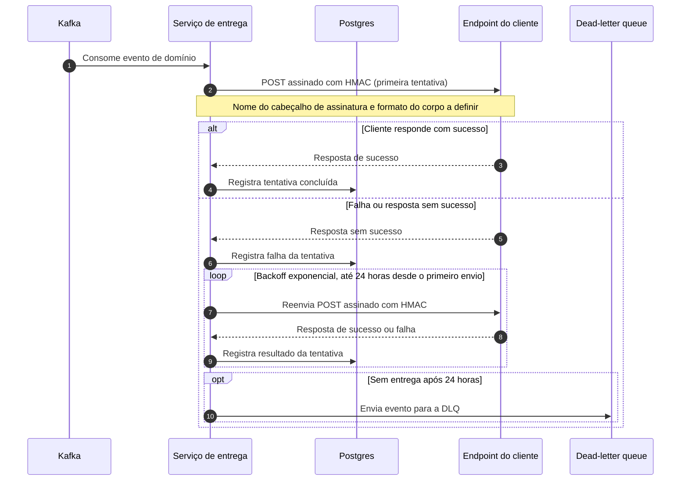

# Serviço de entrega de webhooks de saída

| | |
|---|---|
| **Estado** | Rascunho |
| **Título** | Serviço de entrega de webhooks de saída |
| **Autores** | A definir |
| **Revisores** | A definir. Sugestões pelo conteúdo: Segurança (assinatura HMAC e dados que saem da borda) e Plataforma (operação do serviço sobre Kafka e Postgres). |
| **Criado** | 2026-11-20 |
| **Última atualização** | 2026-11-20 |
| **Tags** | webhooks, kafka, postgres, entrega |

## Glossário

- **Webhook de saída**: chamada HTTP que a nossa plataforma faz ao endpoint de um cliente externo para avisar que algo aconteceu.
- **Evento de domínio**: fato de negócio que um serviço publica no Kafka.
- **Tentativa de entrega**: um envio de um evento a um endpoint, com o resultado dele.
- **HMAC**: código de autenticação de mensagem calculado com uma chave secreta compartilhada. Permite que o cliente confira a origem e a integridade do POST.
- **Backoff exponencial**: espera entre tentativas que cresce a cada falha.
- **DLQ (dead-letter queue)**: fila de eventos que esgotaram as tentativas de entrega.
- **SaaS**: software de terceiros contratado como serviço, com cobrança geralmente por uso.

## Visão geral

Hoje, cada serviço que precisa avisar um cliente externo faz o POST por conta própria. Não há retry e não há log central. Quando o endpoint do cliente cai, o evento se perde, e a equipe só descobre o problema pelo suporte.

Este documento propõe um serviço único de entrega de webhooks. Ele consome os eventos de domínio que já existem no Kafka, registra cada tentativa no Postgres, envia o POST assinado com HMAC ao endpoint do cliente e reenvia com backoff exponencial por até 24 horas. Depois disso, o evento vai para a DLQ. O documento traz a arquitetura, o fluxo de entrega com retry, as alternativas e os custos aceitos. As questões que dependem de decisões ainda não tomadas estão no fim.

## Contexto

Os serviços da plataforma já publicam eventos de domínio no Kafka. Os que avisam clientes externos fazem o POST diretamente, sem retry e sem registro central. Por isso, a indisponibilidade de um endpoint de cliente faz o evento se perder, e a perda só aparece quando o suporte recebe o chamado.

A proposta reaproveita o Kafka como origem dos eventos, em vez de criar um novo canal de publicação. Ela usa o Postgres para registrar as tentativas. Não foram informadas outras restrições, como prazos, limites de contrato com clientes ou exigências de retenção de dados.

## Objetivos e fora de escopo

Objetivos:

1. Nenhum evento perdido por indisponibilidade do endpoint do cliente. O mecanismo é o reenvio com backoff exponencial por até 24 horas, seguido de envio à DLQ. A meta ainda não tem métrica definida (ver questões em aberto).
2. Visibilidade de cada tentativa. O mecanismo é o registro de cada tentativa, com seu resultado, no Postgres.

Fora de escopo: ainda não definido. Ver questões em aberto.

## Desenho da solução

### Visão da solução

Um único serviço de entrega assume o envio dos webhooks de saída. Os serviços de domínio continuam publicando eventos no Kafka. O serviço de entrega consome esses eventos, registra cada tentativa no Postgres e faz o POST assinado ao endpoint do cliente. Quando o envio falha, ele reenvia com backoff exponencial. Depois de 24 horas sem entrega, envia o evento à DLQ.

A decisão central é tirar o envio dos serviços de domínio e concentrá-lo em um lugar só. Essa escolha troca envio imediato por fila e retry, com o custo descrito em Trade-offs.

### Arquitetura


Renderizar esta imagem na passagem manual.

<details>
<summary>Diagrama fonte (Structurizr DSL)</summary>

```
workspace "Webhooks de saída" "Entrega de eventos de domínio a endpoints de clientes externos." {

    !identifiers hierarchical

    model {
        clientes = softwareSystem "Endpoint do cliente" "Recebe os webhooks de cada cliente externo." "External"

        nossaPlataforma = softwareSystem "Nossa plataforma" "Serviços internos e a entrega de webhooks." {
            servicosDominio = container "Serviços de domínio" "Publicam eventos de domínio no Kafka."
            kafka = container "Kafka" "Barramento com os eventos de domínio existentes." "Kafka" "Queue"
            entrega = container "Serviço de entrega de webhooks" "Consome eventos, registra cada tentativa, envia POST assinado com HMAC e reenvia com backoff exponencial por até 24 horas."
            postgres = container "Postgres" "Registro de cada tentativa de entrega." "PostgreSQL" "Database"
            dlq = container "Dead-letter queue" "Eventos não entregues após 24 horas." "" "Queue"
        }

        nossaPlataforma.servicosDominio -> nossaPlataforma.kafka "Publica eventos de domínio em"
        nossaPlataforma.entrega -> nossaPlataforma.kafka "Consome eventos de domínio de"
        nossaPlataforma.entrega -> nossaPlataforma.postgres "Grava cada tentativa de entrega em"
        nossaPlataforma.entrega -> clientes "Envia POST assinado com HMAC para"
        nossaPlataforma.entrega -> nossaPlataforma.dlq "Envia eventos não entregues após 24 horas para"
    }

    views {
        container nossaPlataforma "Containers" "Contêineres do serviço de entrega de webhooks." {
            include *
            autoLayout lr
        }

        styles {
            element "External" {
                background #999999
                color #ffffff
            }
            element "Database" {
                shape Cylinder
            }
            element "Queue" {
                shape Pipe
            }
        }
    }
}
```

</details>

O serviço de entrega é o único contêiner novo. Os serviços de domínio publicam no Kafka, que já existe e é a origem dos eventos. O serviço de entrega lê esses eventos, grava cada tentativa no Postgres e faz o POST ao endpoint do cliente, que fica fora da plataforma. Quando o envio esgota a janela de 24 horas, o serviço grava o evento na DLQ. A tecnologia do serviço de entrega e a forma exata da DLQ, se tópico do Kafka ou outra estrutura, não foram informadas.

### Fluxo de entrega com retry



O serviço de entrega lê um evento do Kafka e tenta o POST assinado. Cada tentativa, com o resultado, fica registrada no Postgres. Se o cliente responde com sucesso, a entrega termina ali. Se a tentativa falha, o serviço reenvia com backoff exponencial até completar 24 horas desde o primeiro envio. Se nenhuma tentativa for aceita nesse período, o evento vai para a DLQ.

Não estão definidos o critério de sucesso (quais códigos de resposta contam), o intervalo entre tentativas, a forma de agendar a próxima tentativa e o momento de confirmar a leitura no Kafka. Essas definições ficam nas questões em aberto. O diagrama mostra apenas o que a proposta estabelece.

## Trade-offs da solução escolhida

- ✓ Nenhum evento perdido por indisponibilidade do cliente, desde que ele volte dentro da janela de 24 horas.
- ✓ Cada tentativa fica registrada no Postgres, com seu resultado.
- ✓ O envio fica em um serviço só, em vez de em cada serviço que avisa clientes.
- ✓ Não há intermediário externo, e a plataforma não paga por evento a um fornecedor.
- ✗ A entrega deixa de ser imediata em alguns casos, porque o evento passa pela fila. O time aceitou esse custo.
- ✗ Passa a existir mais um serviço para operar, com Kafka e Postgres como dependências.
- ✗ Um evento que esgota as 24 horas vai para a DLQ. O caminho de recuperação depende de quem trata essa fila, e isso ainda não foi definido.

## Alternativas consideradas

### Não fazer nada

Manter o POST direto em cada serviço. Descartada porque é o problema descrito: quando o endpoint do cliente cai, o evento se perde, e a perda só aparece pelo suporte.

### SaaS de webhooks

Descartada por dois motivos informados: o custo cresce a cada evento enviado, e o payload sairia da nossa borda.

### Serviço próprio de entrega (escolhida)

Um serviço que consome o Kafka, registra as tentativas no Postgres, envia o POST assinado com HMAC e reenvia com backoff exponencial por até 24 horas, com a DLQ no fim. Os custos aceitos estão em Trade-offs.

Outras alternativas que o time tenha avaliado não foram informadas. Ver questões em aberto.

## Preocupações transversais

- **Segurança.** Os POSTs são assinados com HMAC. O algoritmo, o cabeçalho, o ciclo de vida da chave de cada cliente e o local onde as chaves ficam guardadas não estão definidos. Recomenda-se revisão por Segurança.
- **Dados e privacidade.** O conteúdo do payload e a presença de dados pessoais não foram informados. Esses dados saem da plataforma em cada POST.
- **Infraestrutura e carga.** O serviço lê tópicos do Kafka e grava no Postgres a cada tentativa. Os reenvios por até 24 horas, para cada falha, aumentam essa carga. Ela ainda não foi dimensionada.
- **Clientes externos.** Os reenvios chegam ao endpoint do cliente enquanto ele se recupera. Não há limite de taxa por cliente definido.

## Testabilidade e observabilidade

- **Antes de ir ao ar.** A forma de testar a entrega com retry e a DLQ ainda não foi definida.
- **Depois de ir ao ar.** Cada tentativa fica no Postgres, o que atende à visibilidade pedida. A forma de consulta (painel, relatório ou API) não foi definida. A meta de nenhum evento perdido ainda não tem métrica.

## Questões em aberto

1. Quem são os autores e os revisores deste documento?
2. Qual é o volume: eventos por dia, número de clientes e de endpoints, e pico esperado?
3. O que conta como entrega bem-sucedida (quais códigos de resposta) e qual é o tempo limite de cada POST?
4. Quais são o intervalo inicial, o teto e o jitter do backoff? A janela de 24 horas começa no primeiro envio?
5. Qual é o algoritmo HMAC, qual cabeçalho carrega a assinatura, e como a chave de cada cliente é criada, rotacionada e guardada?
6. Qual é o formato do payload? Ele contém dados pessoais?
7. Onde fica a DLQ (tópico do Kafka, tabela ou outro)? Quem trata os eventos nela e como um evento volta a ser enviado?
8. O cliente pode receber o mesmo evento mais de uma vez? Há garantia de ordem entre os eventos de um mesmo cliente?
9. Quem consulta as tentativas (suporte, clientes ou o próprio time), e por qual interface?
10. Quais serviços fazem POST hoje, e em que ordem migrarão para o serviço de entrega?
11. Qual é a tecnologia do serviço de entrega?
12. Qual métrica comprova a meta de nenhum evento perdido?
13. Quais outros custos o time aceita além da entrega não imediata?
