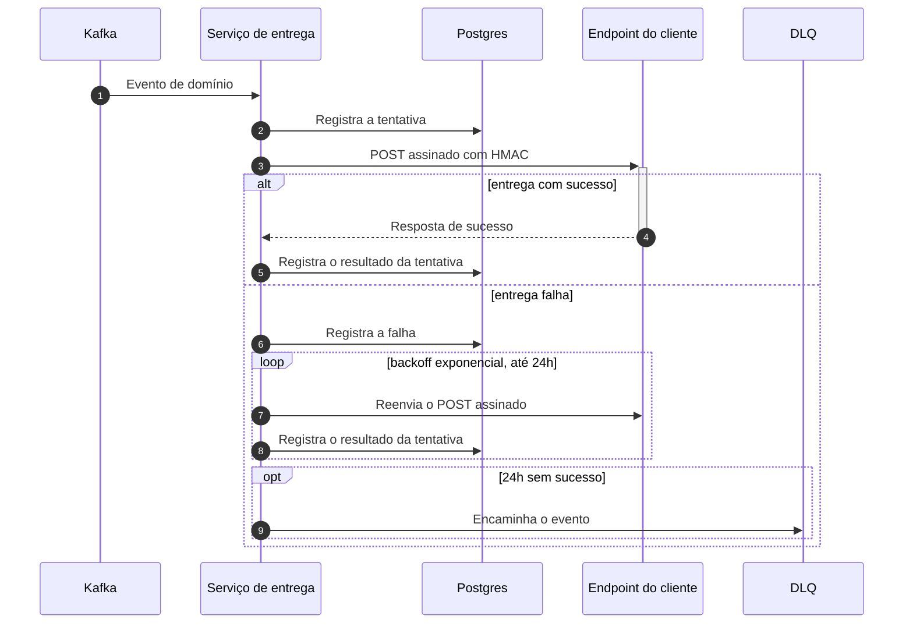

# Serviço de entrega de webhooks de saída

| | |
|---|---|
| **Documento** | DESIGN-DOC |
| **Estado** | Rascunho |
| **Título** | Serviço de entrega de webhooks de saída |
| **Autores** | A definir |
| **Revisores** | A definir |
| **Criado** | 2026-11-20 |
| **Última atualização** | 2026-11-20 |
| **Tags** | webhooks, kafka, entrega, retry |

## Glossário

- **DLQ (dead-letter queue)**: destino dos eventos que esgotaram as tentativas de entrega sem sucesso.
- **HMAC**: assinatura calculada sobre o corpo da requisição com um segredo compartilhado, que permite ao cliente verificar a origem do webhook.
- **Backoff exponencial**: intervalo entre tentativas que cresce a cada falha.
- **Evento de domínio**: mensagem que um serviço nosso publica no Kafka para registrar algo que aconteceu.

## Visão geral

Hoje cada serviço que precisa avisar um cliente externo faz o POST por conta própria. Este documento propõe um serviço único de entrega de webhooks de saída, que consome os eventos de domínio já publicados no Kafka, registra cada tentativa e reenvia as que falham. O objetivo é que nenhum evento se perca quando o endpoint do cliente estiver fora do ar.

## Contexto

Cada serviço que precisa notificar um cliente externo envia o POST diretamente, sem retry e sem log central. Quando o endpoint do cliente cai, o evento se perde. A equipe só descobre o problema quando o suporte avisa.

A empresa já publica eventos de domínio no Kafka e já opera um Postgres.

## Objetivos e fora de escopo

**Objetivos**

- Nenhum evento perdido por indisponibilidade do endpoint do cliente. O mecanismo é a persistência de cada tentativa e o reenvio com backoff exponencial por até 24h.
- Visibilidade de cada tentativa de entrega, consultável em um lugar central.

**Fora de escopo**

- A definição dos critérios numéricos de sucesso (taxa de entrega, latência) está em [Perguntas em aberto](#perguntas-em-aberto).

## O design

### Visão geral da solução

Um único serviço de entrega substitui os POSTs feitos hoje por cada serviço. Ele consome os eventos de domínio do Kafka, grava cada tentativa no Postgres, envia o POST ao endpoint do cliente com uma assinatura HMAC e, quando a entrega falha, reenvia com backoff exponencial por até 24h. Depois desse prazo, o serviço manda o evento para a DLQ.

O custo principal é que a entrega deixa de ser imediata em alguns casos, porque o evento passa pela fila antes de chegar ao cliente.

### Arquitetura


> Imagem a ser renderizada na passagem manual, a partir do código-fonte abaixo.

<details>
<summary>Código-fonte do diagrama (Structurizr DSL)</summary>

```
workspace "Entrega de webhooks de saída" "Serviço único que entrega eventos de domínio a endpoints de clientes externos." {

    !identifiers hierarchical

    model {
        cliente = softwareSystem "Endpoint do cliente" "Endpoint HTTP do cliente externo que recebe os webhooks." {
            tags "External"
        }

        servicos = softwareSystem "Serviços de domínio" "Serviços que já publicam eventos de domínio no Kafka." {
            tags "Existing"
        }

        webhooks = softwareSystem "Entrega de webhooks" "Entrega eventos de domínio a clientes externos, com retry e registro de cada tentativa." {
            entrega = container "Serviço de entrega" "Consome eventos, envia o POST assinado com HMAC, reenvia com backoff exponencial por até 24h e encaminha para a DLQ."
            db = container "Banco de tentativas" "Guarda cada tentativa de entrega." "Postgres" {
                tags "Database"
            }
            dlq = container "DLQ" "Recebe os eventos que esgotaram as 24h de tentativas." {
                tags "Queue"
            }
        }

        kafka = softwareSystem "Kafka" "Barramento dos eventos de domínio que já temos." {
            tags "Existing"
        }

        servicos -> kafka "Publica eventos de domínio em"
        webhooks.entrega -> kafka "Consome eventos de domínio de"
        webhooks.entrega -> webhooks.db "Registra cada tentativa em"
        webhooks.entrega -> cliente "Envia POST assinado com HMAC para"
        webhooks.entrega -> webhooks.dlq "Encaminha eventos sem entrega após 24h para"
    }

    views {
        container webhooks "Containers" {
            include *
            autoLayout lr
        }

        styles {
            element "Element" {
                background #1168bd
                color #ffffff
            }
            element "Database" {
                shape cylinder
            }
            element "Queue" {
                shape pipe
            }
            element "External" {
                background #999999
                color #ffffff
            }
            element "Existing" {
                background #6b8fb5
                color #ffffff
            }
        }
    }

    configuration {
        scope softwaresystem
    }
}
```

</details>

O serviço de entrega é o único componente novo. Ele lê os eventos de domínio que os serviços de domínio já publicam no Kafka, grava cada tentativa no banco de tentativas (Postgres) e faz o POST assinado com HMAC no endpoint do cliente. Quando a entrega não tem sucesso, o próprio serviço reenvia com backoff exponencial. Esgotadas as 24h, ele encaminha o evento para a DLQ. O endpoint do cliente é um sistema externo que não controlamos.

### Fluxo de entrega com retry



O serviço de entrega recebe o evento do Kafka (1) e registra a tentativa no Postgres (2) antes de enviar o POST assinado ao cliente (3). Se o cliente responde com sucesso, o serviço registra o resultado. Se a entrega falha, o serviço registra a falha e reenvia com backoff exponencial por até 24h, registrando o resultado de cada nova tentativa. Quando as 24h terminam sem sucesso, o serviço encaminha o evento para a DLQ.

## Trade-offs da solução escolhida

- ✓ Nenhum evento se perde por indisponibilidade do cliente: o serviço persiste cada tentativa e reenvia por até 24h.
- ✓ Cada tentativa fica registrada em um lugar central, o que acaba com a descoberta de falhas pelo suporte.
- ✓ O payload não sai da nossa borda, porque a entrega é feita por um serviço nosso.
- ✗ A entrega deixa de ser imediata em alguns casos, porque o evento passa pela fila antes do POST. A equipe aceitou esse custo.
- ✗ A equipe passa a operar mais um serviço, e o que antes era um POST dentro de cada serviço vira uma dependência compartilhada de entrega.

## Alternativas consideradas

| Alternativa | Resultado | Motivo |
|---|---|---|
| **Serviço único de entrega (escolhida)** | ✓ | Atende os dois objetivos e mantém o payload dentro da nossa borda. |
| Usar um SaaS de webhooks | ✗ | Cobra por evento e o payload sairia da nossa borda. |
| Não fazer nada (cada serviço continua com o POST na mão) | ✗ | Sem retry e sem log central, o evento se perde quando o endpoint do cliente cai, e a equipe só descobre pelo suporte. |

## Perguntas em aberto

- Quem são os autores e os revisores, e quais áreas (por exemplo segurança e plataforma) devem revisar o documento?
- Qual meta numérica define sucesso (por exemplo, percentual de eventos entregues dentro das 24h)?
- Qual é o intervalo inicial do backoff, o fator de crescimento e o intervalo máximo entre tentativas?
- Quais respostas do cliente contam como sucesso, e quais contam como falha que justifica novo envio?
- De onde o serviço lê o endpoint e o segredo HMAC de cada cliente, e quem os cadastra?
- Em que tecnologia a DLQ roda, e quem consome a DLQ e age sobre os eventos que chegam lá?
- Em quais casos a entrega deixa de ser imediata, e qual atraso a equipe considera aceitável?
- Como será a migração dos serviços que hoje fazem o POST direto, e em que ordem?
