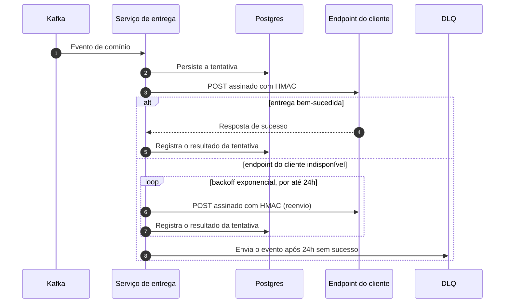

# Serviço de entrega de webhooks de saída

| | |
|---|---|
| **Estado** | Rascunho |
| **Título** | Serviço de entrega de webhooks de saída |
| **Autores** | A definir (ver Perguntas em aberto) |
| **Revisores** | A definir (ver Perguntas em aberto) |
| **Criado** | 2026-11-20 |
| **Última atualização** | 2026-11-20 |
| **Tags** | webhooks, kafka, entrega, retry |

## Glossário

- **DLQ** (dead-letter queue): destino dos eventos que esgotaram as tentativas de entrega, para que ninguém os perca e alguém possa tratá-los.
- **HMAC**: assinatura calculada sobre o corpo da requisição com uma chave compartilhada, que permite ao cliente conferir a origem do webhook.
- **Backoff exponencial**: política de reenvio em que o intervalo entre tentativas cresce a cada falha.
- **Webhook de saída**: requisição POST que nós enviamos ao endpoint de um cliente externo para avisá-lo de um evento.

## Visão geral

Hoje cada serviço que precisa avisar um cliente externo faz o POST por conta própria, sem retry e sem registro central. Este documento propõe um serviço único de entrega de webhooks. Ele consome os eventos de domínio que já circulam no Kafka, registra cada tentativa e reenvia quando o endpoint do cliente falha.

## Contexto

- Cada serviço que avisa um cliente externo faz o POST manualmente.
- Não há retry nem log central dessas entregas.
- Quando o endpoint do cliente está fora do ar, o evento se perde. A equipe só descobre o problema quando o suporte relata.
- Os eventos de domínio já estão disponíveis no Kafka.

## Objetivos e fora de escopo

**Objetivos**

- Nenhum evento se perde por indisponibilidade do endpoint do cliente. O serviço reenvia por até 24h antes de desistir, e o evento que esgota esse prazo vai para a DLQ em vez de sumir.
- Cada tentativa de entrega fica registrada e consultável.

**Fora de escopo**

- Entrega imediata em todos os casos. A proposta aceita atraso em alguns casos (ver Trade-offs).
- Adoção de um serviço externo de webhooks (ver Alternativas consideradas).

## O design

### Visão geral da solução

Um serviço único de entrega substitui os POSTs manuais de cada serviço. Ele consome os eventos de domínio do Kafka, grava cada tentativa no Postgres e envia um POST assinado com HMAC ao endpoint do cliente. Se o envio falha, o serviço reenvia com backoff exponencial por até 24h. Depois desse prazo, o evento vai para a DLQ. O custo principal é que a entrega deixa de ser imediata em alguns casos, porque o evento passa pela fila.

### Arquitetura


> Imagem a renderizar na passada manual: não havia renderizador de Structurizr disponível ao escrever este documento.

<details>
<summary>Fonte do diagrama (Structurizr DSL)</summary>

```
workspace "Serviço de entrega de webhooks de saída" {

    !identifiers hierarchical

    model {
        cliente = softwareSystem "Endpoint do cliente" "Recebe os webhooks de saída." "External"
        dominio = softwareSystem "Serviços de domínio" "Publicam os eventos de domínio no Kafka." "External"

        webhooks = softwareSystem "Entrega de webhooks" "Entrega eventos de domínio aos endpoints dos clientes externos." {
            kafka = container "Kafka" "Eventos de domínio já existentes." "" "Queue"
            entrega = container "Serviço de entrega" "Consome eventos, assina com HMAC, envia o POST e reenvia com backoff exponencial por até 24h." ""
            db = container "Postgres" "Persiste cada tentativa de entrega." "Postgres" "Database"
            dlq = container "DLQ" "Recebe os eventos que esgotaram as tentativas." "" "Queue"
        }

        dominio -> webhooks.kafka "Publica eventos de domínio em"
        webhooks.entrega -> webhooks.kafka "Consome eventos de"
        webhooks.entrega -> webhooks.db "Persiste cada tentativa em"
        webhooks.entrega -> cliente "Envia POST assinado com HMAC para" "HTTP"
        webhooks.entrega -> webhooks.dlq "Envia eventos sem sucesso após 24h para"
    }

    views {
        container webhooks "Containers" {
            include *
            autoLayout
        }

        styles {
            element "External" {
                background #999999
                color #ffffff
            }
            element "Database" {
                shape cylinder
            }
            element "Queue" {
                shape pipe
            }
        }
    }
}
```

</details>

O serviço de entrega é o único componente novo. Ele lê os eventos de domínio do Kafka, que os serviços de domínio já publicam, e grava cada tentativa no Postgres. Em seguida, envia o POST assinado com HMAC ao endpoint do cliente. Quando a entrega falha, o próprio serviço reenvia com backoff exponencial até completar 24h. Passado esse prazo, ele encaminha o evento à DLQ.

### Fluxo de entrega com retry



O serviço persiste a tentativa antes do POST e registra o resultado de cada tentativa no Postgres, o que dá a visibilidade pedida nos objetivos. Se o endpoint do cliente responde com sucesso, o fluxo termina. Se ele está indisponível, o serviço repete o POST com intervalos crescentes até completar 24h. Sem sucesso nesse prazo, o evento vai para a DLQ. O diagrama mostra apenas o caminho de falha por indisponibilidade do endpoint, que é o caso descrito; outras respostas de erro do cliente aguardam definição (ver Perguntas em aberto).

## Trade-offs da solução escolhida

- ✓ Nenhum evento se perde por indisponibilidade do endpoint do cliente: o serviço reenvia por até 24h e o que sobra vai para a DLQ.
- ✓ Cada tentativa fica registrada no Postgres, então o suporte deixa de descobrir falhas pelo cliente.
- ✓ Os payloads continuam dentro da nossa borda, e o custo não cresce por evento como num SaaS.
- ✗ A entrega deixa de ser imediata em alguns casos, porque o evento passa pela fila. A equipe aceitou esse custo.
- ✗ Passamos a operar mais um serviço, sob responsabilidade da equipe.

## Alternativas consideradas

| Alternativa | Resultado |
|---|---|
| **Serviço único de entrega (escolhida)** | ✓ Retry, log central e payload dentro da nossa borda. ✗ Entrega nem sempre imediata. |
| Usar um SaaS de webhooks | ✗ Custo por evento. ✗ O payload sairia da nossa borda. Descartada. |
| Não fazer nada | ✗ Cada serviço continua fazendo o POST na mão, sem retry e sem log central. Quando o endpoint do cliente cai, o evento se perde e a equipe só descobre pelo suporte. Descartada. |

## Preocupações transversais

Quem fica de fora da equipe e é impactado:

- **Clientes externos**: passam a receber um POST assinado com HMAC. O que muda para eles na verificação da assinatura está em aberto.
- **Serviços de domínio**: deixam de fazer o POST manual. O plano para a migração deles está em aberto.
- **Kafka**: o serviço de entrega passa a ser mais um consumidor dos eventos de domínio.

## Perguntas em aberto

- Quem são os autores e quais áreas devem revisar o documento (por exemplo, segurança e as equipes dos serviços que hoje fazem o POST)?
- Qual é a curva exata do backoff (intervalo inicial, fator, teto)?
- O que conta como entrega bem-sucedida: qualquer 2xx? E uma resposta 4xx do cliente, o serviço reenvia ou trata como falha definitiva?
- Como o cliente obtém e rotaciona a chave do HMAC?
- Quem consome a DLQ e o que fazem com os eventos que chegam lá?
- Como a equipe consulta as tentativas registradas (tela, consulta, métrica)?
- Os serviços de domínio migram todos de uma vez ou em etapas? Há plano de rollback?
- Qual tecnologia sustenta a DLQ e o agendamento dos reenvios?
