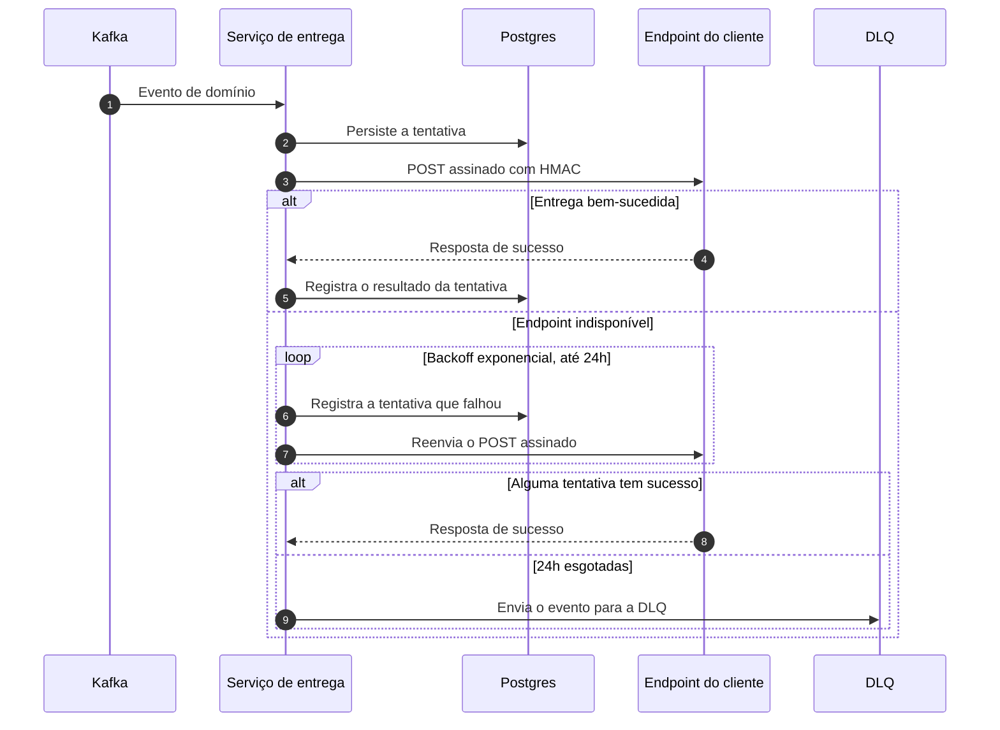

# Serviço de entrega de webhooks de saída

| | |
|---|---|
| **Documento** | DESIGN-DOC |
| **Estado** | Rascunho |
| **Título** | Serviço de entrega de webhooks de saída |
| **Autores** | A confirmar (ver Questões em aberto) |
| **Revisores** | A confirmar (ver Questões em aberto) |
| **Criado em** | 2026-11-20 |
| **Última atualização** | 2026-11-20 |

## Glossário

- **DLQ (dead-letter queue)**: destino onde ficam os eventos que esgotaram as tentativas de entrega, para tratamento posterior.
- **HMAC**: assinatura calculada sobre o payload com um segredo compartilhado, que permite ao cliente verificar a origem e a integridade da mensagem.
- **Backoff exponencial**: política de reenvio em que o intervalo entre tentativas cresce a cada falha.

## Visão geral

Hoje cada serviço que precisa avisar um cliente externo faz o POST por conta própria, sem retry e sem log central. Este documento propõe um serviço único de entrega de webhooks de saída. Ele consome os eventos de domínio que já circulam no Kafka, registra cada tentativa, entrega o evento ao cliente e reenvia em caso de falha. Em troca, a entrega deixa de ser imediata em alguns casos.

## Contexto

- Cada serviço que avisa um cliente externo faz o POST diretamente no endpoint do cliente.
- Esses envios não têm retry e não deixam log central.
- Quando o endpoint do cliente cai, o evento se perde. O time só descobre o problema quando o suporte avisa.
- Os eventos de domínio já estão disponíveis no Kafka.

## Objetivos

- Nenhum evento perdido por indisponibilidade do endpoint do cliente.
- Visibilidade de cada tentativa de entrega.

Os objetivos ainda não têm métrica numérica. Veja Questões em aberto.

## A solução

### Visão da solução

Um serviço único de entrega substitui os POSTs feitos à mão pelos serviços de domínio. O serviço de entrega:

1. consome os eventos de domínio do Kafka;
2. persiste cada tentativa no Postgres;
3. faz o POST no endpoint do cliente, assinado com HMAC;
4. reenvia com backoff exponencial por até 24 horas quando a entrega falha;
5. envia o evento para a DLQ quando as 24 horas se esgotam.

### Arquitetura


*Imagem a renderizar na passada manual a partir do código abaixo (nenhum renderizador estava disponível neste ambiente).*

<details>
<summary>Código do diagrama (Structurizr DSL)</summary>

```
workspace "Serviço de entrega de webhooks de saída" {

    !identifiers hierarchical

    model {
        cliente = softwareSystem "Endpoint do cliente" "Sistema externo que recebe os webhooks." "External"

        dominio = softwareSystem "Serviços de domínio" "Serviços que publicam eventos de domínio." "Existing"

        webhooks = softwareSystem "Entrega de webhooks de saída" "Entrega eventos de domínio aos endpoints dos clientes, com registro de tentativas e reenvio." {
            entrega = container "Serviço de entrega" "Consome eventos, assina e envia o POST, registra tentativas e reenvia com backoff exponencial."
            banco = container "Banco de tentativas" "Guarda cada tentativa de entrega." "Postgres" "Database"
            dlq = container "DLQ" "Recebe os eventos que esgotaram as 24 horas de tentativas." "" "Queue"
        }

        dominio -> webhooks.entrega "Publica eventos de domínio, consumidos pelo serviço de entrega, via" "Kafka"
        webhooks.entrega -> webhooks.banco "Persiste cada tentativa em"
        webhooks.entrega -> cliente "Envia POST assinado com HMAC para"
        webhooks.entrega -> webhooks.dlq "Envia eventos sem entrega após 24h para"
    }

    views {
        container webhooks "Containers" {
            include *
            autoLayout lr
        }

        styles {
            element "Database" {
                shape Cylinder
            }
            element "Queue" {
                shape Pipe
            }
            element "External" {
                background #999999
                color #ffffff
            }
        }
    }
}
```

</details>

Os eventos de domínio chegam pelo Kafka, que os serviços de domínio já usam. O serviço de entrega é o único componente novo: ele consome esses eventos, grava cada tentativa no Postgres, faz o POST assinado com HMAC no endpoint do cliente e, passadas 24 horas de reenvio sem sucesso, manda o evento para a DLQ. Os serviços de domínio deixam de falar diretamente com o cliente.

### Fluxo de entrega com retry



O serviço de entrega recebe o evento do Kafka e persiste a tentativa no Postgres antes de enviar (passos 1 e 2). Em seguida faz o POST assinado com HMAC (passo 3). Se o cliente responde com sucesso, o serviço registra o resultado. Se o endpoint está indisponível, o serviço reenvia com intervalos crescentes, registrando cada tentativa, por até 24 horas. Se nenhuma tentativa der certo nesse prazo, o evento vai para a DLQ.

O diagrama mostra apenas o caminho descrito pelo time. Ele não define o critério de sucesso da resposta, os intervalos do backoff, nem onde o agendamento de cada reenvio fica guardado (Questões em aberto).

## Trade-offs da solução escolhida

- ✓ Nenhum evento se perde por indisponibilidade do endpoint do cliente: o serviço reenvia por até 24 horas e, depois disso, o evento vai para a DLQ em vez de sumir.
- ✓ Cada tentativa fica registrada no Postgres, o que dá o log central que hoje não existe.
- ✓ O payload não sai da borda da empresa, ao contrário do que aconteceria com um SaaS.
- ✗ A entrega deixa de ser imediata em alguns casos, porque o evento passa pela fila. O time aceitou esse custo.

## Alternativas consideradas

### Não fazer nada (escolhida: não)

Cada serviço continua fazendo o POST à mão. Sem retry, o evento se perde quando o endpoint do cliente cai, e sem log central o time só descobre o problema pelo suporte. Isso contraria os dois objetivos do documento.

### Usar um SaaS de webhooks (descartada)

Descartada por dois motivos: o custo é por evento, e o payload sairia da nossa borda.

### Serviço único de entrega (escolhida)

A proposta deste documento.

## Questões em aberto

- Quem são os autores e quais áreas devem revisar este documento?
- Quais métricas definem "nenhum evento perdido" e "visibilidade de cada tentativa" (por exemplo, como o time vai consultar o histórico de tentativas)?
- Qual resposta do cliente conta como entrega bem-sucedida?
- Quais são os intervalos do backoff e o limite entre tentativas?
- Qual tecnologia sustenta a DLQ, e quem trata os eventos que chegam a ela?
- Onde fica guardado o agendamento de cada reenvio?
- Como o cadastro do endpoint e do segredo HMAC de cada cliente é feito e guardado?
- Quais eventos de domínio o serviço consome no início, e todos os serviços migram de uma vez?
- Em quais casos a entrega deixa de ser imediata, e há um atraso máximo aceitável?
