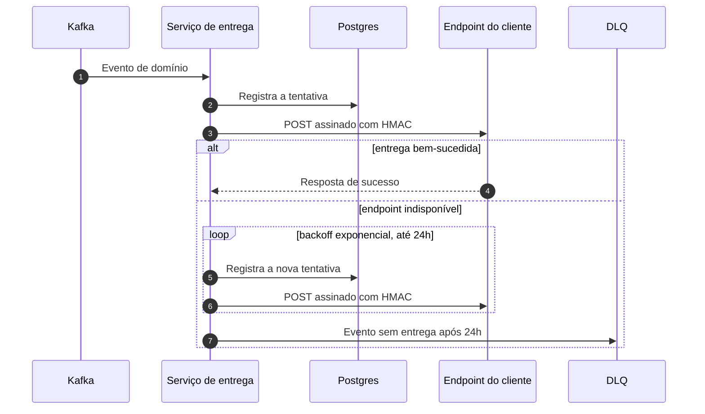

# Serviço de webhooks de saída

| | |
|---|---|
| **Documento** | DESIGN-DOC |
| **Estado** | Rascunho |
| **Título** | Serviço de webhooks de saída |
| **Autores** | A definir |
| **Revisores** | A definir |
| **Criado em** | 2026-11-20 |
| **Última atualização** | 2026-11-20 |

## Glossário

- **DLQ (dead-letter queue)**: destino dos eventos que esgotaram as tentativas de entrega.
- **HMAC**: assinatura calculada sobre o payload com um segredo compartilhado, que o cliente usa para verificar a origem da requisição.
- **Backoff exponencial**: intervalo entre tentativas que cresce a cada falha.

## Visão geral

Hoje cada serviço que precisa avisar um cliente externo faz o POST por conta própria, sem retry e sem log central. Este documento propõe um serviço único de entrega de webhooks. Ele consome os eventos de domínio que já circulam no Kafka, registra cada tentativa de envio e reenvia com backoff quando o endpoint do cliente não responde. A troca é aceitar que a entrega deixe de ser imediata em alguns casos, em nome de não perder eventos.

## Contexto

- Cada serviço que avisa um cliente externo faz o POST diretamente no endpoint do cliente.
- Esse POST não tem retry. Quando o endpoint do cliente está fora do ar, o evento se perde.
- Não existe log central das entregas. A equipe só descobre a perda quando o suporte avisa.
- Os eventos de domínio já estão no Kafka.

## Objetivos e fora de escopo

**Objetivos**

- Nenhum evento perdido por indisponibilidade do endpoint do cliente.
- Visibilidade de cada tentativa de entrega.

Os objetivos ainda não têm número (ver Perguntas em aberto).

**Fora de escopo**

Nada foi excluído até aqui (ver Perguntas em aberto).

## O design

### Visão da solução

Um serviço de entrega consome os eventos de domínio do Kafka e persiste cada tentativa no Postgres. Em seguida faz o POST assinado com HMAC no endpoint do cliente. Se o envio falha, o serviço reenvia com backoff exponencial por até 24 horas. Passado esse prazo, o serviço manda o evento para a DLQ.

### Arquitetura


> Imagem a renderizar no passe manual a partir do DSL abaixo.

<details>
<summary>Fonte do diagrama (Structurizr DSL)</summary>

```
workspace {

    !identifiers hierarchical

    model {
        dominio = softwareSystem "Serviços de domínio" "Publicam os eventos de domínio no Kafka." "External"
        cliente = softwareSystem "Endpoint do cliente" "Recebe os webhooks do cliente externo." "External"

        webhooks = softwareSystem "Serviço de webhooks de saída" "Entrega eventos de domínio aos endpoints dos clientes, com registro e retry." {
            kafka = container "Kafka" "Já existente. Carrega os eventos de domínio." "Kafka" "Queue"
            entrega = container "Serviço de entrega" "Consome eventos, registra tentativas, envia o POST assinado com HMAC e reenvia com backoff exponencial por até 24h."
            db = container "Banco de tentativas" "Guarda cada tentativa de entrega." "Postgres" "Database"
            dlq = container "DLQ" "Recebe os eventos que esgotaram as tentativas." "" "Queue"
        }

        dominio -> webhooks.kafka "Publica eventos de domínio em"
        webhooks.entrega -> webhooks.kafka "Consome eventos de domínio de"
        webhooks.entrega -> webhooks.db "Registra cada tentativa em"
        webhooks.entrega -> cliente "Envia POST assinado com HMAC para"
        webhooks.entrega -> webhooks.dlq "Envia eventos sem entrega após 24h para"
    }

    views {
        container webhooks "Containers" {
            include *
            autoLayout lr
        }

        styles {
            element "External" {
                background #999999
                color #ffffff
            }
            element "Database" {
                shape Cylinder
            }
            element "Queue" {
                shape Pipe
            }
        }
    }

    configuration {
        scope softwaresystem
    }
}
```

</details>

Os serviços de domínio publicam eventos no Kafka, que já existe. O serviço de entrega é o único componente novo com lógica: ele lê os eventos do Kafka, grava cada tentativa no banco Postgres, envia o POST assinado ao endpoint do cliente e controla os reenvios. Quando o prazo de 24 horas se esgota, ele move o evento para a DLQ. O endpoint do cliente fica fora da nossa borda e é o único ponto externo.

### Fluxo de entrega com retry



O serviço de entrega recebe o evento do Kafka e registra a tentativa no Postgres antes de enviar. Se o endpoint do cliente responde, a entrega termina. Se o endpoint está indisponível, o serviço repete o envio com intervalos crescentes, registrando cada tentativa. Quando as 24 horas passam sem sucesso, ele manda o evento para a DLQ. Os critérios que separam "entrega bem-sucedida" de "falha" e o ponto em que o resultado de cada tentativa é gravado estão em Perguntas em aberto.

## Trade-offs da solução escolhida

- ✓ Nenhum evento se perde por indisponibilidade do cliente: o serviço reenvia por até 24 horas e, depois, preserva o evento na DLQ.
- ✓ Cada tentativa fica registrada no Postgres, então a equipe enxerga o que aconteceu sem depender do suporte.
- ✓ Os payloads não saem da nossa borda, porque o envio é feito por um serviço nosso.
- ✗ A entrega deixa de ser imediata em alguns casos, porque o evento passa pela fila antes do POST. Este é o custo que a equipe aceitou.
- ✗ A equipe passa a operar mais um serviço e usa o Postgres para guardar as tentativas.

## Alternativas consideradas

| Alternativa | Resultado | Motivo |
|---|---|---|
| **Serviço único de entrega (escolhida)** | ✓ | Atende aos dois objetivos e mantém o payload dentro da nossa borda. |
| SaaS de webhooks | ✗ | Cobra por evento, e o payload sairia da nossa borda. |
| Não fazer nada | ✗ | Cada serviço continua fazendo o POST sem retry e sem log central. Quando o endpoint do cliente cai, o evento se perde e a equipe só descobre pelo suporte. |

## Perguntas em aberto

- Quais números definem o sucesso dos objetivos (por exemplo, taxa de eventos entregues, tempo até a primeira tentativa)?
- Quais itens ficam fora de escopo nesta primeira versão?
- O que conta como entrega bem-sucedida? Quais respostas do cliente disparam novo retry e quais encerram a tentativa?
- Qual é o intervalo inicial e o teto do backoff exponencial?
- O serviço grava o resultado de cada tentativa antes ou depois do POST?
- A DLQ é um tópico do Kafka ou outra estrutura? Quem trata os eventos que chegam a ela e como?
- Como cada cliente cadastra o endpoint e o segredo do HMAC? Em que header a assinatura viaja?
- Como fica a migração dos serviços que hoje fazem o POST diretamente?
- Quem são os autores e quais áreas devem revisar este documento?
