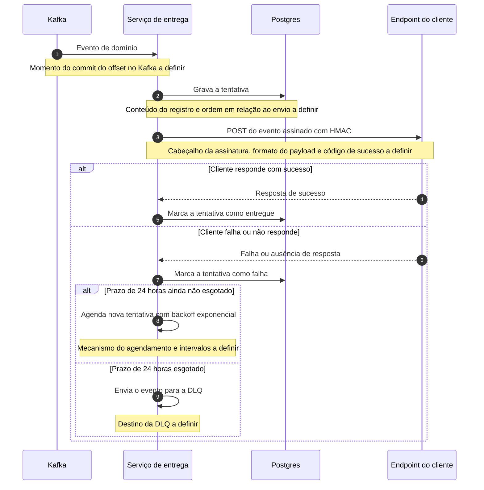

# Serviço de webhooks de saída

| | |
|---|---|
| **Documento** | DESIGN-DOC |
| **Estado** | Rascunho |
| **Autores** | A definir |
| **Revisores** | A definir |
| **Criado** | 2026-11-20 |
| **Última atualização** | 2026-11-20 |
| **Tags** | webhooks, kafka, entrega, retry |

## Glossário

- **Webhook**: requisição HTTP que nosso sistema envia ao endpoint de um cliente quando algo acontece do lado de cá.
- **HMAC**: assinatura calculada com uma chave secreta compartilhada entre nós e o cliente, enviada junto com o payload para que o cliente verifique a origem e a integridade da mensagem.
- **Backoff exponencial**: estratégia de espaçamento entre tentativas em que o intervalo cresce a cada falha.
- **DLQ** (dead-letter queue): destino dos eventos que esgotaram o prazo de entrega sem sucesso.

## Visão geral

Hoje, cada serviço que precisa avisar um cliente externo faz a chamada HTTP por conta própria, sem retry e sem log central. Quando o endpoint do cliente cai, o evento se perde, e a perda só aparece quando o suporte recebe a reclamação.

Este documento propõe um serviço único de entrega de webhooks de saída. Ele consome os eventos de domínio que já são publicados no Kafka, registra cada tentativa de entrega no Postgres, envia o evento ao endpoint do cliente em um POST assinado com HMAC e reenvia com backoff exponencial por até 24 horas. Eventos que não forem entregues nesse prazo vão para a DLQ.

## Contexto

- Serviços internos publicam eventos de domínio no Kafka. Esse barramento já existe e é a fonte dos eventos que precisam chegar aos clientes.
- Os serviços que avisam clientes externos hoje fazem o POST diretamente. Não há retry, não há registro central das tentativas e não há como saber, sem olhar o suporte, quais eventos não chegaram.
- Quando o endpoint de um cliente está indisponível, a entrega falha no momento da chamada e não há segunda tentativa.

## Objetivos e fora de escopo

**Objetivos**

- Nenhum evento perdido por indisponibilidade do endpoint do cliente. Meta numérica (janela de indisponibilidade coberta, percentual de eventos entregues): a definir.
- Visibilidade de cada tentativa de entrega, com o registro guardado no Postgres.

**Fora de escopo**: a definir.

## O design

### Visão geral da solução

Um serviço de entrega, separado dos serviços que geram os eventos, consome os eventos de domínio do Kafka. Para cada evento, ele faz o POST assinado com HMAC no endpoint do cliente, registra o resultado de cada tentativa no Postgres e, em caso de falha, agenda novas tentativas com backoff exponencial. Quando o prazo de 24 horas se esgota sem sucesso, o evento vai para a DLQ.

O principal trade-off da solução é a fila: a entrega deixa de ser imediata em alguns casos, porque o evento passa por ela antes de chegar ao cliente.

### Arquitetura

O diagrama de containers mostra o serviço de entrega e os dois armazenamentos que ele usa, além do Kafka de onde consome e dos endpoints dos clientes para onde envia.


Renderização pendente: o diagrama deve ser gerado a partir do DSL abaixo na passagem manual, quando houver um renderizador disponível.

<details>
<summary>Código do diagrama (Structurizr DSL)</summary>

```
workspace "Webhooks de saída" "Entrega de eventos de domínio a endpoints de clientes externos." {

    model {
        servicosInternos = softwareSystem "Serviços internos" "Publicam eventos de domínio no Kafka."
        kafka = softwareSystem "Kafka" "Barramento com os eventos de domínio já existentes."
        clienteExterno = softwareSystem "Endpoint do cliente" "Recebe o POST assinado com HMAC." "External"

        webhooks = softwareSystem "Serviço de webhooks de saída" "Entrega eventos de domínio a endpoints de clientes externos, com retry por até 24 horas." {
            entrega = container "Serviço de entrega" "Consome eventos, faz o POST assinado e agenda novas tentativas em caso de falha."
            tentativas = container "Registro de tentativas" "Guarda cada tentativa de entrega e seu resultado." "Postgres" "Database"
            dlq = container "DLQ" "Eventos que esgotaram o prazo de 24 horas sem sucesso. Destino a definir."
        }

        servicosInternos -> kafka "Publica eventos de domínio em"
        kafka -> entrega "Entrega os eventos consumidos a"
        entrega -> tentativas "Grava cada tentativa e seu resultado em"
        entrega -> clienteExterno "Envia o POST assinado com HMAC a"
        entrega -> dlq "Envia os eventos que esgotaram o prazo para"
    }

    views {
        systemContext webhooks "Contexto" {
            include *
            autoLayout
        }

        container webhooks "Containers" {
            include *
            autoLayout
        }

        styles {
            element "Database" {
                shape Cylinder
            }
            element "External" {
                background #999999
            }
        }
    }
}
```

</details>

O serviço de entrega lê os eventos do Kafka, grava cada tentativa no registro de tentativas (Postgres), chama o endpoint do cliente e, em caso de falha, agenda a próxima tentativa. Os eventos que esgotam o prazo seguem para a DLQ. Tecnologia do serviço de entrega, da DLQ e o mecanismo de agendamento das novas tentativas: a definir.

### Fluxo de entrega com retry

O diagrama de sequência mostra o caminho de um evento desde o consumo no Kafka até a entrega, o registro da tentativa, o agendamento de novas tentativas e o encaminhamento para a DLQ.



A cada passo, o serviço grava o resultado no Postgres, de modo que cada tentativa fica visível. Quando o cliente responde com sucesso, a tentativa é marcada como entregue e o fluxo termina. Quando o cliente falha ou não responde, a tentativa é marcada como falha e o serviço agenda uma nova, até o prazo de 24 horas. Depois disso, o evento vai para a DLQ. A referência do prazo (primeira tentativa ou criação do evento) e a ordem entre gravar a tentativa e enviar o POST ainda não foram definidas.

## Trade-offs da solução escolhida

- ✓ Eventos não se perdem por indisponibilidade do cliente enquanto o endpoint voltar dentro do prazo de 24 horas.
- ✓ Cada tentativa de entrega fica registrada no Postgres, o que dá visibilidade ao suporte e ao time.
- ✓ Evita o custo por evento cobrado por um SaaS, e o payload permanece dentro da nossa borda.
- ✗ A entrega deixa de ser imediata em alguns casos, porque o evento passa pela fila antes de chegar ao cliente. Esse custo foi aceito.
- ✗ Outros custos (operação do serviço, carga no Kafka e no Postgres, duplicidade de entregas em caso de falha entre o envio e o registro) não foram levantados. Ver perguntas em aberto.

## Alternativas consideradas

**Não fazer nada.** Manter o POST direto em cada serviço. Descartada porque, sem retry e sem registro central, os eventos continuam se perdendo quando o endpoint do cliente cai, e a perda só é percebida pelo suporte.

**SaaS de webhooks.** Terceirizar a entrega. Descartada por dois motivos: o custo cresce com cada evento enviado, e o payload sairia da nossa borda.

**Serviço próprio de entrega (escolhida).** Atende ao objetivo de não perder eventos e dá visibilidade de cada tentativa, ao preço da entrega não ser imediata em alguns casos.

Outras alternativas consideradas pelo time: a definir.

## Preocupações transversais

**Segurança.** Cada POST é assinado com HMAC. Onde as chaves secretas são guardadas, como são provisionadas para cada cliente e como são rotacionadas: a definir.

**Impacto nos clientes.** Clientes passam a receber reenvios do mesmo evento durante uma indisponibilidade. Como cada cliente trata eventos repetidos: a definir.

**Carga nos sistemas compartilhados.** O serviço consome o Kafka e grava em Postgres a cada tentativa. Volume esperado de eventos e de tentativas: a definir.

**Dados pessoais.** Se o payload carrega dados pessoais, isso muda o armazenamento no registro de tentativas e a retenção. Situação: a definir.

## Testabilidade e observabilidade

O registro de tentativas no Postgres é a base da observabilidade: cada tentativa e o seu resultado ficam registrados. Quais métricas e alertas serão expostos, e como o time vai testar o retry e a DLQ antes de entrar em produção: a definir.

## Plano de implantação

A definir.

## Perguntas em aberto

- Qual é a meta numérica dos objetivos (janela de indisponibilidade coberta, percentual de eventos entregues)?
- O que fica fora de escopo nesta entrega?
- Quais outras alternativas o time avaliou além de não fazer nada e do SaaS?
- Qual critério define uma entrega bem-sucedida (código de resposta do cliente)?
- A janela de 24 horas começa na criação do evento ou na primeira tentativa?
- Em que ordem a tentativa é gravada no Postgres e o POST é enviado? Se o serviço cair entre o envio e o registro do sucesso, o cliente recebe o evento de novo?
- Quando o offset do Kafka é commitado em relação à gravação da tentativa?
- Onde ficam a DLQ e o agendamento das novas tentativas (tabela, tópico do Kafka ou outro mecanismo)?
- Quem é responsável por reprocessar os eventos da DLQ?
- Como as chaves HMAC são provisionadas, guardadas e rotacionadas?
- Qual é o volume esperado de eventos e de tentativas?
- Os payloads contêm dados pessoais?
- Qual é a stack do serviço de entrega?
- Quem são os autores e os revisores, e quais times de clientes ou internos devem revisar?
- Como o serviço será implantado (em uma etapa ou em fases)?
