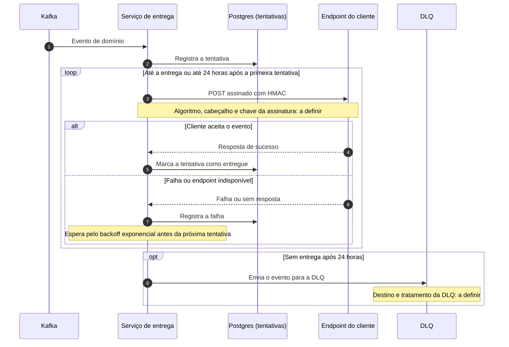

# Entrega de webhooks de saída

| | |
|---|---|
| **State** | Rascunho |
| **Title** | Entrega de webhooks de saída |
| **Authors** | A definir |
| **Reviewers** | A definir |
| **Created** | 2026-11-20 |
| **Last updated** | 2026-11-20 |
| **Tags** | webhooks, kafka, postgres, retry |

## Glossário

- **Webhook**: chamada HTTP que nós fazemos ao endpoint de um cliente externo para avisar que algo aconteceu.
- **HMAC**: código de autenticação calculado com uma chave secreta sobre o corpo da mensagem; permite ao cliente verificar que o POST veio de nós e não foi alterado.
- **Backoff exponencial**: intervalo entre tentativas que cresce a cada falha, para não sobrecarregar um endpoint que já está em dificuldade.
- **DLQ** (dead-letter queue): fila de mensagens que não puderam ser entregues e precisam de tratamento manual ou posterior.

## Visão geral

Este documento propõe um serviço único de entrega de webhooks de saída. Ele consome os eventos de domínio que já existem no Kafka, grava cada tentativa de entrega no Postgres, envia o evento ao endpoint do cliente por um POST assinado com HMAC e reenvia com backoff exponencial por até 24 horas. Um evento que não for entregue nesse prazo vai para a DLQ.

O texto descreve o problema de hoje, a solução, o que ela custa e as alternativas consideradas. O que ainda não foi definido aparece em Questões em aberto, e não no corpo do texto.

## Contexto e escopo

Hoje, cada serviço que precisa avisar um cliente externo faz o POST por conta própria. Não há reenvio nem log central. Quando o endpoint do cliente está indisponível, o evento se perde, e a equipe só descobre o problema pelo suporte. Os eventos de domínio já são publicados no Kafka.

Restrições técnicas que o desenho precisa respeitar: a definir (ver Questões em aberto).

## Objetivos e fora de escopo

Objetivos:

- Nenhum evento perdido por indisponibilidade do endpoint do cliente. A forma de medir isso está em Questões em aberto.
- Visibilidade de cada tentativa de entrega: cada tentativa fica registrada e consultável.

Fora de escopo: a definir (ver Questões em aberto).

## O desenho

### Solução em visão geral

Um único serviço de entrega assume o envio de todos os webhooks de saída. Ele lê os eventos de domínio do Kafka, grava a tentativa no Postgres, faz o POST assinado com HMAC para o endpoint do cliente e, se a entrega falhar, reenvia com backoff exponencial. O trade-off central é que a entrega passa a depender da fila e deixa de ser imediata em alguns casos (ver Trade-offs).

### Arquitetura


Renderizar na revisão manual: a imagem ainda não foi gerada.

<details>
<summary>Código-fonte do diagrama (Structurizr DSL)</summary>

```
workspace "Entrega de webhooks de saída" "Serviço único que entrega eventos de domínio aos endpoints dos clientes" {

    !identifiers hierarchical

    model {
        kafka = softwareSystem "Kafka de eventos de domínio" "Eventos de domínio que os serviços já publicam" "Existing"
        cliente = softwareSystem "Endpoint do cliente" "Recebe os webhooks de saída" "External"

        entrega = softwareSystem "Entrega de webhooks" "Entrega eventos de domínio aos clientes e reenvia por até 24 horas" {
            servico = container "Serviço de entrega" "Consome eventos, envia POST assinado com HMAC e reenvia com backoff exponencial"
            tentativas = container "Registro de tentativas" "Persiste cada tentativa de entrega" "PostgreSQL" "Database"
        }

        kafka -> entrega.servico "Fornece eventos de domínio para"
        entrega.servico -> entrega.tentativas "Grava cada tentativa em"
        entrega.servico -> cliente "Envia POST assinado com HMAC para"
    }

    views {
        container entrega "Containers" {
            include *
            autoLayout
        }

        styles {
            element "Existing" {
                background #999999
                color #ffffff
            }
            element "External" {
                background #999999
                color #ffffff
            }
            element "Database" {
                shape Cylinder
            }
        }
    }

    configuration {
        scope softwaresystem
    }
}
```

</details>

O serviço de entrega é o único contêiner novo. Ele recebe os eventos de domínio do Kafka, que já existe e continua sendo a fonte deles. Para cada evento, grava uma tentativa no registro de tentativas, implementado no Postgres, e envia o POST assinado ao endpoint do cliente. Esse endpoint pertence ao cliente e está fora da nossa organização. A ligação entre o serviço de entrega e o endpoint é o ponto onde a assinatura HMAC é aplicada.

### Fluxo de entrega com reenvio



O fluxo começa quando o Kafka entrega um evento de domínio ao serviço de entrega. A tentativa é registrada no Postgres antes do primeiro POST, para que cada tentativa fique visível mesmo que o serviço caia no meio do caminho. O POST é assinado com HMAC. Se o endpoint do cliente aceita o evento, a tentativa é marcada como entregue. Se falha ou não responde, a falha é registrada e o serviço espera o intervalo do backoff exponencial antes de tentar de novo. Passadas 24 horas sem entrega, o evento vai para a DLQ.

## Trade-offs da solução escolhida

- ✓ Um evento que falha por indisponibilidade do cliente é reenviado automaticamente, por até 24 horas, em vez de se perder.
- ✓ Cada tentativa fica registrada no Postgres, o que dá visibilidade ao suporte e à equipe, no lugar da descoberta pelo suporte.
- ✗ A entrega deixa de ser imediata em alguns casos, porque o evento passa pela fila antes de ser enviado.

## Alternativas consideradas

- **Não fazer nada (manter o POST manual em cada serviço).** Descartada pela dor descrita: sem reenvio e sem log central, quando o endpoint do cliente cai o evento se perde e a descoberta acontece pelo suporte.
- **Usar um SaaS de webhooks.** Descartada por dois motivos: o custo cresce com o número de eventos, e o payload passaria por infraestrutura de terceiros antes de chegar ao cliente.
- **Serviço próprio de entrega, com Kafka como fonte e Postgres como registro.** Escolhida. Atende aos objetivos sem o custo por evento do SaaS. Tem o custo de atraso na entrega descrito em Trade-offs.

## Impacto transversal

- **Segurança**: o POST é assinado com HMAC. Quem guarda e rotaciona a chave de cada cliente ainda não foi definido.
- **Clientes externos**: o reenvio pode chegar ao endpoint do cliente por até 24 horas após a primeira tentativa.
- **Infraestrutura**: o serviço consome o Kafka e grava no Postgres. Cargas e dimensionamento não foram levantados.

## Testabilidade e observabilidade

Cada tentativa é registrada no Postgres, e esse registro é a base da visibilidade pedida pelo objetivo. Testes que verifiquem o reenvio e a ida para a DLQ, e as métricas e alertas que mostrariam o serviço funcionando em produção, ainda não foram definidos (ver Questões em aberto).

## Questões em aberto

- Qual é a medida de "nenhum evento perdido"? Por exemplo, um percentual de entregas concluídas dentro de 24 horas.
- Quais tópicos do Kafka o serviço consome, e qual a garantia de entrega e de ordem esperada para cada cliente?
- Quais são os parâmetros do backoff exponencial: intervalo inicial, fator de crescimento, limite e variação aleatória?
- O que conta como entrega bem-sucedida: quais códigos de resposta do cliente, e qual o tempo limite de cada POST?
- Como a chave HMAC é criada, distribuída, guardada e rotacionada? Qual o algoritmo e em qual cabeçalho a assinatura vai?
- O que é a DLQ nesta arquitetura: qual tecnologia, quem a consome e como um evento sai dela?
- Quantos clientes e quantos eventos por dia são esperados? Qual o volume previsto de tentativas no Postgres e por quanto tempo elas são retidas?
- Quais dados do payload são sensíveis (dados pessoais, financeiros)?
- Quais são as restrições técnicas do desenho? Há algo que não pode mudar?
- O que está fora de escopo?
- Os serviços que hoje fazem o POST manual vão migrar para o serviço de entrega? Em que ordem, e como fica a convivência durante a migração?
- Quem são os autores e os revisores? Existe um modelo de documento de design da equipe a seguir?
- Quais métricas e alertas indicam que o serviço funciona em produção?
