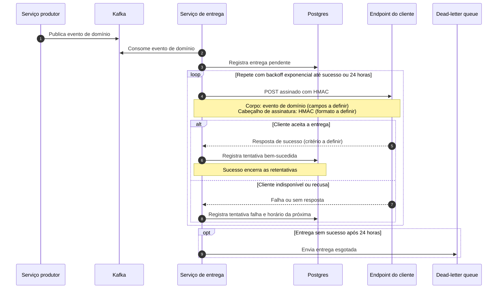

# Serviço de webhooks de saída

| | |
|---|---|
| **Documento** | Design doc |
| **Estado** | Rascunho |
| **Título** | Serviço de webhooks de saída |
| **Autores** | a definir |
| **Revisores** | a definir (ver Questões em aberto) |
| **Criado** | 2026-11-20 |
| **Última atualização** | 2026-11-20 |
| **Tags** | webhooks, eventos, entrega, Kafka, Postgres |

## Glossário

- **Webhook**: chamada HTTP que nosso sistema faz ao endpoint de um cliente externo para avisar que algo aconteceu.
- **Evento de domínio**: fato de negócio já publicado no Kafka por um serviço nosso (por exemplo, um pedido foi pago).
- **HMAC**: código de autenticação calculado sobre o corpo da mensagem com um segredo compartilhado, usado para o cliente verificar que a chamada veio de nós e não foi alterada.
- **Backoff exponencial**: estratégia de retentativa em que o intervalo entre tentativas cresce a cada falha.
- **DLQ (dead-letter queue)**: fila para onde vão as entregas que esgotaram as retentativas, para análise posterior.
- **SaaS**: serviço de terceiros contratado como produto, cobrado pelo uso.

## Visão geral

Hoje cada serviço que precisa avisar um cliente externo faz o POST por conta própria, sem retentativa e sem registro central. Quando o endpoint do cliente está indisponível, o evento se perde, e a equipe só descobre o problema quando o suporte é acionado.

Este documento propõe um serviço único de entrega de webhooks. Ele consome os eventos de domínio que já existem no Kafka, registra cada tentativa de entrega no Postgres, envia o POST assinado com HMAC ao endpoint do cliente e reenvia com backoff exponencial por até 24 horas. Entregas que não tiverem sucesso nesse período vão para a DLQ.

## Contexto

- Os serviços produtores já publicam eventos de domínio no Kafka.
- Cada serviço que notifica clientes externos implementa hoje o próprio POST, sem retentativa e sem log centralizado.
- Quando um endpoint de cliente cai, não há mecanismo que recoloque o evento na fila de envio. A perda só aparece quando o cliente ou o suporte reclama.
- O Postgres é o banco que o time já usa para persistência.

Restrições conhecidas: a lista de restrições técnicas e de contratos com clientes ainda não foi levantada (ver Questões em aberto).

## Objetivos e fora de escopo

**Objetivos**

- Nenhum evento perdido por indisponibilidade do endpoint do cliente, com reenvio por até 24 horas.
- Visibilidade de cada tentativa de entrega: cada uma fica registrada no Postgres.
- Assinatura HMAC em todo POST enviado a clientes externos.

**Fora de escopo**

A ser definido. Não há lista de itens excluídos do trabalho (ver Questões em aberto).

## O desenho

### Solução em visão geral

Um serviço único de entrega fica entre o Kafka e os clientes externos. Ele faz três coisas:

1. consome os eventos de domínio do Kafka e cria, para cada cliente interessado, uma entrega pendente no Postgres;
2. envia o POST assinado com HMAC ao endpoint do cliente e registra o resultado de cada tentativa;
3. se a tentativa falha, agenda a próxima com backoff exponencial, até o limite de 24 horas; esgotado o prazo, envia a entrega para a DLQ.

O ponto central da proposta é que a entrega passa a ser feita por um componente só, com registro, em vez de cada serviço cuidar do seu POST.

### Arquitetura

O diagrama de contêineres abaixo mostra o serviço de entrega, o banco onde ficam as tentativas, a DLQ e as relações com o Kafka e com os endpoints dos clientes.


*Render this in the manual pass: a imagem acima é o lugar do diagrama renderizado a partir do DSL abaixo.*

<details>
<summary>Diagram source (Structurizr DSL)</summary>

```
workspace "Serviço de webhooks de saída" "Entrega de eventos de domínio a endpoints de clientes externos" {

    model {
        produtores = softwareSystem "Serviços produtores" "Publicam eventos de domínio"
        kafka = softwareSystem "Kafka" "Barramento onde os eventos de domínio já são publicados"
        clientes = softwareSystem "Endpoints dos clientes" "Recebem os webhooks via POST assinado com HMAC" "Externo"

        webhooks = softwareSystem "Serviço de entrega de webhooks" "Entrega eventos a clientes externos com registro e retentativas" {
            servico = container "Serviço de entrega" "Consome eventos, envia o POST assinado e reenvia com backoff exponencial por até 24 horas"
            tentativas = container "Tentativas de entrega" "Armazena cada tentativa de entrega e seu resultado" "Postgres"
            dlq = container "Dead-letter queue" "Recebe as entregas que esgotaram as retentativas"
        }

        produtores -> kafka "Publica eventos de domínio"
        servico -> kafka "Consome eventos de domínio"
        servico -> tentativas "Registra cada tentativa"
        servico -> clientes "POST assinado com HMAC"
        servico -> dlq "Envia entregas esgotadas após 24 horas"
    }

    views {
        container webhooks "Entrega" {
            include *
            autoLayout lr
        }
    }
}
```

</details>

Os produtores continuam publicando no Kafka como já fazem. O serviço de entrega é o único componente que consome esses eventos para notificar clientes externos, grava cada tentativa no Postgres e chama os endpoints dos clientes. A DLQ recebe o que não foi entregue em 24 horas. A tecnologia da DLQ e o modo de consumo do Kafka ainda não foram definidos (ver Questões em aberto).

### Fluxo de entrega com retentativa

O diagrama a seguir mostra uma entrega do início ao fim, incluindo as retentativas.



O serviço de entrega consome o evento e grava a entrega como pendente antes de tentar o envio, para que nenhuma entrega exista apenas na memória. Cada tentativa é gravada com seu resultado. Uma falha, seja sem resposta ou recusa, gera nova tentativa no horário calculado pelo backoff. Quando uma tentativa é aceita, as retentativas param. Se nenhuma tentativa for aceita dentro de 24 horas, a entrega vai para a DLQ.

O que conta como resposta aceita, os intervalos do backoff e o formato do corpo e da assinatura não foram definidos e estão em Questões em aberto.

### Assinatura

Cada POST é assinado com HMAC para que o cliente verifique a origem e a integridade da mensagem. O algoritmo, o cabeçalho que leva a assinatura, o segredo por cliente e sua rotação ainda não foram definidos.

## Trade-offs da solução escolhida

- ✓ Um único ponto de entrega, com registro de cada tentativa no Postgres, em vez de POST manual em cada serviço.
- ✓ Retentativa por até 24 horas em caso de indisponibilidade do cliente, com a DLQ como destino final.
- ✓ O payload não passa por um fornecedor externo de webhooks.
- ✓ Não há cobrança por evento, como em um SaaS de webhooks.
- ✗ A entrega deixa de ser imediata em alguns casos, porque passa pela fila. O time aceitou esse custo.
- ✗ Um serviço novo passa a ser operado pelo time: deploy, monitoramento e manutenção da fila e do banco de tentativas.

Outros custos da proposta, como duplicidade de entregas e volume de dados no Postgres, ainda não foram avaliados (ver Questões em aberto).

## Alternativas consideradas

**Não fazer nada (manter o POST manual em cada serviço).** Descartada porque o problema descrito continua: eventos se perdem quando o endpoint do cliente cai, e a perda só é percebida pelo suporte.

**SaaS de webhooks.** Descartada por dois motivos: o custo cresce com o número de eventos, e o payload sairia da nossa borda para um fornecedor terceiro.

**Serviço próprio de entrega (escolhido).** Mantém o payload dentro da nossa infraestrutura até o envio ao cliente, dá visibilidade de cada tentativa e evita o custo por evento. Tem o custo de operação já descrito em Trade-offs.

## Impactos transversais

**Segurança.** Cada POST leva assinatura HMAC. A gestão do segredo por cliente (armazenamento, distribuição e rotação) é a parte ainda aberta.

**Clientes externos.** Os clientes passam a receber as notificações de um único remetente, com retentativas. Como os clientes atuais recebem hoje o POST de cada serviço, a migração ainda precisa ser planejada (ver Questões em aberto).

**Carga nos endpoints dos clientes.** As retentativas por até 24 horas geram chamadas repetidas a um endpoint que estava fora do ar. Não há dados sobre o volume esperado.

## Testabilidade e observabilidade

- Cada tentativa fica registrada no Postgres, com seu resultado e o horário da próxima. Isso dá a visibilidade pedida nos objetivos.
- As métricas que mostram se o objetivo de nenhum evento perdido está sendo cumprido ainda não foram definidas.
- A forma de verificar o serviço antes de publicá-lo não foi definida.

## Questões em aberto

1. Quais eventos de domínio entram no serviço: todos os tópicos atuais ou uma lista definida?
2. Qual é o esquema de backoff (intervalo inicial, fator de crescimento e limite por tentativa), além do limite de 24 horas?
3. Quais respostas contam como sucesso: códigos HTTP específicos, ou qualquer resposta dentro de um tempo limite?
4. A assinatura HMAC usa qual algoritmo e cabeçalho, e como o segredo de cada cliente é armazenado, distribuído e rotacionado?
5. O cliente recebe um identificador do evento para deduplicar? Entregas repetidas são aceitáveis para os clientes?
6. A DLQ é um tópico Kafka, uma tabela no Postgres ou outra coisa? Quem trata as entregas que chegaram lá?
7. Como o objetivo "nenhum evento perdido" será medido, e qual tolerância é aceita?
8. Quais itens estão explicitamente fora do escopo?
9. Quanto tempo as tentativas ficam guardadas no Postgres?
10. Quais clientes recebem hoje o POST manual, e como será a migração para o novo serviço?
11. Quem são os autores e os revisores deste documento, incluindo as áreas de segurança e das equipes que mantêm os serviços produtores?
