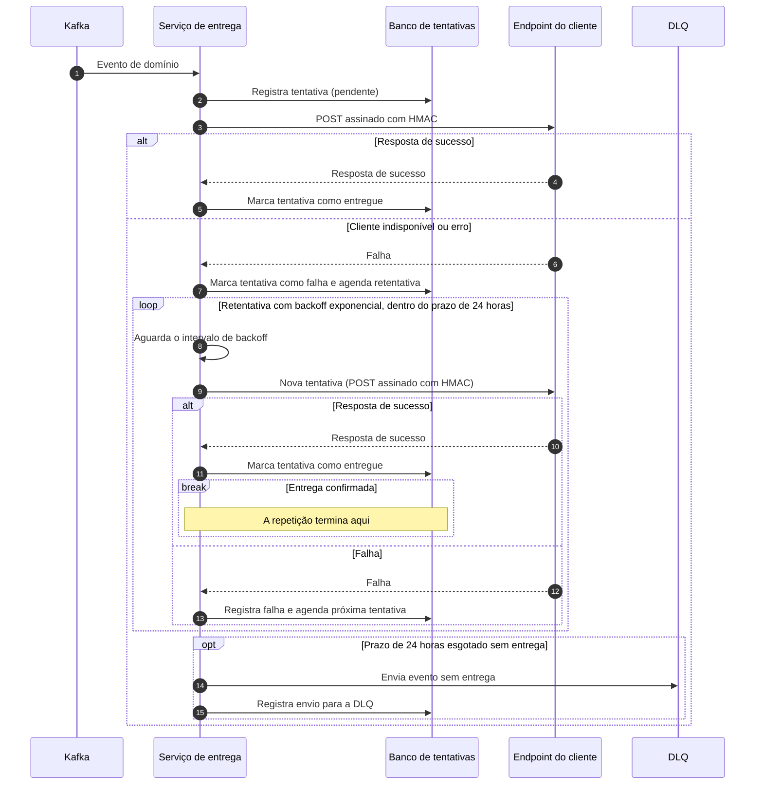

# Serviço de webhooks de saída

| | |
|---|---|
| **State** | Rascunho |
| **Title** | Serviço de webhooks de saída |
| **Authors** | A definir |
| **Reviewers** | A definir |
| **Created** | 2026-11-20 |
| **Last updated** | 2026-11-20 |
| **Tags** | webhooks, entrega, eventos, kafka, postgres |

## Glossário

- **Evento de domínio**: fato de negócio que os serviços já publicam no Kafka.
- **Backoff exponencial**: intervalo entre retentativas que cresce a cada falha.
- **DLQ (dead-letter queue)**: fila dos eventos cujo prazo de entrega se esgotou, guardados para tratamento posterior.
- **HMAC**: código de autenticação calculado com um segredo compartilhado; permite ao cliente verificar a origem e a integridade do POST recebido.
- **SaaS**: serviço de terceiros, hospedado fora da nossa infraestrutura.

## Visão geral

Cada serviço que precisa avisar um cliente externo hoje faz o POST por conta própria, sem retentativa e sem log central. Quando o endpoint do cliente está indisponível, o evento se perde, e a perda só aparece quando o suporte recebe a reclamação.

Este documento propõe um serviço único de entrega de webhooks. Ele consome os eventos de domínio que já existem no Kafka, registra cada tentativa de entrega no Postgres, envia o POST assinado com HMAC para o endpoint do cliente e reenvia com backoff exponencial por até 24 horas. Depois desse prazo, o evento vai para uma DLQ.

## Escopo e contexto

Hoje, cada serviço que avisa um cliente externo implementa o próprio envio. Não há retentativa padronizada nem registro central das tentativas. Quando um endpoint de cliente cai, o evento não é reenviado, e não existe hoje um lugar onde se consulte o histórico de uma entrega.

Os eventos de domínio já são publicados no Kafka, e o serviço de entrega passa a consumir esse fluxo.

## Objetivos e fora de escopo

**Objetivos**

- Nenhum evento perdido por indisponibilidade do endpoint do cliente. A retentativa com backoff exponencial dura até 24 horas, e só depois disso o evento vai para a DLQ.
- Visibilidade de cada tentativa: cada envio fica registrado no Postgres, com seu resultado.

**Fora de escopo**

- A definir (ver Questões em aberto).

## O design

### Visão geral da solução

Um único serviço de entrega se coloca entre o Kafka e os endpoints dos clientes. Ele tem quatro responsabilidades: consumir os eventos de domínio, gravar cada tentativa no Postgres, assinar o payload com HMAC e enviar o POST; quando a entrega falha, reagendar a próxima tentativa conforme o backoff exponencial. Esgotado o prazo de 24 horas sem entrega, o evento segue para a DLQ.

Como a persistência fica no Postgres e o envio sai de um único lugar, o que antes era implementado em cada serviço passa a ter um ponto de observação só.

### Arquitetura


*Renderizar na passagem manual: o diagrama ainda não foi renderizado a partir do DSL abaixo.*

<details>
<summary>Diagram source (Structurizr DSL)</summary>

```
workspace "Webhooks de saída" "Serviço de entrega de webhooks de saída" {

    !identifiers hierarchical

    model {
        cliente = softwareSystem "Cliente externo" "Recebe o webhook no endpoint que informou" "External"

        plataforma = softwareSystem "Plataforma" "Serviços internos que produzem eventos de domínio e avisam clientes externos" {
            produtores = container "Serviços produtores" "Publicam eventos de domínio no Kafka"
            kafka = container "Kafka" "Tópicos de eventos de domínio já existentes" "Kafka" "Queue"
            entrega = container "Serviço de entrega de webhooks" "Consome eventos, registra cada tentativa, assina o payload com HMAC, envia o POST e reagenda retentativas por até 24 horas"
            banco = container "Banco de tentativas" "Registro de cada tentativa de entrega e do seu resultado" "PostgreSQL" "Database"
            dlq = container "DLQ" "Eventos cujo prazo de entrega se esgotou" "" "Queue"
        }

        plataforma.produtores -> plataforma.kafka "Publica eventos de domínio em"
        plataforma.entrega -> plataforma.kafka "Consome eventos de domínio de"
        plataforma.entrega -> plataforma.banco "Grava cada tentativa e o seu resultado em"
        plataforma.entrega -> cliente "Envia POST assinado com HMAC para o endpoint do cliente"
        plataforma.entrega -> plataforma.dlq "Envia eventos sem entrega após 24 horas para"
    }

    views {
        container plataforma "Containers" {
            include *
            autoLayout lr
        }

        styles {
            element "External" {
                background #999999
                color #ffffff
            }
            element "Database" {
                shape Cylinder
            }
            element "Queue" {
                shape Pipe
            }
        }

        theme default
    }

    configuration {
        scope softwaresystem
    }
}
```

</details>

O diagrama mostra cinco contêineres dentro da plataforma e o endpoint do cliente, que fica fora dela. Os serviços produtores publicam no Kafka, e o serviço de entrega consome esses tópicos. Para cada evento, o serviço grava uma tentativa no banco de tentativas, envia o POST assinado ao cliente e registra o resultado. Quando a entrega falha, o evento permanece sob retentativa; sem entrega após 24 horas, segue para a DLQ.

### Fluxo de entrega com retentativa

O fluxo abaixo mostra uma entrega bem-sucedida e o caminho de falha, com as retentativas e o desvio para a DLQ.



O fluxo começa quando um evento de domínio chega do Kafka. Antes de enviar, o serviço registra a tentativa no Postgres, para que ela exista mesmo se o envio falhar. O POST vai assinado com HMAC. Se a resposta indicar sucesso, a tentativa é marcada como entregue e o fluxo termina.

Se a entrega falha, o serviço registra a falha e entra no laço de retentativas, que espera um intervalo de backoff exponencial antes de cada nova tentativa. Quando uma tentativa tem sucesso, a repetição termina. Se o prazo de 24 horas se esgota sem entrega, o evento vai para a DLQ e o envio fica registrado no banco.

## Trade-offs da solução escolhida

- ✓ Um evento deixa de ser reenviado só depois de 24 horas sem entrega, e nesse caso segue para a DLQ em vez de desaparecer.
- ✓ Cada tentativa fica registrada no Postgres, com o seu resultado. Hoje essa informação não existe.
- ✓ O envio é feito em um único lugar, e não em cada serviço separadamente.
- ✓ O payload não passa por um fornecedor externo de webhooks: ele vai da nossa infraestrutura direto ao endpoint do cliente, o que não aconteceria com um SaaS.
- ✗ A entrega deixa de ser imediata em alguns casos, porque o evento passa pela fila do Kafka antes de ser enviado.
- ✗ Passa a existir um serviço em produção a operar e manter, no lugar de vários envios espalhados.
- ✗ Os eventos que esgotam o prazo vão para a DLQ, que exige um processo de tratamento. Esse processo ainda não foi definido.

## Alternativas consideradas

**Não fazer nada.** Mantém cada serviço com o seu envio manual. Foi descartado porque os eventos se perdem quando o endpoint do cliente cai, e a perda só é descoberta pelo suporte, sem registro central para investigar.

**SaaS de webhooks.** Foi descartado por dois motivos: o custo cresce a cada evento enviado, e o payload sairia da nossa borda para um fornecedor externo.

**Serviço único de entrega com persistência no Postgres (escolhida).** Mantém o custo sob nosso controle, deixa o payload dentro da nossa infraestrutura e torna cada tentativa consultável. Aceita o custo de a entrega passar pela fila.

## Preocupações transversais

**Segurança.** Cada POST é assinado com HMAC para que o cliente possa verificar a origem e a integridade do conteúdo. A criação, o armazenamento e a rotação do segredo de cada cliente ainda não foram definidos.

**Privacidade.** O payload carrega dados de eventos de domínio destinados a clientes externos. Se há dados pessoais nesses payloads, isso precisa ser avaliado. Ver Questões em aberto.

**Outras equipes e sistemas.** Os endpoints dos clientes recebem tráfego de retentativas durante a indisponibilidade. Ainda não foi medido o quanto essa carga pesa sobre um cliente que já está fora do ar.

## Testabilidade e observabilidade

A visibilidade de cada tentativa é um objetivo do próprio serviço: cada envio fica registrado no Postgres com o seu resultado, o que permite consultar o histórico de uma entrega. As métricas e alertas de operação ainda não foram definidos.

## Questões em aberto

- Quem são os autores deste documento e quais áreas devem revisá-lo?
- O que está fora de escopo? Por exemplo, a ordem de entrega dos eventos de um mesmo cliente.
- O que conta como sucesso na resposta do cliente? Um código de status específico ou qualquer resposta de confirmação?
- Como o reagendamento das retentativas será implementado: tópicos de retentativa no Kafka, uma tabela no Postgres ou outro mecanismo?
- Com que tecnologia o serviço de entrega será construído, e como a DLQ será implementada?
- Como são criados, armazenados e rotacionados os segredos HMAC de cada cliente?
- O cliente consegue lidar com um mesmo evento recebido mais de uma vez? Existe um identificador do evento no POST para essa deduplicação?
- Os payloads contêm dados pessoais ou sensíveis?
- Quem trata os eventos que chegam à DLQ, e como são reprocessados?
- Quais métricas e alertas indicam que o serviço está funcionando?
- Como a entrega será implantada: de uma vez, ou em etapas?
