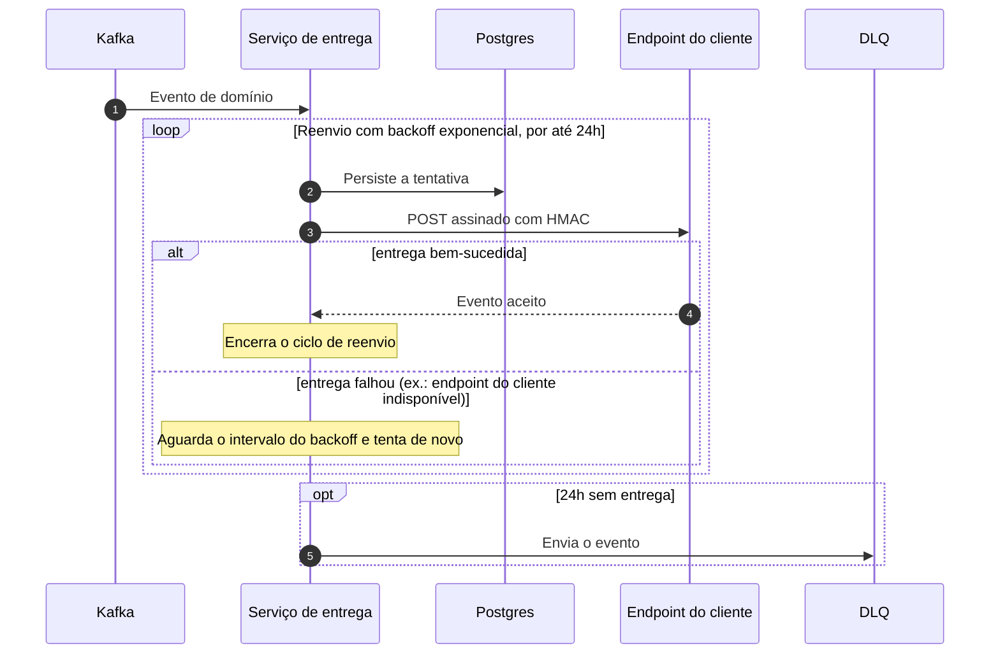

# Serviço de webhooks de saída

| | |
|---|---|
| **Documento** | DESIGN-DOC |
| **Estado** | Rascunho |
| **Título** | Serviço de webhooks de saída |
| **Criado em** | 2026-11-20 |
| **Última atualização** | 2026-11-20 |
| **Tags** | webhooks, entrega de eventos, Kafka |

## Glossário

- **Evento de domínio**: mensagem publicada no Kafka quando algo relevante acontece em um serviço nosso.
- **Webhook de saída**: chamada HTTP POST que nós fazemos ao endpoint de um cliente externo para avisá-lo de um evento.
- **HMAC**: assinatura calculada sobre o payload com um segredo compartilhado, que permite ao cliente verificar a origem da chamada.
- **Backoff exponencial**: política de reenvio em que o intervalo entre tentativas cresce a cada falha.
- **DLQ** (dead-letter queue): destino dos eventos que esgotaram as tentativas de entrega.

## Visão geral

Hoje cada serviço que precisa avisar um cliente externo faz o POST por conta própria, sem retry e sem registro central. Este documento propõe um serviço único de entrega de webhooks de saída: ele consome os eventos de domínio que já existem no Kafka, registra cada tentativa, entrega o evento ao cliente com assinatura e reenvia quando a entrega falha.

## Contexto

- Cada serviço que precisa notificar um cliente externo faz o POST manualmente.
- Não há retry: quando o endpoint do cliente está fora do ar, o evento se perde.
- Não há log central das entregas. A equipe só descobre a perda quando o suporte avisa.
- Os eventos de domínio já circulam no Kafka.

## Objetivos

- Nenhum evento perdido por indisponibilidade do endpoint do cliente.
- Visibilidade de cada tentativa de entrega.

## O design

### Visão da solução

Um serviço de entrega consome os eventos de domínio do Kafka e, para cada um, persiste a tentativa no Postgres, faz o POST assinado com HMAC no endpoint do cliente e, se a entrega falhar, reenvia com backoff exponencial por até 24 horas. Esgotado esse prazo, o evento vai para a DLQ.

### Arquitetura


> Imagem a renderizar na passagem manual a partir do DSL abaixo.

<details>
<summary>Código-fonte do diagrama (Structurizr DSL)</summary>

```
workspace {
    !identifiers hierarchical

    model {
        dominio = softwareSystem "Serviços de domínio" "Publicam os eventos de domínio no Kafka." "External"
        kafka = softwareSystem "Kafka" "Barramento que já transporta os eventos de domínio." "External"
        cliente = softwareSystem "Endpoint do cliente" "Sistema externo que recebe o webhook." "External"

        webhooks = softwareSystem "Serviço de webhooks de saída" "Entrega os eventos de domínio aos endpoints dos clientes, com retry e registro de cada tentativa." {
            entrega = container "Serviço de entrega" "Consome eventos, assina e envia o POST, reenvia com backoff exponencial por até 24h."
            banco = container "Banco de tentativas" "Persiste cada tentativa de entrega." "PostgreSQL" "Database"
            dlq = container "DLQ" "Recebe os eventos que esgotaram as tentativas." "" "Queue"
        }

        dominio -> kafka "Publica eventos de domínio em"
        webhooks.entrega -> kafka "Consome eventos de domínio de" "Kafka"
        webhooks.entrega -> webhooks.banco "Persiste as tentativas em" "PostgreSQL"
        webhooks.entrega -> cliente "Envia o webhook assinado com HMAC para" "HTTP POST"
        webhooks.entrega -> webhooks.dlq "Envia eventos não entregues após 24h para"
    }

    views {
        container webhooks "Containers" {
            include *
            autoLayout lr
        }

        styles {
            element "External" {
                background #999999
                color #ffffff
            }
            element "Database" {
                shape Cylinder
            }
            element "Queue" {
                shape Pipe
            }
        }
    }

    configuration {
        scope softwaresystem
    }
}
```

</details>

Os serviços de domínio publicam eventos no Kafka, como já fazem hoje. O serviço de entrega, dentro do novo sistema, consome esses eventos e grava cada tentativa no banco Postgres. Em seguida envia ao endpoint do cliente o POST assinado com HMAC. Se a entrega não se completa, o serviço reenvia com backoff exponencial por até 24 horas; passado esse prazo, o evento é enviado à DLQ.

### Fluxo de entrega com retry



O serviço de entrega recebe o evento do Kafka e, a cada tentativa, primeiro persiste a tentativa no Postgres e depois faz o POST assinado ao cliente (passos 2 e 3). Se o cliente aceita, o ciclo termina. Se a entrega falha, por exemplo porque o endpoint do cliente está fora do ar, o serviço espera o intervalo do backoff exponencial e repete o ciclo. Quando as 24 horas se esgotam sem entrega, o evento vai para a DLQ.

## Trade-offs da solução escolhida

- ✓ Eventos deixam de se perder quando o endpoint do cliente está indisponível: há retry por até 24 horas e, depois, DLQ.
- ✓ Cada tentativa fica registrada no Postgres, o que dá visibilidade central das entregas.
- ✓ O payload não sai da nossa borda.
- ✗ A entrega deixa de ser imediata em alguns casos, porque o evento passa pela fila. A equipe aceitou esse custo em troca da garantia de entrega.

## Alternativas consideradas

| Alternativa | Por que perdeu |
|---|---|
| **Serviço único de entrega próprio (escolhida)** | Atende os objetivos mantendo o payload dentro da nossa borda. |
| SaaS de webhooks | Custo por evento e o payload sairia da nossa borda. |
| Não fazer nada | Cada serviço continua fazendo o POST na mão, sem retry e sem log central: quando o endpoint do cliente cai, o evento se perde e a equipe só descobre pelo suporte. |

## Preocupações transversais

### Segurança

A chamada ao cliente é assinada com HMAC. O gerenciamento dos segredos de assinatura está em aberto (ver Questões em aberto).

## Questões em aberto

- Quais intervalos o backoff exponencial usa (primeiro intervalo, fator, teto)?
- O que conta como falha de entrega: só indisponibilidade do endpoint, ou também respostas de erro e timeouts? Qual é o timeout do POST?
- Como o reenvio é agendado e persistido entre as tentativas?
- Qual é o mecanismo da DLQ e o que a equipe faz com os eventos que chegam nela?
- Onde ficam, e como são rotacionados, os segredos HMAC de cada cliente? Como cada cliente cadastra o endpoint?
- Como a visibilidade das tentativas será consumida (consulta, painel, alerta)?
- Como os serviços atuais migram do POST manual para o novo serviço?
- Como o objetivo "nenhum evento perdido" será medido?
- Quem são os autores e os revisores (segurança, plataforma, times que publicam eventos)?
