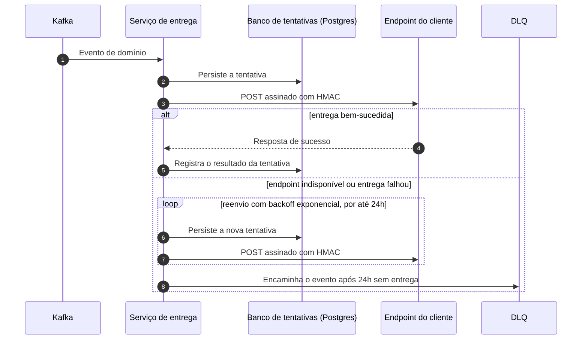

# Serviço de entrega de webhooks de saída

| | |
|---|---|
| **Documento** | DESIGN-DOC |
| **Estado** | Rascunho |
| **Título** | Serviço de entrega de webhooks de saída |
| **Criado** | 2026-11-20 |
| **Última atualização** | 2026-11-20 |
| **Tags** | webhooks, entrega, retry, kafka |

## Glossário

- **Webhook de saída**: chamada HTTP `POST` que a nossa plataforma faz ao endpoint de um cliente externo para avisá-lo de que algo aconteceu.
- **Evento de domínio**: mensagem publicada no Kafka que descreve um fato ocorrido em um dos nossos serviços.
- **HMAC**: assinatura calculada sobre o conteúdo da requisição com um segredo compartilhado, que permite ao cliente verificar a origem e a integridade do webhook.
- **Backoff exponencial**: política de reenvio em que o intervalo entre tentativas cresce a cada falha.
- **DLQ** (dead-letter queue): destino dos eventos que esgotaram as tentativas de entrega, mantidos ali para tratamento posterior.

## Visão geral

Hoje cada serviço que precisa avisar um cliente externo faz o `POST` por conta própria. Este documento propõe um serviço único de entrega de webhooks: ele consome os eventos de domínio que já circulam no Kafka, registra cada tentativa de entrega, envia o `POST` assinado ao endpoint do cliente e, se a entrega falhar, reenvia com backoff exponencial por até 24 horas antes de encaminhar o evento para a DLQ.

## Contexto

- Cada serviço que precisa notificar um cliente externo faz o `POST` manualmente.
- Não há retry nem log central dessas chamadas.
- Quando o endpoint do cliente está fora do ar, o evento se perde. A equipe só descobre o problema quando o suporte é acionado.
- Os eventos de domínio já estão disponíveis no Kafka.

## Objetivos e fora de escopo

### Objetivos

1. Nenhum evento é perdido por indisponibilidade do endpoint do cliente: a entrega é reenviada por até 24 horas e, depois disso, o evento vai para a DLQ em vez de ser descartado.
2. Cada tentativa de entrega fica visível: toda tentativa é persistida no Postgres.

### Fora de escopo

Nada foi definido como fora de escopo até aqui. Ver Questões em aberto.

## O design

### Visão geral da solução

Um único serviço de entrega substitui os `POST` manuais de cada serviço. Os fatos que disparam um webhook continuam sendo publicados como eventos de domínio no Kafka; o serviço de entrega os consome e passa a ser o responsável por falar com o endpoint do cliente. O custo principal, aceito pela equipe, é que a entrega deixa de ser imediata em alguns casos, porque o evento passa pela fila antes de chegar ao cliente.

### Arquitetura


> Imagem a ser renderizada a partir do DSL abaixo no passe manual; o arquivo `diagrams/architecture.svg` ainda não existe.

<details>
<summary>Código-fonte do diagrama (Structurizr DSL)</summary>

```
workspace "Serviço de entrega de webhooks de saída" "Entrega webhooks assinados a clientes externos, com registro de tentativas e reenvio." {

    !identifiers hierarchical

    model {
        cliente = softwareSystem "Endpoint do cliente" "Sistema do cliente externo que recebe os webhooks." {
            tags "External"
        }

        kafka = softwareSystem "Kafka" "Já existente; carrega os eventos de domínio." {
            tags "External"
        }

        servicos = softwareSystem "Serviços de domínio" "Serviços que publicam os eventos de domínio e hoje fazem o POST manualmente." {
            tags "External"
        }

        webhooks = softwareSystem "Plataforma de webhooks de saída" "Entrega eventos de domínio aos endpoints dos clientes, registrando cada tentativa." {
            entrega = container "Serviço de entrega" "Consome eventos, assina e envia o POST, reenvia com backoff exponencial por até 24h."
            db = container "Banco de tentativas" "Persiste cada tentativa de entrega." "Postgres" {
                tags "Database"
            }
            dlq = container "DLQ" "Recebe os eventos cujas tentativas se esgotaram." {
                tags "Queue"
            }
        }

        servicos -> kafka "Publica eventos de domínio em"
        webhooks.entrega -> kafka "Consome eventos de domínio de"
        webhooks.entrega -> webhooks.db "Persiste cada tentativa em"
        webhooks.entrega -> cliente "Envia POST assinado com HMAC para"
        webhooks.entrega -> webhooks.dlq "Encaminha eventos sem entrega após 24h para"
    }

    views {
        container webhooks "Containers" {
            include *
            autoLayout lr
        }

        styles {
            element "Element" {
                background #1168bd
                color #ffffff
            }
            element "Database" {
                shape cylinder
            }
            element "Queue" {
                shape pipe
            }
            element "External" {
                background #999999
                color #ffffff
            }
        }
    }

    configuration {
        scope softwaresystem
    }
}
```

</details>

Os serviços de domínio publicam eventos no Kafka, como já fazem hoje. O **Serviço de entrega** consome esses eventos, grava cada tentativa no **banco de tentativas** (Postgres), envia o `POST` assinado com HMAC ao **endpoint do cliente** e, esgotado o prazo de 24 horas de reenvios, encaminha o evento à **DLQ**. O Kafka e os serviços de domínio já existem hoje. Tecnologia da DLQ e protocolo das conexões não foram definidos e ficam como questões em aberto.

### Fluxo de entrega com retry



O serviço de entrega recebe o evento do Kafka (1), persiste a tentativa (2) e faz o `POST` assinado ao cliente (3). Se a entrega for bem-sucedida, o resultado é registrado e o fluxo termina. Se o endpoint estiver indisponível, o serviço reenvia com intervalos crescentes, persistindo cada nova tentativa, por até 24 horas; passado esse prazo sem entrega, o evento vai para a DLQ. O diagrama mostra o caminho de falha do endpoint do cliente. Outras falhas (do próprio serviço, do Postgres ou do Kafka) não foram descritas e não estão representadas.

## Trade-offs da solução escolhida

- ✓ Um evento não se perde por indisponibilidade do endpoint do cliente: ele é reenviado por até 24 horas e, depois, vai para a DLQ.
- ✓ Cada tentativa fica registrada no Postgres, o que dá visibilidade a toda tentativa de entrega.
- ✓ O envio, o retry e o registro passam a viver em um serviço único, em vez de em cada serviço que notifica clientes.
- ✗ A entrega deixa de ser imediata em alguns casos, porque o evento passa pela fila antes de chegar ao cliente. A equipe aceitou esse custo em troca de não perder eventos.

## Alternativas consideradas

| Alternativa | Resultado | Motivo |
|---|---|---|
| Não fazer nada (cada serviço continua fazendo o `POST` manual) | Descartada | Sem retry e sem log central, o evento se perde quando o endpoint do cliente cai e a equipe só descobre pelo suporte. |
| **Serviço único de entrega (proposta)** | **Escolhida** | Atende aos dois objetivos: nenhum evento perdido por indisponibilidade do cliente e visibilidade de cada tentativa. |
| SaaS de webhooks | Descartada | Custo por evento, e o payload sairia da nossa borda. |

## Questões em aberto

- **Backoff**: qual o intervalo inicial, o fator de crescimento e o teto entre tentativas?
- **O que conta como falha de entrega** (códigos de resposta, timeout) e o que dispara um reenvio?
- **DLQ**: em que tecnologia ela vive, quem a consome e o que acontece com um evento depois que chega lá (reprocessamento, alerta)?
- **Assinatura HMAC**: onde o segredo de cada cliente é guardado e como é rotacionado? Quais cabeçalhos carregam a assinatura?
- **Endpoints dos clientes**: de onde o serviço obtém a URL e o segredo de cada cliente?
- **Fora de escopo**: há algo que se espera deste serviço e que fica de fora desta primeira versão (por exemplo, ordenação de eventos por cliente)?
- **Observabilidade e testes**: como as tentativas gravadas no Postgres serão consultadas, e quais métricas e alertas acompanham a entrega?
- **Implantação**: a migração dos serviços atuais para o serviço único é feita de uma vez ou em etapas?
- **Equipes impactadas**: quais equipes (serviços que hoje fazem o `POST`, segurança, infraestrutura) devem revisar este documento?
- **Protocolo e tecnologias** das conexões do diagrama (Kafka, DLQ, HTTP do `POST`) ainda não foram definidos.
