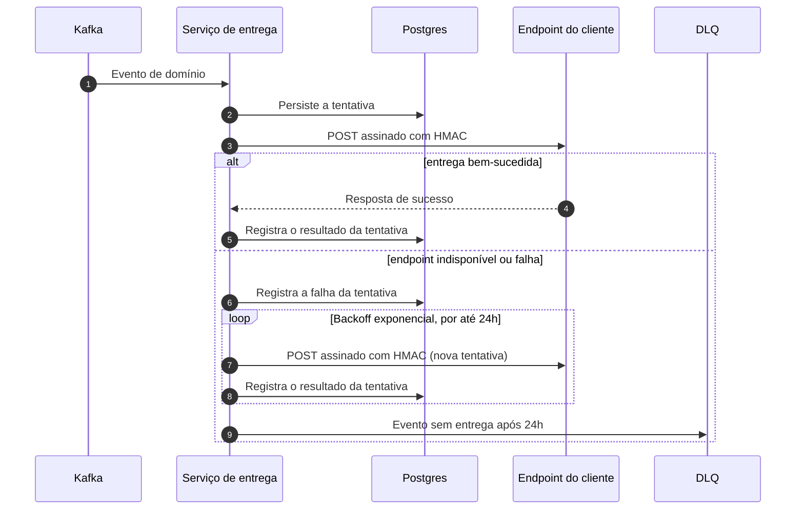

# Serviço de webhooks de saída

| | |
|---|---|
| **Estado** | Rascunho |
| **Título** | Serviço de webhooks de saída |
| **Autores** | A confirmar |
| **Revisores** | A confirmar |
| **Criado em** | 2026-11-20 |
| **Última atualização** | 2026-11-20 |

## Glossário

- **DLQ (dead-letter queue)**: destino dos eventos cuja entrega esgotou todas as tentativas.
- **HMAC**: assinatura calculada sobre o payload com um segredo, para o cliente verificar a origem da requisição.
- **Backoff exponencial**: intervalo entre tentativas que cresce a cada falha.

## Visão geral

Hoje cada serviço que precisa avisar um cliente externo faz o POST por conta própria, sem retry e sem log central. Este documento propõe um serviço único de entrega de webhooks de saída: ele consome os eventos de domínio já publicados no Kafka, registra cada tentativa e reenvia as que falham, para que nenhum evento se perca quando o endpoint do cliente está fora do ar.

## Contexto

- Cada serviço que precisa notificar um cliente externo faz o POST diretamente, "na mão".
- Não há retry: quando o endpoint do cliente cai, o evento se perde.
- Não há log central das entregas: a equipe só descobre a perda quando o suporte avisa.
- Os eventos de domínio já circulam no Kafka.

## Objetivos e fora de escopo

**Objetivos**

- Nenhum evento perdido por indisponibilidade do endpoint do cliente.
- Visibilidade de cada tentativa de entrega.

**Fora de escopo**: a definir (ver Questões em aberto).

## O design

### Visão geral da solução

Um serviço único de entrega consome os eventos de domínio do Kafka e, para cada um, persiste a tentativa no Postgres e faz o POST assinado com HMAC no endpoint do cliente. Se a entrega falha, o serviço reenvia com backoff exponencial por até 24 horas; passado esse prazo, o evento vai para a DLQ. O custo principal é que a entrega deixa de ser imediata em alguns casos, porque passa pela fila.

### Arquitetura


> Imagem a renderizar na passada manual a partir do DSL abaixo.

<details>
<summary>Código-fonte do diagrama (Structurizr DSL)</summary>

```
workspace "Serviço de webhooks de saída" "Entrega única, com retry e registro central, de webhooks para clientes externos." {

    !identifiers hierarchical

    model {
        kafka = softwareSystem "Kafka de eventos de domínio" "Publica os eventos de domínio que já existem hoje." "Existing"
        cliente = softwareSystem "Endpoint do cliente" "Sistema externo que recebe os webhooks." "External"

        webhooks = softwareSystem "Serviço de webhooks de saída" "Entrega webhooks aos clientes externos, com retry e registro de cada tentativa." {
            entrega = container "Serviço de entrega" "Consome eventos, assina e envia o POST, reenvia com backoff exponencial por até 24h."
            db = container "Banco de tentativas" "Persiste cada tentativa de entrega." "PostgreSQL" "Database"
            dlq = container "DLQ" "Recebe os eventos que esgotaram as tentativas." "" "Queue"
        }

        kafka -> webhooks.entrega "Entrega eventos de domínio a"
        webhooks.entrega -> webhooks.db "Persiste tentativas em"
        webhooks.entrega -> cliente "Envia POST assinado com HMAC a"
        webhooks.entrega -> webhooks.dlq "Envia eventos sem entrega após 24h para"
    }

    views {
        container webhooks "Containers" "Arquitetura do serviço de webhooks de saída." {
            include *
            autoLayout lr
        }

        styles {
            element "Database" {
                shape Cylinder
            }
            element "Queue" {
                shape Pipe
            }
            element "External" {
                background #999999
                color #ffffff
            }
        }
    }
}
```

</details>

O serviço de entrega recebe os eventos de domínio do Kafka (que já existe), grava cada tentativa no banco Postgres, faz o POST assinado com HMAC no endpoint do cliente (sistema externo) e, depois de 24 horas de tentativas sem sucesso, envia o evento para a DLQ. A tecnologia da DLQ e a do próprio serviço de entrega não foram definidas e ficam como questões em aberto.

### Fluxo de entrega com retry



O serviço lê o evento do Kafka, persiste a tentativa e envia o POST assinado. Se o cliente responde com sucesso, o resultado é registrado. Se o endpoint está indisponível, a falha é registrada e o serviço repete o envio com backoff exponencial por até 24 horas, registrando cada tentativa. Esgotado o prazo sem sucesso, o evento vai para a DLQ. O diagrama mostra o caminho completo descrito pela equipe; o que conta como falha e o intervalo exato entre tentativas estão em Questões em aberto.

## Trade-offs da solução escolhida

- ✓ Nenhum evento se perde por indisponibilidade do endpoint do cliente: o serviço reenvia por até 24 horas e, depois disso, o evento vai para a DLQ.
- ✓ Cada tentativa fica persistida no Postgres, o que dá visibilidade que hoje não existe.
- ✓ O payload não sai da borda da empresa, ao contrário do que ocorreria com um SaaS de webhooks.
- ✓ Sem custo por evento cobrado por terceiro.
- ✗ **Custo aceito**: a entrega deixa de ser imediata em alguns casos, porque o evento passa pela fila antes de chegar ao cliente.

## Alternativas consideradas

| Alternativa | Resultado | Motivo |
|---|---|---|
| Não fazer nada (cada serviço continua fazendo o POST) | ✗ Descartada | Sem retry, o evento se perde quando o endpoint do cliente cai; sem log central, a equipe só descobre pelo suporte. |
| SaaS de webhooks | ✗ Descartada | Custo por evento e o payload sairia da nossa borda. |
| **Serviço único de entrega (proposta)** | ✓ Escolhida | Atende aos dois objetivos, ao custo de a entrega deixar de ser imediata em alguns casos. |

## Questões em aberto

- Quem são os autores e os revisores deste documento, e quais áreas devem revisá-lo?
- Qual é a meta mensurável de sucesso (por exemplo, percentual de eventos entregues, tempo máximo até a primeira tentativa)?
- O que fica deliberadamente fora de escopo nesta primeira versão?
- Qual é o intervalo entre tentativas do backoff (início, fator, teto)?
- O que conta como falha de entrega (resposta fora da faixa de sucesso, timeout, erro de conexão)?
- Qual é a tecnologia da DLQ e o que acontece com os eventos que chegam a ela (alerta, reprocessamento, quem atua)?
- Em que tecnologia o serviço de entrega será implementado?
- De onde vem o segredo HMAC de cada cliente e como é gerenciado?
- O Kafka de eventos de domínio pertence à equipe que escreve este documento ou a outra?
- Como será a migração dos serviços que hoje fazem o POST por conta própria?
- Como a visibilidade das tentativas será consumida (consulta, painel, alerta) e quem são os consumidores?
