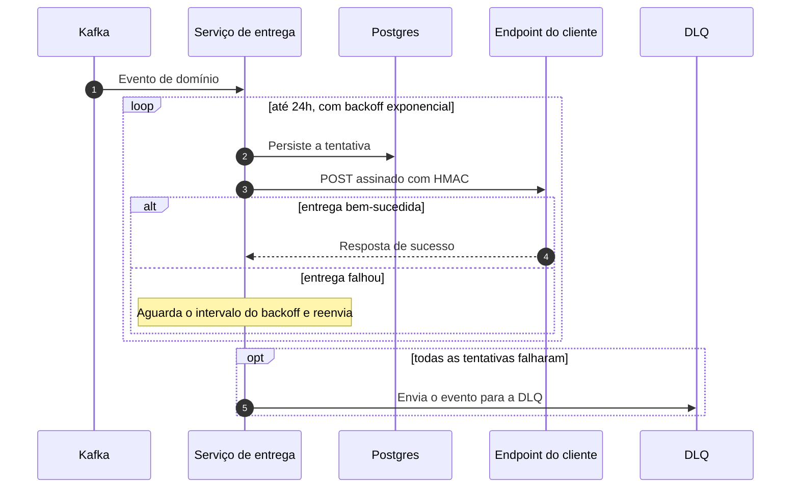

# Serviço de entrega de webhooks de saída

| | |
|---|---|
| **Documento** | DESIGN-DOC |
| **Estado** | Rascunho |
| **Título** | Serviço de entrega de webhooks de saída |
| **Criado em** | 2026-11-20 |
| **Última atualização** | 2026-11-20 |
| **Tags** | webhooks, entrega, kafka, retry |

## Glossário

- **DLQ (dead-letter queue)**: destino para onde vão os eventos que esgotaram todas as tentativas de entrega.
- **HMAC**: assinatura calculada sobre o corpo da requisição com um segredo compartilhado; permite ao cliente verificar a origem e a integridade do webhook.
- **Backoff exponencial**: política de reenvio em que o intervalo entre tentativas cresce a cada falha.

## Visão geral

Hoje cada serviço que precisa avisar um cliente externo faz o POST por conta própria, sem retry e sem log central. Este documento propõe um serviço único de entrega de webhooks de saída, que consome os eventos de domínio já publicados no Kafka, registra cada tentativa e reenvia com backoff exponencial quando o endpoint do cliente não responde.

## Contexto

- Cada serviço que precisa notificar um cliente externo envia o POST diretamente.
- Não há retry nem registro central das entregas.
- Quando o endpoint do cliente fica indisponível, o evento se perde. A equipe só descobre o problema por meio do suporte.
- Os eventos de domínio já circulam no Kafka.

## Objetivos e fora de escopo

**Objetivos**

1. Nenhum evento perdido por indisponibilidade do endpoint do cliente.
2. Visibilidade de cada tentativa de entrega.

**Fora de escopo**

- Ainda não definido. Ver Questões em aberto.

## Design

### Visão geral da solução

Um serviço único de entrega consome os eventos de domínio do Kafka e, para cada evento a notificar, persiste a tentativa no Postgres e faz o POST assinado com HMAC no endpoint do cliente. Se a entrega falhar, o serviço reenvia com backoff exponencial por até 24 horas. Esgotado esse prazo, o evento vai para a DLQ.

O trade-off central: a entrega deixa de ser imediata em alguns casos, porque o evento passa pela fila antes de chegar ao cliente. Em troca, nenhum evento se perde por indisponibilidade do cliente e cada tentativa fica registrada.

### Arquitetura


> Imagem a renderizar na passada manual a partir do DSL abaixo.

<details>
<summary>Fonte do diagrama (Structurizr DSL)</summary>

```
workspace {
    !identifiers hierarchical

    model {
        cliente = softwareSystem "Endpoint do cliente" "Sistema externo que recebe os webhooks." "External"
        servicos = softwareSystem "Serviços de domínio" "Serviços que publicam eventos de domínio." "Existing"

        entrega = softwareSystem "Entrega de webhooks" "Entrega eventos de domínio a clientes externos com registro de tentativas e reenvio." {
            kafka = container "Eventos de domínio" "Eventos publicados pelos serviços de domínio." "Kafka" "Queue"
            servico = container "Serviço de entrega" "Consome eventos, registra cada tentativa, assina e envia o POST, reenvia com backoff exponencial."
            db = container "Registro de tentativas" "Guarda cada tentativa de entrega." "Postgres" "Database"
            dlq = container "DLQ" "Recebe eventos que esgotaram as tentativas." "" "Queue"
        }

        servicos -> entrega.kafka "Publica eventos de domínio em"
        entrega.servico -> entrega.kafka "Consome eventos de"
        entrega.servico -> entrega.db "Persiste tentativas em"
        entrega.servico -> cliente "Envia POST assinado com HMAC para"
        entrega.servico -> entrega.dlq "Envia eventos esgotados para"
    }

    views {
        container entrega "Containers" {
            include *
            autoLayout lr
        }

        styles {
            element "Database" {
                shape Cylinder
            }
            element "Queue" {
                shape Pipe
            }
            element "External" {
                background #999999
            }
        }
    }
}
```

</details>

O fluxo é este. Os serviços de domínio publicam eventos no Kafka, como já fazem hoje. O serviço de entrega consome esses eventos e grava cada tentativa no Postgres. Em seguida envia o POST assinado com HMAC ao endpoint do cliente. Se a entrega falhar, o serviço reenvia com backoff exponencial por até 24 horas e, depois disso, manda o evento para a DLQ. O cliente externo é o único elemento fora da nossa borda.

### Fluxo de entrega com retry



O serviço recebe o evento (1) e, a cada tentativa, persiste o registro (2) antes de enviar o POST assinado (3). Em caso de sucesso, a entrega termina. Em caso de falha, o serviço espera o intervalo do backoff e tenta de novo. Passadas 24 horas sem sucesso, o evento é enviado para a DLQ. Os critérios que definem "falha" e o ponto exato do registro do resultado estão nas questões em aberto.

## Trade-offs da solução escolhida

- ✓ Nenhum evento se perde por indisponibilidade do endpoint do cliente: o reenvio dura até 24 horas e o que sobra vai para a DLQ.
- ✓ Cada tentativa fica registrada em um só lugar, o que dá visibilidade sem depender do suporte.
- ✓ O payload não sai da nossa borda para um terceiro.
- ✗ A entrega deixa de ser imediata em alguns casos, porque passa pela fila. Esse custo foi aceito pela equipe.
- ✗ Passa a existir um serviço novo para operar, além do Postgres e da DLQ que ele usa.

## Alternativas consideradas

| Alternativa | Resultado | Motivo |
|---|---|---|
| Não fazer nada | ✗ Descartada | Cada serviço continua enviando o POST sem retry e sem log central. Quando o endpoint do cliente cai, o evento se perde e a equipe só descobre pelo suporte. |
| SaaS de webhooks | ✗ Descartada | Custo por evento, e o payload sairia da nossa borda. |
| **Serviço único de entrega (escolhida)** | ✓ | Atende aos dois objetivos mantendo o payload dentro da nossa borda. |

## Questões em aberto

- Quais respostas e erros do endpoint do cliente contam como falha e disparam o reenvio?
- Quais são os intervalos do backoff (primeiro intervalo, fator, teto)?
- O que é a DLQ (tecnologia) e quem a consome ou reprocessa?
- Como o reenvio é agendado entre uma tentativa e outra?
- Onde ficam o endpoint e o segredo HMAC de cada cliente, e quem os gerencia?
- Como e onde a equipe consulta o histórico de tentativas?
- Qual meta mensurável confirma que o objetivo foi atingido, e o que fica explicitamente fora de escopo?
- Quais equipes são impactadas e devem revisar este documento?
