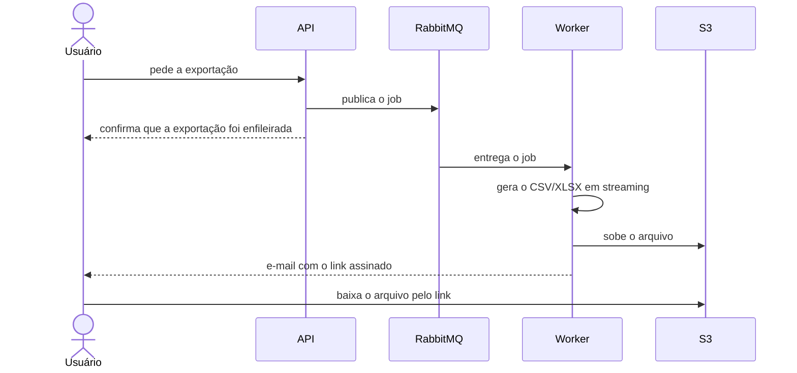

# Exportação de relatórios em background

| | |
|---|---|
| **Documento** | DESIGN-DOC |
| **Estado** | Rascunho |
| **Título** | Exportação de relatórios em background |
| **Autores** | A preencher |
| **Revisores** | Plataforma (dona da fila compartilhada), Segurança (link assinado com PII) |
| **Criado em** | 2026-11-22 |
| **Última atualização** | 2026-11-22 |
| **Tags** | exportação, relatórios, fila, worker |

## Glossário

- **Job**: uma solicitação de exportação enfileirada, com os parâmetros do relatório.
- **Worker**: processo separado da API que consome jobs da fila e gera o arquivo.
- **Streaming**: gerar o arquivo escrevendo linha a linha, sem carregar o relatório inteiro em memória.
- **Link assinado**: URL de download com assinatura, que o usuário recebe por e-mail.
- **PII**: dados pessoais que identificam uma pessoa.

## Visão geral

Hoje a API gera os relatórios exportados dentro da própria request, e as exportações grandes estouram o timeout do gateway. Este documento propõe tirar a geração da request: a API enfileira um job, um worker gera o arquivo em streaming, sobe para o S3 e avisa o usuário por e-mail com um link assinado.

## Contexto

- A API gera o CSV/XLSX de forma síncrona, na request que o usuário fez.
- O gateway corta requests em 30 segundos.
- Cerca de 12% das exportações acima de 50 mil linhas falham por esse timeout.
- O suporte abre ticket por causa disso toda semana.
- A infraestrutura já tem RabbitMQ, e a fila é compartilhada com o time de Plataforma.

## Objetivos e fora de escopo

### Objetivos

1. Zerar os timeouts de exportação.
2. Suportar exportações de até 100 mil linhas.
3. Manter um único caminho de exportação: toda exportação passa pelo job assíncrono, inclusive as pequenas.

### Fora de escopo

A conversa não definiu itens fora de escopo. Veja as [questões em aberto](#questões-em-aberto).

## O design

### Visão da solução

A API deixa de gerar o arquivo. Ao receber um pedido de exportação, ela publica um job no RabbitMQ e responde ao usuário sem esperar o resultado. Um worker, executado como processo separado da API, consome o job, lê os dados do relatório e escreve o CSV ou XLSX em streaming. O worker sobe o arquivo para o S3 e envia ao usuário um e-mail com um link assinado para baixá-lo.

O usuário perde o download imediato. Em troca, a geração deixa de depender do limite de 30 segundos do gateway.

### Fluxo

A API só enfileira o job, então a resposta ao usuário não depende do tamanho do relatório. O worker gera o arquivo fora da request e avisa o usuário por e-mail. O link assinado aponta para o arquivo no S3.

### Um caminho só

Exportações pequenas, que hoje funcionam na hora, também viram assíncronas. O time quer um caminho só para todas as exportações.

## Trade-offs da solução escolhida

- ✓ O timeout de 30 segundos do gateway deixa de limitar a geração do arquivo.
- ✓ A geração em streaming evita manter o relatório inteiro em memória, o que sustenta o objetivo de 100 mil linhas.
- ✓ Um único caminho de exportação, sem lógica de decisão entre síncrono e assíncrono.
- ✓ Aproveita o RabbitMQ que a infraestrutura já tem.
- ✗ O usuário perde o download imediato, inclusive nas exportações pequenas que hoje respondem na hora.
- ✗ A entrega depende de um e-mail, e o usuário precisa abri-lo para baixar o arquivo.
- ✗ O desenho adiciona um processo (o worker) para operar e uma carga nova na fila compartilhada.
- ✗ Um arquivo com PII passa a ficar armazenado no S3 e acessível por link.

## Alternativas consideradas

| Alternativa | Resultado | Motivo |
|---|---|---|
| Não fazer nada | ✗ Descartada | 12% das exportações acima de 50 mil linhas falham e o suporte abre ticket toda semana. |
| Geração síncrona com timeout maior | ✗ Descartada | Só empurra o problema. |
| Ferramenta de BI externa | ✗ Descartada | Custo e exposição de dado de cliente. |
| Job em worker, arquivo no S3, link por e-mail | ✓ Escolhida | Ver [trade-offs](#trade-offs-da-solução-escolhida). |

## Preocupações transversais

### Plataforma

Os jobs de exportação entram na fila RabbitMQ compartilhada, então o design adiciona carga a um sistema que o time de Plataforma mantém. Veja as questões em aberto sobre volume.

### Segurança e privacidade

O arquivo exportado contém PII e fica acessível por um link assinado enviado por e-mail. O time de Segurança revisa esse desenho. Veja as questões em aberto sobre validade do link e retenção do arquivo.

## Questões em aberto

1. Quem são os autores e os nomes dos revisores de Plataforma e Segurança?
2. O que está fora de escopo nesta primeira versão (por exemplo, outros formatos, agendamento de exportações, exportações acima de 100 mil linhas)?
3. Qual a validade do link assinado e por quanto tempo o arquivo fica no S3?
4. O que acontece quando um job falha (retentativas, fila de mensagens mortas, aviso ao usuário)?
5. Qual o volume esperado de exportações por dia, e o que a Plataforma precisa para aceitar essa carga na fila compartilhada?
6. Como o usuário acompanha uma exportação em andamento, ou o e-mail é o único retorno?
7. Que métricas e alertas indicam que o objetivo de zero timeouts foi atingido?
8. O que o time de Segurança exige sobre o envio de link com PII por e-mail?
9. O lançamento acontece de uma vez ou por etapas, e existe plano de rollback?
