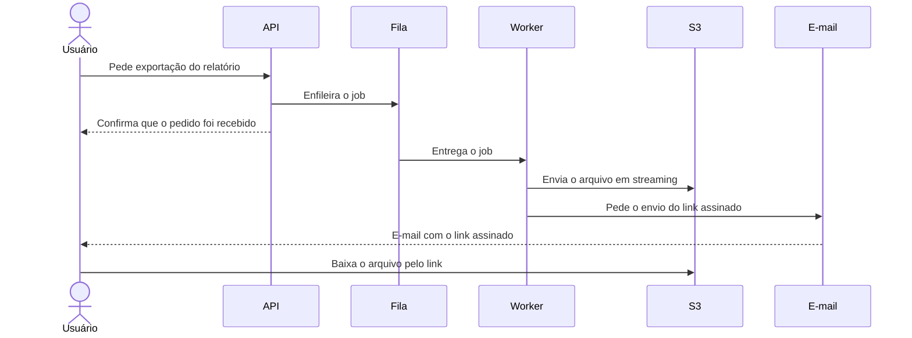

# Serviço de exportação de relatórios em background

| | |
|---|---|
| **Documento** | DESIGN-DOC |
| **Estado** | Rascunho |
| **Título** | Serviço de exportação de relatórios em background |
| **Autores** | cassiobotaro |
| **Revisores** | Plataforma (fila compartilhada), Segurança (link assinado com PII) |
| **Criado em** | 2026-11-22 |
| **Última atualização** | 2026-11-22 |
| **Tags** | exportação, relatórios, fila, worker, s3 |

## Glossário

| Termo | Definição |
|---|---|
| PII | Dados pessoais identificáveis presentes nas linhas dos relatórios. |
| Link assinado | URL temporária de download de um objeto no S3, com assinatura que dispensa credenciais de quem baixa. |
| Streaming | Gerar o arquivo e enviá-lo ao S3 em partes, sem manter o relatório inteiro em memória. |
| Gateway | Camada na frente da API que encerra a request após 30 segundos. |
| Job | Pedido de exportação enfileirado, que o worker consome e processa. |

## Visão geral

Hoje a API gera os relatórios dentro da própria request, e as exportações grandes estouram o timeout de 30s do gateway. Este documento propõe tirar a geração da request: a API enfileira um job, um worker separado gera o arquivo (CSV ou XLSX) em streaming, sobe para o S3 e avisa o usuário por e-mail com um link assinado.

O custo aceito é que o usuário perde o download imediato. Toda exportação, inclusive as pequenas que funcionam na hora hoje, passa a ser assíncrona.

## Contexto

- A API gera o relatório de forma síncrona, na request que o usuário faz.
- O gateway encerra requests acima de 30s. Cerca de 12% das exportações com mais de 50 mil linhas falham por esse timeout.
- O suporte abre ticket por causa dessas falhas toda semana.
- A infraestrutura já tem RabbitMQ, e a fila é compartilhada com outros times.
- Os relatórios contêm PII.

## Objetivos e fora de escopo

### Objetivos

1. Zerar os timeouts de exportação (hoje, cerca de 12% das exportações acima de 50 mil linhas falham).
2. Exportar relatórios de até 100 mil linhas com sucesso.
3. Manter um único caminho de exportação, sem diferença entre pequenas e grandes.

### Fora de escopo

O que fica fora do escopo ainda precisa ser definido (ver [Questões em aberto](#questões-em-aberto)).

## O design

### Visão da solução

Quatro peças participam da exportação:

- API: recebe o pedido de exportação e enfileira o job. Deixa de gerar o arquivo.
- Fila (RabbitMQ): guarda os jobs até um worker consumi-los. É a fila compartilhada que já existe na infraestrutura.
- Worker: processo separado da API. Consome o job, gera o CSV ou XLSX em streaming e sobe o arquivo para o S3.
- S3: armazena o arquivo gerado. O link assinado aponta para ele.

Quando o arquivo está no S3, o usuário recebe um e-mail com o link assinado.


> A imagem renderizada ainda não existe. Renderizar a partir do DSL abaixo na passada manual.

<details>
<summary>Código do diagrama (Structurizr DSL)</summary>

```
workspace {
    model {
        usuario = person "Usuário" "Pede a exportação de um relatório e recebe o link por e-mail."

        sistema = softwareSystem "Exportação de relatórios" {
            api = container "API" "Recebe o pedido de exportação e enfileira o job."
            fila = container "Fila de jobs" "Guarda os jobs de exportação até o worker consumir. RabbitMQ compartilhado com outros times."
            worker = container "Worker de exportação" "Consome jobs, gera CSV/XLSX em streaming e envia o arquivo ao S3."
            armazenamento = container "Armazenamento de arquivos" "Guarda os arquivos exportados. S3."
        }

        email = softwareSystem "Envio de e-mail" "Entrega o e-mail com o link assinado." "External"

        usuario -> api "Pede a exportação"
        api -> fila "Enfileira o job"
        worker -> fila "Consome o job"
        worker -> armazenamento "Envia o arquivo em streaming"
        worker -> email "Pede o envio do link assinado"
        email -> usuario "Entrega o e-mail com o link"
        usuario -> armazenamento "Baixa o arquivo pelo link assinado"
    }

    views {
        container sistema "Containers" {
            include *
            autoLayout
        }
    }
}
```

</details>

O usuário fala só com a API. A API publica o job na fila e não espera o resultado. O worker consome o job, escreve o arquivo no S3 enquanto o gera e, ao terminar, aciona o envio do e-mail. O usuário baixa o arquivo direto do S3 pelo link assinado, sem passar pela API. Quem envia o e-mail e com qual tecnologia ainda não está definido (ver [Questões em aberto](#questões-em-aberto)).

### Fluxo de uma exportação



A confirmação ao usuário acontece logo depois do enfileiramento, então a request da API não depende mais do tamanho do relatório. O trabalho pesado (consulta, geração do arquivo e upload) acontece no worker, fora do limite de 30s do gateway.

### Dados e sensibilidade

Os arquivos exportados contêm PII. O arquivo no S3 e o link assinado que dá acesso a ele passam a ser uma superfície nova de exposição de dado de cliente. Os controles sobre esse link estão em [Segurança](#segurança) e em [Questões em aberto](#questões-em-aberto).

## Trade-offs da solução escolhida

- ✓ Elimina o timeout de 30s das exportações, porque a geração sai da request. É a causa dos cerca de 12% de falhas acima de 50 mil linhas e dos tickets semanais do suporte.
- ✓ Reaproveita o RabbitMQ que já existe, sem introduzir uma tecnologia de fila nova.
- ✓ O streaming permite gerar relatórios de 100 mil linhas sem montar o arquivo inteiro na request.
- ✓ Um único caminho de exportação, sem manter um fluxo síncrono e outro assíncrono.
- ✗ O usuário perde o download imediato. A exportação pequena que hoje funciona na hora passa a esperar o e-mail. O time aceitou esse custo em troca do caminho único.
- ✗ Passa a existir um link assinado que dá acesso a arquivos com PII. Isso cria uma superfície que a segurança precisa avaliar.
- ✗ Os jobs entram em uma fila compartilhada, então a carga das exportações passa a competir com a dos outros times (ver [Infraestrutura](#infraestrutura)).
- ✗ Há mais peças em produção (worker, bucket, envio de e-mail) para operar e monitorar.

## Alternativas consideradas

| Alternativa | Resultado | Motivo |
|---|---|---|
| Não fazer nada | ✗ Descartada | As exportações acima de 50 mil linhas continuam falhando em cerca de 12% dos casos, e o suporte continua abrindo ticket toda semana. |
| Gerar síncrono com timeout maior | ✗ Descartada | Só empurra o problema para um volume maior de linhas, sem resolvê-lo. |
| Ferramenta de BI externa | ✗ Descartada | Custo e exposição de dado de cliente a um terceiro. |
| **Job em fila, worker em streaming, S3 e link por e-mail** | ✓ Escolhida | Resolve o timeout na causa, reaproveita o RabbitMQ e mantém um caminho só. Custa o download imediato. |

## Preocupações transversais

### Infraestrutura

Os jobs de exportação entram na fila RabbitMQ compartilhada. Plataforma precisa avaliar o impacto da carga dos jobs nos outros consumidores da fila e se as exportações pedem isolamento ou limites próprios (ver [Questões em aberto](#questões-em-aberto)).

### Segurança

O e-mail carrega um link assinado para um arquivo com PII. Segurança precisa avaliar esse link e os controles em volta dele: validade, retenção do arquivo no S3 e o que o e-mail revela (ver [Questões em aberto](#questões-em-aberto)).

## Testabilidade e observabilidade

As duas métricas que provam os objetivos são:

- a taxa de timeout nas exportações, que deve chegar a zero;
- o sucesso de exportações de até 100 mil linhas.

Quais testes rodam antes do lançamento, quais alertas ficam ativos e como medir essas duas métricas ainda precisam ser definidos (ver [Questões em aberto](#questões-em-aberto)).

## Questões em aberto

Escopo e produto:

- O que fica explicitamente fora de escopo nesta entrega?
- Como o usuário vê o estado do pedido entre o clique e o e-mail?

Segurança (com o time de Segurança):

- Qual a validade do link assinado?
- Por quanto tempo o arquivo fica no S3 e quem o remove?
- Quem pode pedir uma exportação, e o link pode ser baixado por outra pessoa além do solicitante?

Infraestrutura (com o time de Plataforma):

- O job usa uma fila ou exchange própria dentro do RabbitMQ compartilhado, ou a mesma dos outros times?
- Existe um limite de jobs simultâneos por usuário ou por cliente?

Confiabilidade:

- O que acontece quando o worker falha no meio de uma exportação? Há retentativa? Quantas?
- O usuário é avisado quando o job falha?
- O que acontece se o mesmo pedido for enviado duas vezes?

Operação:

- Qual serviço envia o e-mail?
- Qual a estratégia de entrega (tudo de uma vez ou em etapas) e de rollback?
- Quais testes, métricas e alertas cobrem os objetivos?
- Quem são os revisores nomeados em cada time?
