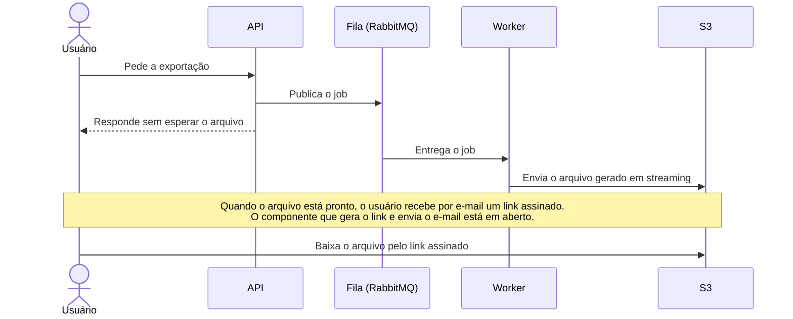

# Exportação de relatórios em background

| | |
|---|---|
| **Estado** | Rascunho |
| **Título** | Exportação de relatórios em background |
| **Autores** | A preencher |
| **Revisores** | A preencher (Plataforma, Segurança) |
| **Criado em** | 2026-11-22 |
| **Última atualização** | 2026-11-22 |
| **Tags** | exportação, relatórios, fila, RabbitMQ, S3 |

## Glossário

- **PII**: dado pessoal identificável. Os relatórios exportados contêm esse tipo de dado.
- **Link assinado**: URL temporária que dá acesso a um arquivo privado no S3 sem exigir que quem baixa tenha credenciais de acesso ao armazenamento.
- **Streaming**: geração do arquivo em partes, em vez de montá-lo inteiro de uma vez.

## Visão geral

Hoje a API gera os relatórios dentro da própria request, e as exportações grandes estouram o timeout de 30s do gateway. Este documento propõe que a API apenas enfileire um job de exportação, que um worker separado gere o arquivo em streaming e o envie ao S3, e que o usuário receba por e-mail um link assinado quando o arquivo ficar pronto.

O custo da proposta é que toda exportação passa a ser assíncrona, inclusive as pequenas que hoje baixam na hora.

## Contexto

- A API gera o relatório (CSV ou XLSX) na mesma request que o usuário fez.
- O gateway corta a request em 30s. Cerca de 12% das exportações acima de 50 mil linhas falham por esse motivo.
- O suporte abre ticket por causa dessas falhas toda semana.
- A infraestrutura já tem RabbitMQ. A fila seria compartilhada com outros usos, o que envolve o time de Plataforma.
- Os relatórios contêm PII, o que envolve o time de Segurança.

## Objetivos e fora de escopo

Objetivos:

- Zerar os timeouts de exportação. Hoje 12% das exportações acima de 50 mil linhas falham.
- Suportar exportações de até 100 mil linhas, gerando o arquivo em streaming.

Fora de escopo:

- Manter o download imediato para exportações pequenas. O time decidiu ter um único caminho, assíncrono, para qualquer tamanho.

## Solução

### Visão geral da solução

Quatro peças trabalham juntas:

1. A **API** recebe o pedido de exportação, publica um job na fila e responde sem esperar a geração do arquivo.
2. A **fila** (RabbitMQ) guarda os jobs até um worker pegá-los.
3. O **worker de exportação**, um processo separado da API, consome o job, gera o CSV ou XLSX em streaming e envia o arquivo ao S3.
4. O **S3** guarda o arquivo gerado. Quando o arquivo está pronto, o usuário recebe por e-mail um link assinado para baixá-lo.

Como a request da API deixa de depender do tempo de geração, o timeout de 30s do gateway deixa de se aplicar à exportação. O preço é o usuário esperar o e-mail em vez de baixar na hora.


> A imagem renderizada ainda não existe. Renderizar a partir do DSL abaixo na passada manual.

<details>
<summary>Código do diagrama (Structurizr DSL)</summary>

```
workspace {
    model {
        usuario = person "Usuário" "Pede a exportação e recebe o link por e-mail."

        exportacao = softwareSystem "Exportação de relatórios" {
            api = container "API" "Recebe o pedido e enfileira o job de exportação."
            fila = container "Fila de exportação" "Guarda os jobs até um worker pegá-los." "RabbitMQ"
            worker = container "Worker de exportação" "Gera o CSV ou XLSX em streaming e envia ao S3."
            armazenamento = container "Armazenamento de relatórios" "Guarda os arquivos gerados." "S3"
        }

        usuario -> api "Pede a exportação"
        api -> fila "Publica o job"
        worker -> fila "Consome o job"
        worker -> armazenamento "Envia o arquivo"
        usuario -> armazenamento "Baixa o arquivo pelo link assinado"
    }

    views {
        container exportacao "containers" {
            include *
            autolayout lr
        }
    }
}
```

</details>

A API só publica o job e responde. O worker consome da fila, gera o arquivo e o envia ao S3. O usuário baixa o arquivo direto do S3 pelo link assinado. O diagrama omite de propósito a origem dos dados do relatório e o componente que envia o e-mail, porque a definição de ambos ainda está em aberto (ver Perguntas em aberto).

### Fluxo de uma exportação



A request do usuário termina logo depois da publicação do job. A geração acontece fora dela, no worker, e só o e-mail avisa o usuário de que o arquivo está pronto.

## Trade-offs da solução escolhida

- ✓ Nenhuma exportação depende mais do timeout de 30s do gateway, que é a causa das falhas e dos tickets semanais.
- ✓ Um único caminho de exportação, assíncrono, para qualquer tamanho de relatório.
- ✓ O worker separado, com geração em streaming, é o mecanismo escolhido para chegar às 100 mil linhas.
- ✓ A fila reaproveita o RabbitMQ que a infraestrutura já tem.
- ✗ O usuário perde o download imediato. Uma exportação pequena, que hoje funciona na hora, passa a esperar o e-mail.
- ✗ O S3 passa a guardar arquivos com PII e o usuário os baixa por link assinado, o que cria uma superfície nova para o time de Segurança avaliar.
- ✗ A fila passa a ser compartilhada, o que exige alinhamento com o time de Plataforma.
- ✗ O time passa a operar duas peças novas: o worker e a fila usada para esse fim.

## Alternativas consideradas

| Alternativa | Resultado | Motivo |
|---|---|---|
| Não fazer nada | ✗ Descartada | Cerca de 12% das exportações acima de 50 mil linhas continuam falhando e o suporte continua abrindo ticket toda semana. |
| Gerar de forma síncrona com timeout maior | ✗ Descartada | Só empurra o problema para frente. |
| Usar uma ferramenta de BI externa | ✗ Descartada | Tem custo e expõe dados de clientes. |
| **Worker em background com fila, S3 e link por e-mail** | ✓ Escolhida | Elimina a dependência do timeout do gateway ao custo do download imediato. |

## Preocupações transversais

### Plataforma

A fila de exportação é compartilhada com outros usos. O time de Plataforma precisa avaliar o efeito dos jobs de exportação sobre a fila e sobre os demais consumidores.

### Segurança e privacidade

Os arquivos exportados contêm PII e ficam acessíveis por link assinado. O time de Segurança precisa avaliar esse link, incluindo quem pode usá-lo e por quanto tempo. Os valores de validade e de retenção ainda não estão definidos (ver Perguntas em aberto).

## Perguntas em aberto

- Qual a validade do link assinado e por quanto tempo o arquivo fica no S3?
- Qual componente gera o link assinado e qual envia o e-mail? Existe hoje um serviço de e-mail que o projeto possa usar?
- De onde o worker lê os dados do relatório? É o mesmo caminho que a API usa hoje?
- O S3 usado é um bucket novo ou já existente? Quem é dono dele e da política de acesso?
- O que acontece com um job que falha? Existe nova tentativa, e o usuário recebe aviso?
- O usuário vê o estado da exportação em algum lugar além do e-mail?
- Como a fila compartilhada isola as exportações dos outros consumidores (fila dedicada, prioridade, limite de concorrência)?
- Como o rollout acontece: troca direta ou por etapas, e como reverter se algo der errado?
- Quais métricas e alertas mostram que o objetivo de zero timeouts foi atingido?
- Quem são os autores e os revisores de Plataforma e de Segurança?
