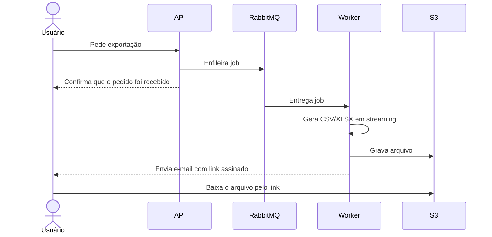

# Exportação de relatórios em background

| | |
|---|---|
| **Estado** | Rascunho |
| **Título** | Exportação de relatórios em background |
| **Autores** | cassiobotaro |
| **Revisores** | Plataforma (dono da fila compartilhada), Segurança (link assinado com PII) |
| **Criado em** | 2026-11-22 |
| **Última atualização** | 2026-11-22 |
| **Tags** | exportação, relatórios, fila, worker |

## Glossário

- **Job**: pedido de exportação enfileirado, que o worker processa de forma independente da request que o criou.
- **Worker**: processo separado da API que consome jobs da fila e gera o arquivo.
- **Streaming**: o worker lê as linhas e escreve o arquivo aos poucos, sem montar o relatório inteiro em memória.
- **Link assinado**: URL temporária do S3 que dá acesso a um objeto sem exigir credenciais.
- **PII**: dado pessoal que identifica uma pessoa.
- **Gateway**: camada na frente da API que encerra requests acima de 30 segundos.

## Visão geral

Hoje a API gera os relatórios dentro da própria request, e as exportações grandes estouram o timeout de 30 segundos do gateway. Este documento propõe que a API apenas enfileire um job, que um worker separado gere o CSV ou XLSX em streaming, grave o arquivo no S3 e avise o usuário por e-mail com um link assinado.

## Contexto

- A API gera o relatório de forma síncrona, dentro da request.
- O gateway encerra requests que passam de 30 segundos.
- Cerca de 12% das exportações acima de 50 mil linhas falham por esse timeout.
- O suporte abre tickets por causa dessas falhas toda semana.
- A infraestrutura já tem RabbitMQ, e a fila é compartilhada com o time de Plataforma.

## Objetivos e fora de escopo

### Objetivos

- Zerar os timeouts de exportação (hoje, ~12% de falha acima de 50 mil linhas).
- Suportar exportações de até 100 mil linhas.
- Manter um único caminho de exportação: toda exportação, de qualquer tamanho, passa pelo job em background.

### Fora de escopo

- Download imediato para exportações pequenas. Hoje elas funcionam na hora, e o design abre mão disso de propósito (ver [Trade-offs](#trade-offs-da-solução-escolhida)).

## O design

### Visão geral da solução

A solução tem três partes:

1. **API.** Ao receber um pedido de exportação, a API enfileira um job no RabbitMQ e responde sem gerar o relatório. Isso tira a geração da request e, com ela, o limite de 30 segundos do gateway.
2. **Worker.** Um processo separado consome os jobs da fila, gera o CSV ou XLSX em streaming e sobe o arquivo para o S3. O streaming evita carregar o relatório inteiro em memória, o que importa para chegar a 100 mil linhas.
3. **Notificação.** Quando o arquivo está no S3, o usuário recebe um e-mail com um link assinado para baixá-lo.

O trade-off central é trocar o download imediato pela geração fora da request. Todas as exportações passam a esperar o e-mail, inclusive as pequenas, em troca de manter um único caminho.

### Fluxo

A API só valida e enfileira, então a resposta ao usuário não depende do tamanho do relatório. O worker faz o trabalho pesado fora da request e grava o resultado no S3. O e-mail leva o link assinado, e o usuário baixa o arquivo direto do S3. Quem dispara o e-mail (o worker ou outro componente) ainda está em aberto; veja [Questões em aberto](#questões-em-aberto).

### Dados e sensibilidade

Os relatórios contêm PII. O arquivo gerado fica no S3, e o usuário o acessa pelo link assinado que recebe por e-mail. Isso coloca dado de cliente em dois lugares novos: o objeto no S3 e o e-mail com o link. A seção de [Segurança](#segurança) trata das consequências.

## Trade-offs da solução escolhida

- ✓ Elimina o timeout de 30 segundos como causa de falha: a geração sai da request.
- ✓ O worker gera o arquivo em streaming, o mecanismo escolhido para suportar 100 mil linhas.
- ✓ Remove a causa dos tickets semanais de suporte por exportações que falham no timeout.
- ✓ Reaproveita o RabbitMQ que a infraestrutura já tem, sem introduzir um componente novo de mensageria.
- ✓ Um caminho só para toda exportação, sem lógica para decidir entre síncrono e assíncrono.
- ✗ O usuário perde o download imediato. Exportações pequenas, que hoje funcionam na hora, passam a depender de fila, worker e e-mail. O time aceitou esse custo para manter um único caminho.
- ✗ Entra um processo novo para operar (o worker) e mais uma carga sobre a fila compartilhada.
- ✗ Dado com PII passa a existir em um objeto no S3 e a trafegar por um link enviado por e-mail.

## Alternativas consideradas

| Alternativa | Resultado | Motivo |
|---|---|---|
| Não fazer nada | ✗ Descartada | Mantém o problema: ~12% de falha acima de 50 mil linhas e tickets de suporte toda semana. |
| Gerar síncrono com timeout maior | ✗ Descartada | Só empurra o problema: o relatório que passar do novo limite volta a falhar. |
| Ferramenta de BI externa | ✗ Descartada | Custo, e exposição de dado de cliente a um terceiro. |
| Job em background com worker, S3 e link por e-mail | ✓ Escolhida | Tira a geração da request e aguenta o volume alvo, ao custo do download imediato. |

## Preocupações transversais

### Plataforma

Os jobs de exportação entram numa fila compartilhada com o time de Plataforma. Os autores e a Plataforma precisam alinhar o volume esperado de jobs, o tamanho das mensagens e o isolamento entre a exportação e os outros consumidores.

### Segurança

O link assinado dá acesso a um arquivo com PII a quem o tiver, e o link viaja por e-mail. O time de Segurança precisa revisar a validade do link e o tempo de retenção do arquivo no S3. Nenhum dos dois está definido ainda.

## Questões em aberto

- **Plataforma:** qual é o volume esperado de jobs e como a fila de exportação se isola dos outros consumidores da fila compartilhada?
- **Segurança:** qual é a validade do link assinado, e por quanto tempo o arquivo fica no S3?
- **Notificação:** que componente envia o e-mail com o link: o worker ou outro serviço que já existe?
- **Falhas:** o que o usuário recebe se o job falhar, e o job tenta de novo? A solução atual não define isso.
- **Experiência do usuário:** o que a API responde ao enfileirar, e o usuário tem alguma forma de acompanhar o pedido além do e-mail?
- **Medição:** como o time vai medir o "zero timeouts" e a capacidade de 100 mil linhas depois do lançamento?
- **Entrega:** a mudança vai para produção de uma vez ou em etapas, e existe plano de rollback?
