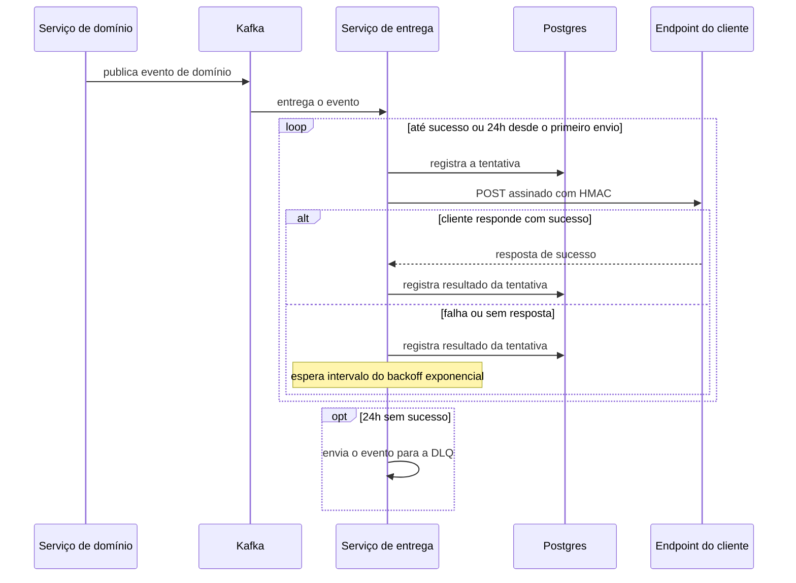

# Serviço de webhooks de saída

| | |
|---|---|
| **State** | Draft |
| **Title** | Serviço de webhooks de saída |
| **Authors** | A definir |
| **Reviewers** | A definir |
| **Created** | 2026-11-22 |
| **Last updated** | 2026-11-22 |
| **Tags** | webhooks, kafka, entrega, retry |

## Glossário

- **Webhook de saída**: chamada HTTP POST que a nossa plataforma faz no endpoint de um cliente externo para avisá-lo de um evento.
- **Evento de domínio**: mensagem que um serviço nosso publica no Kafka para registrar que algo aconteceu no seu domínio.
- **HMAC**: assinatura calculada sobre o payload com um segredo compartilhado. Permite ao cliente verificar que a chamada veio de nós e que o corpo não foi alterado.
- **Backoff exponencial**: política de retry em que o intervalo entre tentativas cresce a cada falha.
- **DLQ** (dead-letter queue): destino dos eventos que esgotaram todas as tentativas sem sucesso.

## Overview

Hoje cada serviço que precisa avisar um cliente externo faz o POST por conta própria, sem retry e sem log central. Este documento propõe um serviço único de entrega de webhooks de saída. Ele consome os eventos de domínio que já circulam no Kafka, registra cada tentativa no Postgres, assina o POST com HMAC e reenvia com backoff exponencial por até 24 horas antes de mandar o evento para a DLQ.

## Contexto

- Cada serviço que notifica um cliente externo implementa o POST por conta própria.
- Nenhuma dessas implementações faz retry. Quando o endpoint do cliente está fora do ar, o evento se perde.
- Não existe log central das entregas. A equipe descobre a perda quando o suporte avisa.
- Os eventos de domínio já estão no Kafka, e o serviço novo parte deles.

## Objetivos e fora de escopo

### Objetivos

- Nenhum evento se perde por indisponibilidade do endpoint do cliente. O serviço retenta por até 24 horas e, passado esse prazo, o evento vai para a DLQ em vez de ser descartado.
- Toda tentativa de entrega fica registrada e consultável, de modo que a equipe enxerga o que aconteceu com cada evento sem depender do suporte.
- O payload não sai da nossa borda para terceiros.

As metas ainda não têm números (por exemplo, percentual de eventos entregues dentro de um prazo). Ver [Questões em aberto](#questões-em-aberto).

### Fora de escopo

O escopo excluído ainda não foi definido. Ver [Questões em aberto](#questões-em-aberto).

## O design

### Visão geral da solução

Um serviço de entrega assume o envio de todos os webhooks de saída. Os serviços de domínio deixam de chamar o cliente e passam a publicar apenas o evento de domínio no Kafka. O serviço de entrega consome o evento, grava a tentativa no Postgres, envia o POST assinado com HMAC ao endpoint do cliente e, se a entrega falha, agenda uma nova tentativa com backoff exponencial. Se o evento continua sem entrega depois de 24 horas, o serviço o envia para a DLQ.

O trade-off central é que a entrega deixa de ser imediata em alguns casos, porque o evento passa pela fila antes de chegar ao cliente. Em troca, nenhum evento se perde enquanto o cliente estiver fora do ar e cada tentativa fica registrada.

### Arquitetura


> Imagem a ser renderizada a partir do DSL abaixo na revisão manual. Nesta máquina não há Docker nem a CLI do Structurizr.

<details>
<summary>Fonte do diagrama (Structurizr DSL)</summary>

```
workspace {
    model {
        domainServices = softwareSystem "Serviços de domínio" "Serviços existentes que geram eventos de domínio." "Existing"
        kafka = softwareSystem "Kafka" "Transporta os eventos de domínio." "Existing"
        customer = softwareSystem "Endpoint do cliente" "Recebe os webhooks." "External"

        webhooks = softwareSystem "Serviço de webhooks de saída" "Entrega eventos de domínio aos clientes externos, com retry e log de tentativas." {
            delivery = container "Serviço de entrega" "Consome eventos, assina e envia o POST, reenvia com backoff exponencial e encaminha à DLQ."
            db = container "Banco de tentativas" "Registra cada tentativa de entrega." "Postgres" "Database"
        }

        domainServices -> kafka "Publica eventos de domínio"
        delivery -> kafka "Consome eventos de domínio"
        delivery -> db "Registra e consulta tentativas"
        delivery -> customer "POST assinado com HMAC"
    }

    views {
        container webhooks "Containers" {
            include *
            autolayout lr
        }

        styles {
            element "Existing" {
                background #999999
                color #ffffff
            }
            element "External" {
                background #666666
                color #ffffff
            }
            element "Database" {
                shape Cylinder
            }
        }
    }
}
```

</details>

Os serviços de domínio publicam eventos no Kafka e não conhecem mais o endpoint do cliente. O serviço de entrega é o único componente novo que fala com o cliente. Ele lê os eventos do Kafka, usa o Postgres para registrar cada tentativa e faz o POST assinado com HMAC no endpoint do cliente. O destino físico da DLQ e o mecanismo que dispara os retries não aparecem no diagrama porque a equipe ainda não os definiu (ver [Questões em aberto](#questões-em-aberto)).

### Fluxo de entrega com retry



O serviço de entrega registra no Postgres cada tentativa e o seu resultado, tanto os sucessos quanto as falhas. Quando uma tentativa falha, ele espera um intervalo que cresce a cada falha e tenta de novo. O ciclo termina na primeira entrega bem-sucedida ou quando passam 24 horas desde o primeiro envio. Nesse segundo caso, o serviço envia o evento para a DLQ.

## Trade-offs da solução escolhida

- ✓ Um evento não se perde quando o endpoint do cliente fica indisponível, porque o serviço retenta por até 24 horas e depois encaminha o evento à DLQ.
- ✓ Toda tentativa fica registrada em um lugar só, e a equipe passa a ver as falhas sem esperar o suporte.
- ✓ O payload permanece dentro da nossa borda.
- ✓ A lógica de assinatura, retry e log deixa de ser reimplementada em cada serviço.
- ✗ A entrega deixa de ser imediata em alguns casos, porque o evento passa pela fila. A equipe aceitou esse custo.

## Alternativas consideradas

| Alternativa | Resultado | Motivo |
|---|---|---|
| Não fazer nada (manter o POST em cada serviço) | ✗ Descartada | Sem retry, o evento se perde quando o endpoint do cliente cai. Sem log central, a equipe só descobre a perda pelo suporte. |
| SaaS de webhooks | ✗ Descartada | Cobra por evento e o payload sairia da nossa borda. |
| Serviço único de entrega sobre Kafka e Postgres | ✓ Escolhida | Atende aos objetivos, ao custo de a entrega deixar de ser imediata em alguns casos. |

## Questões em aberto

- Metas mensuráveis: qual número define sucesso (por exemplo, percentual de eventos entregues, ou latência aceitável nos casos em que a entrega passa pela fila)?
- Fora de escopo: o que o serviço deliberadamente não cobre nesta primeira versão?
- Casos de entrega não imediata: em quais casos a entrega deixa de ser imediata, e qual atraso é aceitável?
- Política de retry: qual é a sequência de intervalos do backoff, o timeout de cada POST e o critério que classifica uma resposta como falha?
- Mecanismo de retry: o que dispara as tentativas seguintes (varredura no Postgres, republicação no Kafka ou outro)?
- DLQ: onde ela vive (tópico Kafka, tabela, outro) e quem a consome? Existe replay manual dos eventos que chegam a ela?
- Semântica de entrega: o cliente pode receber o mesmo evento mais de uma vez? Se sim, como ele deduplica (identificador do evento, cabeçalho)?
- Assinatura: onde ficam os segredos HMAC por cliente, como são rotacionados e quais cabeçalhos carregam a assinatura?
- Consulta às tentativas: quem lê o log de tentativas, por qual interface e por quanto tempo os registros são retidos?
- Impacto em outras equipes: quem cadastra os endpoints dos clientes, e quais serviços migram primeiro?
- Autores e revisores: quem assina o documento e quais áreas (por exemplo, segurança e plataforma) revisam?
