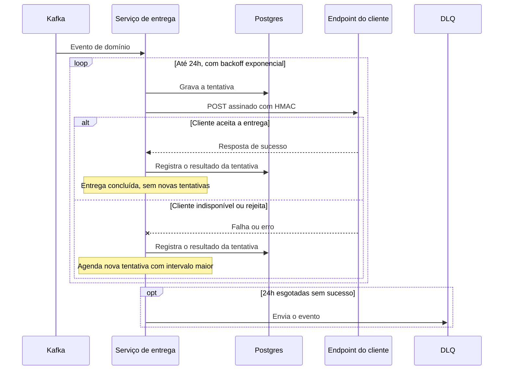

# Serviço de entrega de webhooks de saída

| | |
|---|---|
| **Estado** | Rascunho |
| **Título** | Serviço de entrega de webhooks de saída |
| **Autores** | A confirmar |
| **Revisores** | A confirmar (ver [Questões em aberto](#questões-em-aberto)) |
| **Criado em** | 2026-11-22 |
| **Última atualização** | 2026-11-22 |
| **Tags** | webhooks, kafka, entrega, retry |

## Glossário

| Termo | Definição |
|---|---|
| Evento de domínio | Mensagem publicada no Kafka por um serviço nosso para registrar que algo aconteceu no negócio. |
| Tentativa | Um POST do serviço de entrega ao endpoint do cliente. O serviço grava cada tentativa no Postgres. |
| HMAC | Assinatura calculada com um segredo compartilhado, enviada junto do POST para o cliente verificar a origem e a integridade do payload. |
| Backoff exponencial | Estratégia de retry em que o intervalo entre tentativas cresce a cada falha. |
| DLQ | Dead-letter queue: destino dos eventos que esgotaram as tentativas sem entrega. |

## Visão geral

Hoje cada serviço que precisa avisar um cliente externo faz o POST por conta própria, sem retry e sem registro central. Este documento propõe um serviço único de entrega de webhooks. Ele consome os eventos de domínio que já circulam no Kafka, grava cada tentativa no Postgres, assina o POST com HMAC e reenvia com backoff exponencial por até 24 horas. Depois desse prazo, o evento vai para a DLQ.

## Contexto

- Cada serviço que notifica um cliente externo implementa o POST à mão.
- Não há retry. Quando o endpoint do cliente está fora do ar, o evento se perde.
- Não há log central de entregas. A equipe só descobre a perda quando o suporte avisa.
- Os eventos de domínio já são publicados no Kafka.

O payload do cliente não pode sair da nossa borda (ver [Alternativas consideradas](#alternativas-consideradas)).

## Objetivos

- Nenhum evento perdido por indisponibilidade do endpoint do cliente. O serviço tenta entregar por até 24 horas e, esgotado o prazo, o evento vai para a DLQ em vez de ser descartado.
- Visibilidade de cada tentativa. O serviço registra toda tentativa de entrega no Postgres.

Os itens fora de escopo estão em [Questões em aberto](#questões-em-aberto).

## Design

### Visão da solução

O serviço de entrega substitui os POSTs que hoje cada serviço faz. Ele lê os eventos de domínio do Kafka, grava a tentativa no Postgres, envia o POST assinado com HMAC ao endpoint do cliente e registra o resultado. Se o cliente não aceita a entrega, o serviço agenda nova tentativa com backoff exponencial. Passadas 24 horas sem sucesso, o evento segue para a DLQ.

O custo central é que a entrega deixa de ser imediata em alguns casos, porque o evento passa pela fila antes de chegar ao cliente.

### Arquitetura


> Imagem a renderizar na passagem manual (sem Docker nem CLI do Structurizr nesta máquina). O arquivo `diagrams/arquitetura.svg` ainda não existe.

<details>
<summary>Fonte do diagrama (Structurizr DSL)</summary>

```
workspace {
    model {
        cliente = softwareSystem "Sistema do cliente" "Endpoint externo que recebe os webhooks." "External"

        nosso = softwareSystem "Plataforma de webhooks" "Entrega eventos de domínio aos endpoints dos clientes." {
            servicosDominio = container "Serviços de domínio" "Publicam eventos de domínio. Hoje cada um faz o POST ao cliente por conta própria."
            kafka = container "Kafka" "Transporta os eventos de domínio." "" "Queue"
            entrega = container "Serviço de entrega" "Consome eventos, assina e envia o POST, registra cada tentativa e agenda os retries."
            postgres = container "Postgres" "Guarda cada tentativa de entrega." "" "Database"
            dlq = container "DLQ" "Recebe eventos que esgotaram as 24h de tentativas." "" "Queue"
        }

        servicosDominio -> kafka "Publica eventos de domínio"
        entrega -> kafka "Consome eventos de domínio"
        entrega -> postgres "Grava cada tentativa"
        entrega -> cliente "Envia POST assinado com HMAC"
        entrega -> dlq "Envia eventos não entregues em 24h"
    }

    views {
        container nosso "Containers" {
            include *
            autolayout lr
        }

        styles {
            element "External" {
                background #999999
                color #ffffff
            }
            element "Database" {
                shape Cylinder
            }
            element "Queue" {
                shape Pipe
            }
        }
    }
}
```

</details>

Os serviços de domínio continuam a publicar eventos no Kafka e deixam de falar com o cliente. O serviço de entrega é o único componente que envia POST ao endpoint do cliente. Ele grava cada tentativa no Postgres, o que dá o log central que falta hoje. Os eventos que esgotam o prazo de 24 horas vão para a DLQ.

O diagrama não indica a tecnologia da DLQ nem a do serviço de entrega. Esses pontos estão em [Questões em aberto](#questões-em-aberto).

### Fluxo de entrega com retry



O serviço de entrega recebe o evento do Kafka e entra em um ciclo de tentativas. Em cada volta, ele grava a tentativa no Postgres, envia o POST assinado e registra o resultado. Se o cliente aceita, o ciclo termina. Se o cliente está fora do ar ou rejeita a entrega, o serviço agenda a próxima tentativa com intervalo maior que o anterior. Quando as 24 horas se esgotam sem sucesso, o serviço envia o evento para a DLQ.

O desenho não define o que conta como "aceita a entrega", os intervalos do backoff nem como o serviço agenda a próxima tentativa. São questões em aberto.

## Trade-offs da solução escolhida

- ✓ Um evento não se perde por indisponibilidade do cliente dentro da janela de 24 horas.
- ✓ Cada tentativa fica registrada, então o suporte deixa de descobrir falhas pelo cliente.
- ✓ O payload não sai da nossa borda.
- ✓ Não há custo por evento cobrado por terceiros.
- ✗ A entrega deixa de ser imediata em alguns casos, porque passa pela fila. Esse é o custo que a equipe aceitou.
- ✗ A equipe passa a operar um serviço novo e a manter o Postgres com o histórico de tentativas.
- ✗ Eventos que chegam à DLQ não são entregues automaticamente. O destino deles ainda está em aberto (ver [Questões em aberto](#questões-em-aberto)).

## Alternativas consideradas

| Alternativa | Resultado | Motivo |
|---|---|---|
| Não fazer nada (cada serviço continua com o POST à mão) | ✗ Descartada | Sem retry, o evento se perde quando o endpoint do cliente cai. Sem log central, a equipe só descobre pelo suporte. |
| SaaS de webhooks | ✗ Descartada | Cobra por evento e o payload sairia da nossa borda. |
| Serviço próprio de entrega, consumindo o Kafka | ✓ Escolhida | Atende aos dois objetivos, mantém o payload na borda e evita custo por evento. O preço é a entrega não imediata em alguns casos. |

## Questões em aberto

- Quem são os autores e quais áreas revisam? O serviço envia dados a terceiros, então segurança parece uma área a convidar. Os times dos serviços que hoje fazem o POST também são afetados.
- O que conta como entrega bem-sucedida? Quais respostas do cliente disparam novo retry e quais encerram a tentativa?
- Quais são os intervalos do backoff (primeiro intervalo, fator, teto)?
- Como o serviço agenda a próxima tentativa?
- Qual é a tecnologia da DLQ? Quem olha a DLQ e o que se faz com um evento que chega lá (reprocesso manual, aviso ao cliente)?
- Onde fica e como se rotaciona o segredo do HMAC de cada cliente? Qual é o formato da assinatura e dos cabeçalhos?
- Como o cliente trata uma entrega repetida? O desenho precisa de um identificador de evento ou de tentativa no payload?
- A ordem dos eventos para um mesmo cliente importa?
- Qual é o plano de migração dos serviços que hoje fazem o POST direto? Há rollout em etapas e plano de rollback?
- Quais métricas e alertas indicam saúde do serviço? Como verificar o comportamento antes de ir a produção (testes de integração, endpoint de teste)?
- Quais itens ficam fora de escopo desta primeira versão?
- Existe retenção ou política de dados para o histórico de tentativas no Postgres?
