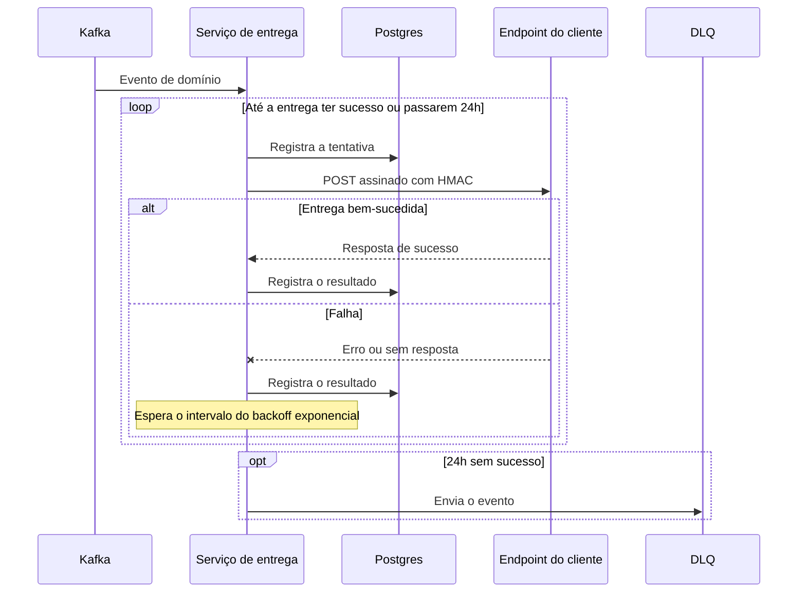

# Serviço de webhooks de saída

| | |
|---|---|
| **Estado** | Rascunho |
| **Título** | Serviço de webhooks de saída |
| **Autores** | A definir |
| **Revisores** | A definir (ver [Perguntas em aberto](#perguntas-em-aberto)) |
| **Criado** | 2026-11-22 |
| **Última atualização** | 2026-11-22 |
| **Tags** | webhooks, kafka, entrega, retry |

## Glossário

| Termo | Definição |
|---|---|
| Evento de domínio | Mensagem que um serviço nosso publica no Kafka para informar que algo aconteceu no seu domínio. |
| Webhook de saída | Requisição POST que a gente envia ao endpoint de um cliente externo para avisá-lo de um evento. |
| Tentativa de entrega | Um POST ao endpoint do cliente, com seu resultado, registrado no Postgres. |
| HMAC | Assinatura calculada sobre o payload com um segredo compartilhado, que permite ao cliente verificar a origem da requisição. |
| Backoff exponencial | Estratégia de retry em que o intervalo entre tentativas cresce a cada falha. |
| DLQ | Dead-letter queue: destino dos eventos cuja entrega esgotou todas as tentativas. |

## Visão geral

Hoje cada serviço que precisa avisar um cliente externo faz o POST por conta própria, sem retry e sem registro central. Este documento propõe um serviço único de entrega de webhooks, que consome os eventos de domínio que já circulam no Kafka, registra cada tentativa no Postgres, assina o POST com HMAC e reenvia com backoff exponencial por até 24 horas antes de mandar o evento para a DLQ.

## Contexto

- Cada serviço que avisa um cliente externo implementa o POST sozinho.
- Esses POSTs não têm retry. Quando o endpoint do cliente está fora do ar, o evento se perde.
- Não existe log central de entregas. A equipe só descobre uma falha quando o suporte avisa.
- Os eventos de domínio já estão no Kafka, e o serviço novo parte deles.

## Objetivos e fora de escopo

### Objetivos

1. Nenhum evento se perde por indisponibilidade do endpoint do cliente. Um evento só deixa de ser entregue depois de 24 horas de tentativas, e nesse caso vai para a DLQ.
2. O serviço de entrega registra cada tentativa, de modo que a equipe consulte o registro em vez de depender do suporte para descobrir uma falha.

Os dois objetivos ainda não têm meta numérica. Ver [Perguntas em aberto](#perguntas-em-aberto).

### Fora de escopo

- Entrega imediata em todos os casos. Como o evento passa pela fila, a entrega pode atrasar (ver [Trade-offs](#trade-offs-da-solução-escolhida)).

## O design

### Visão geral da solução

O serviço de entrega assume a responsabilidade que hoje está espalhada pelos serviços de domínio. Os serviços de domínio continuam publicando eventos no Kafka. O serviço de entrega consome esses eventos, grava a tentativa no Postgres, envia o POST assinado com HMAC ao endpoint do cliente e, se a entrega falha, reenvia com backoff exponencial por até 24 horas. Depois desse prazo, o evento vai para a DLQ.

O trade-off central é que a entrega deixa de ser imediata em alguns casos, porque o evento passa pela fila. Em troca, a entrega passa a ter retry e registro de cada tentativa.

### Arquitetura


> Renderizar a imagem acima a partir do DSL na passagem manual: a máquina onde este documento foi escrito não tem Docker nem a CLI do Structurizr.

<details>
<summary>Fonte do diagrama (Structurizr DSL)</summary>

```
workspace {

    model {
        cliente = person "Cliente externo" "Dono do endpoint que recebe os webhooks."

        sistema = softwareSystem "Webhooks de saída" "Entrega eventos de domínio aos endpoints dos clientes, com retry e registro de cada tentativa." {
            entrega = container "Serviço de entrega" "Consome eventos, assina com HMAC, envia o POST, registra cada tentativa e reenvia com backoff exponencial por até 24h."
            banco = container "Banco de tentativas" "Registra cada tentativa de entrega." "PostgreSQL" "Database"
            dlq = container "DLQ" "Recebe os eventos cuja entrega falhou por 24h."
        }

        dominio = softwareSystem "Serviços de domínio" "Serviços existentes que geram eventos de domínio." "Existing System"
        kafka = softwareSystem "Kafka" "Transporta os eventos de domínio." "Existing System"

        dominio -> kafka "Publica eventos de domínio"
        entrega -> kafka "Consome eventos de domínio"
        entrega -> banco "Grava cada tentativa e seu resultado"
        entrega -> cliente "Envia POST assinado com HMAC"
        entrega -> dlq "Envia o evento após 24h de falhas"
    }

    views {
        container sistema "containers" {
            include *
            autolayout lr
        }

        styles {
            element "Database" {
                shape cylinder
            }
            element "Existing System" {
                background #999999
            }
        }
    }
}
```

</details>

O serviço de entrega lê do Kafka os eventos que os serviços de domínio já publicam, registra a tentativa no banco de tentativas (Postgres) e faz o POST ao endpoint do cliente, assinado com HMAC. Quando a entrega falha, ele reenvia com backoff exponencial. Esgotadas as 24 horas, ele manda o evento para a DLQ.

O diagrama não indica a tecnologia do serviço de entrega nem a da DLQ, porque o design ainda não as definiu (ver [Perguntas em aberto](#perguntas-em-aberto)).

### Fluxo de entrega com retry



O serviço de entrega registra no Postgres cada tentativa e seu resultado, seja sucesso ou falha. Cada falha leva a uma nova tentativa, com intervalo crescente. Se passam 24 horas sem sucesso, o serviço envia o evento para a DLQ. O documento ainda não define o que conta como sucesso nem os intervalos do backoff (ver [Perguntas em aberto](#perguntas-em-aberto)).

## Trade-offs da solução escolhida

- ✓ Um evento não se perde quando o endpoint do cliente cai, porque o serviço reenvia por até 24 horas antes de mandá-lo à DLQ.
- ✓ O serviço registra cada tentativa no Postgres, e a equipe deixa de descobrir falhas pelo suporte.
- ✓ A lógica de entrega passa a existir em um só lugar, no lugar de cada serviço de domínio implementar o seu POST.
- ✓ O payload não sai da nossa borda para um terceiro.
- ✗ A entrega deixa de ser imediata em alguns casos, porque o evento passa pela fila. Aceitamos esse custo em troca do retry e do registro.
- ✗ A equipe passa a operar mais um serviço, com seu banco de tentativas e a DLQ.

## Alternativas consideradas

| Alternativa | Resultado | Motivo |
|---|---|---|
| Não fazer nada (cada serviço continua com seu POST) | ✗ Descartada | Quando o endpoint do cliente cai, o evento se perde, e a equipe só descobre pelo suporte. |
| Usar um SaaS de webhooks | ✗ Descartada | Cobra por evento, e o payload sairia da nossa borda. |
| Serviço próprio de entrega (esta proposta) | ✓ Escolhida | Atende aos dois objetivos e mantém o payload na nossa borda, ao custo de a entrega não ser imediata em alguns casos. |

## Perguntas em aberto

- Quem são os autores e quais equipes revisam o documento (Segurança, pela assinatura HMAC e pelo armazenamento dos segredos; os times dos serviços de domínio que hoje fazem o POST)?
- Como medimos os objetivos? Há uma meta para a taxa de eventos na DLQ e para o atraso aceitável de entrega?
- O que conta como entrega bem-sucedida? Só respostas 2xx, ou também outros códigos? Há timeout por tentativa?
- Quais são os parâmetros do backoff exponencial (intervalo inicial, fator, teto)?
- Como o serviço agenda os reenvios ao longo de 24 horas?
- O que é a DLQ (um tópico Kafka, uma tabela, outra coisa)? Quem a consome e como se reprocessa um evento que caiu nela?
- Como o serviço sabe a qual endpoint de cliente cada evento vai, e onde ficam o endpoint e o segredo do HMAC?
- Qual tecnologia o serviço de entrega usa?
- Como os serviços atuais migram do POST direto para o serviço novo?
- Com retry, o mesmo evento pode chegar mais de uma vez ao cliente? Se pode, como o cliente deve tratar isso?
