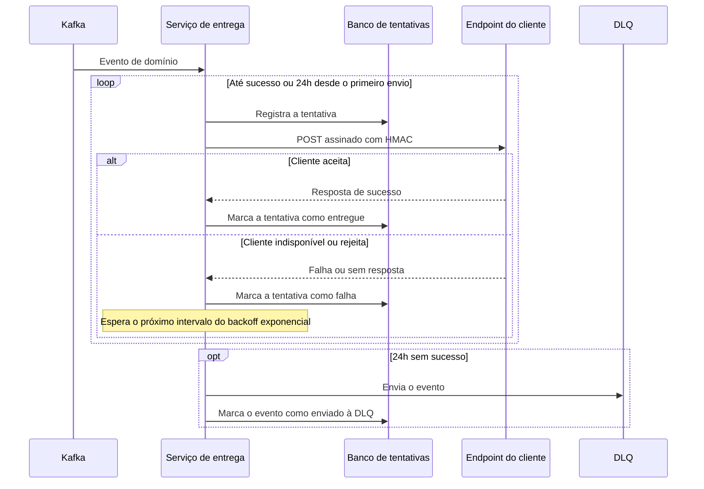

# Serviço de entrega de webhooks de saída

| | |
|---|---|
| **Documento** | DESIGN-DOC |
| **Estado** | Rascunho |
| **Título** | Serviço de entrega de webhooks de saída |
| **Autores** | A confirmar |
| **Revisores** | A confirmar (sugestão: Segurança, Plataforma, times dos serviços produtores de eventos) |
| **Criado** | 2026-11-22 |
| **Última atualização** | 2026-11-22 |
| **Tags** | webhooks, kafka, postgres, retry, dlq |

## Glossário

- **Evento de domínio**: mensagem publicada no Kafka por um serviço nosso para registrar que algo aconteceu no negócio.
- **HMAC**: assinatura calculada sobre o corpo da requisição com um segredo compartilhado. O cliente recalcula a assinatura para confirmar que a mensagem veio de nós e não foi alterada.
- **Backoff exponencial**: política de retry em que o intervalo entre tentativas cresce a cada falha.
- **DLQ** (dead-letter queue): destino dos eventos cuja entrega esgotou todas as tentativas.
- **Tentativa**: um POST ao endpoint do cliente, com o resultado registrado.

## Visão geral

Hoje cada serviço que precisa avisar um cliente externo faz o POST por conta própria, sem retry e sem registro central. Este documento propõe um serviço único de entrega de webhooks. Ele consome os eventos de domínio que já circulam no Kafka, registra cada tentativa no Postgres, assina o POST com HMAC e reenvia com backoff exponencial por até 24 horas. Depois disso, o evento vai para a DLQ.

## Contexto

- Cada serviço que notifica um cliente externo implementa o POST sozinho.
- Não há retry. Quando o endpoint do cliente está fora do ar, o evento se perde.
- Não há log central das entregas. A equipe só descobre uma falha quando o suporte avisa.
- Os eventos de domínio já estão no Kafka, e a proposta reaproveita esse fluxo.

## Objetivos

1. Nenhum evento se perde por indisponibilidade do endpoint do cliente. Se o endpoint continua fora do ar depois de 24 horas de retry, o evento vai para a DLQ em vez de se perder.
2. O serviço registra cada tentativa de entrega com o seu resultado, e o time passa a ver cada uma delas.

A lista de itens fora de escopo está em [Questões em aberto](#questões-em-aberto).

## O design

### Visão da solução

O serviço de entrega lê os eventos de domínio do Kafka. Para cada evento destinado a um cliente externo, ele grava a tentativa no Postgres, assina o corpo com HMAC e faz o POST no endpoint do cliente. Se a entrega falha, o serviço tenta de novo depois de um intervalo que cresce a cada falha (backoff exponencial). Passadas 24 horas sem sucesso, ele envia o evento para a DLQ. Os serviços de domínio deixam de falar com o cliente: só publicam eventos.

O trade-off central está no caminho: como o webhook passa pela fila, a entrega deixa de ser imediata em alguns casos. Em troca, nenhum evento depende de o endpoint do cliente estar no ar naquele instante.

### Arquitetura


> Imagem pendente: esta máquina não tem Docker nem a CLI do Structurizr. Renderize o DSL abaixo e salve em `diagrams/architecture.svg`.

<details>
<summary>Fonte do diagrama (Structurizr DSL)</summary>

```
workspace "Webhooks de saída" {

    model {
        cliente = softwareSystem "Endpoint do cliente" "Recebe os webhooks assinados." "External"

        kafka = softwareSystem "Kafka" "Já existente. Carrega os eventos de domínio." "Existing"

        servicos = softwareSystem "Serviços de domínio" "Publicam eventos de domínio. Deixam de fazer POST direto ao cliente." "Existing"

        webhooks = softwareSystem "Entrega de webhooks" "Entrega eventos de domínio a clientes externos." {
            entrega = container "Serviço de entrega" "Consome eventos, assina com HMAC, faz o POST, reenvia com backoff exponencial por até 24h."
            banco = container "Banco de tentativas" "Guarda cada tentativa de entrega e seu resultado." "" "Database"
            dlq = container "DLQ" "Recebe eventos que esgotaram as 24h de retry."
        }

        servicos -> kafka "Publica eventos de domínio"
        entrega -> kafka "Consome eventos de domínio"
        entrega -> banco "Registra cada tentativa"
        entrega -> cliente "Envia POST assinado com HMAC"
        entrega -> dlq "Envia eventos não entregues após 24h"
    }

    views {
        container webhooks "containers" {
            include *
            autolayout lr
        }

        styles {
            element "Element" {
                background #1168bd
                color #ffffff
            }
            element "External" {
                background #999999
            }
            element "Existing" {
                background #6b8fb5
            }
            element "Database" {
                shape Cylinder
            }
        }
    }
}
```

</details>

O serviço de entrega é o único componente novo com lógica. Ele lê do Kafka, que já existe, e escreve no banco de tentativas, onde cada POST fica registrado com seu resultado. O POST ao endpoint do cliente leva a assinatura HMAC. Quando o prazo de 24 horas termina sem sucesso, o serviço envia o evento para a DLQ. Os serviços de domínio só publicam eventos e não conhecem o endpoint do cliente.

### Fluxo de entrega com retry



O serviço trata cada evento em ciclos. A cada ciclo ele registra a tentativa, faz o POST e grava o resultado. Em caso de sucesso, o ciclo termina. Em caso de falha, o serviço espera um intervalo maior que o anterior e tenta de novo. Quando passam 24 horas sem sucesso, ele envia o evento para a DLQ e registra isso no banco. O critério exato de sucesso e o mecanismo de espera entre tentativas estão em [Questões em aberto](#questões-em-aberto).

## Trade-offs da solução escolhida

- ✓ Uma indisponibilidade do endpoint do cliente deixa de perder o evento: o serviço reenvia por até 24 horas.
- ✓ O serviço registra cada tentativa no Postgres, e o time deixa de depender do suporte para saber que uma entrega falhou.
- ✓ O payload não sai da nossa borda para um terceiro.
- ✓ Os serviços de domínio deixam de implementar o POST, e a lógica de entrega fica em um lugar só.
- ✗ A entrega deixa de ser imediata em alguns casos, porque o evento passa pela fila. Esse é o custo aceito.
- ✗ O time passa a construir e operar o serviço, o que um SaaS evitaria.

## Alternativas consideradas

| Opção | Resultado |
|---|---|
| **Serviço próprio de entrega (escolhida)** | ✓ O payload fica na nossa borda. ✓ Sem custo por evento de terceiro. ✗ Construção e operação por nossa conta. ✗ Entrega nem sempre imediata. |
| SaaS de webhooks | ✗ Custo por evento. ✗ O payload sairia da nossa borda. Descartada. |
| Não fazer nada | ✗ Quando o endpoint do cliente cai, o evento se perde, sem retry e sem log central, e a equipe só descobre pelo suporte. Descartada. |

## Questões em aberto

Os pontos abaixo não foram definidos até aqui. O texto acima não assume resposta para nenhum deles.

1. **Fora de escopo**: o que alguém poderia esperar deste serviço e que fica de fora desta versão?
2. **Critério de sucesso**: quais respostas do cliente contam como entrega bem-sucedida e quais contam como falha?
3. **Agenda de retry**: qual o intervalo inicial, o fator de crescimento e o teto do backoff? O que dispara cada nova tentativa (o mecanismo de espera)?
4. **DLQ**: de que tipo é a DLQ, quem a consome e como um evento volta de lá para reenvio, se volta?
5. **Garantia de entrega**: o cliente pode receber o mesmo evento mais de uma vez? Se puder, ele recebe um identificador para deduplicar?
6. **Ordenação**: a ordem dos eventos para um mesmo cliente precisa ser preservada, inclusive durante os retries?
7. **Segredo do HMAC**: onde o segredo de cada cliente fica guardado, quem o gera e como ele é rotacionado?
8. **Cadastro de destinos**: como o serviço sabe qual evento vai para qual endpoint de qual cliente?
9. **Dados no Postgres**: o registro da tentativa guarda o payload? Por quanto tempo? O payload contém dados pessoais?
10. **Migração**: como e em que ordem os serviços atuais abandonam o POST direto?
11. **Observabilidade e testes**: quais métricas e alertas indicam que a entrega funciona, e como o time verifica o design antes de publicar?
12. **Autores e revisores**: quem assina o documento e quem o revisa?
