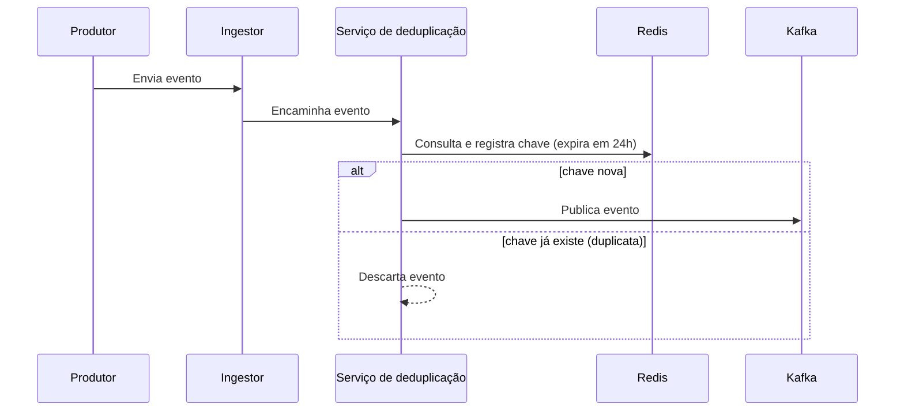

# Serviço de deduplicação de eventos · DD-2026-001

| | |
|---|---|
| **Documento** | DD-2026-001 |
| **Estado** | Rascunho |
| **Autores** | Rafael Nunes |
| **Revisores** | |
| **Criado em** | 2026-11-22 |
| **Última atualização** | 2026-11-22 |

## Motivação

O pipeline de ingestão recebe eventos duplicados dos produtores, que reenviam o mesmo evento quando fazem retry. Em outubro de 2026 medimos 4% de eventos duplicados. As duplicatas chegam aos relatórios de faturamento e inflam os valores. O financeiro já reclamou duas vezes.

A meta é reduzir as duplicatas que chegam ao Kafka de 4% para menos de 0,1%.

## Proposta

Criamos um serviço de deduplicação que fica entre o ingestor e o Kafka. Para cada evento, o serviço consulta a chave idempotente no Redis. Se a chave já existe, o serviço descarta o evento. Se não existe, o serviço guarda a chave por 24h e deixa o evento seguir para o Kafka.

O produtor envia o evento ao ingestor, e o ingestor o encaminha ao serviço de deduplicação em vez de publicar direto no Kafka. O serviço consulta o Redis com a chave idempotente do evento. Para uma chave nova, o serviço a registra com expiração de 24h e publica o evento no Kafka. Uma chave que já existe indica reenvio, e o serviço descarta o evento sem publicá-lo.

### Trade-off aceito

O serviço adiciona um salto ao caminho crítico da ingestão. Estimamos +5ms de latência por evento. Aceitamos esse custo em troca de resolver a duplicidade num único ponto, antes do Kafka. O número de 5ms é uma estimativa, ainda sem medição (ver Perguntas abertas).

Como a chave expira em 24h, o serviço não reconhece como duplicata um reenvio que chegue depois dessa janela.

## Alternativas consideradas

Esta seção não consta no template. Ela fica entre Proposta e Riscos, sem alterar a ordem das demais, porque as alternativas que o time discutiu explicam a decisão.

| Alternativa | Resultado | Motivo |
|---|---|---|
| Não fazer nada | ✗ Descartada | Mantém os 4% de duplicatas e o erro nos relatórios de faturamento, que o financeiro já reclamou duas vezes. |
| Deduplicar no consumidor | ✗ Descartada | Cada consumidor teria que reimplementar a deduplicação. |
| Idempotência nativa do produtor Kafka | ✗ Descartada | Não cobre o reenvio entre reinícios do produtor. |
| **Serviço de deduplicação entre o ingestor e o Kafka** | ✓ Escolhida | Deduplica num único ponto, antes do Kafka, ao custo de um salto a mais no caminho crítico. |

## Riscos

| Risco | Mitigação |
|---|---|
| A latência da ingestão aumenta. A estimativa é de +5ms por evento, por causa do novo salto no caminho crítico. | Medir a latência real antes de ampliar o rollout (ver Perguntas abertas). |
| O Redis e o serviço de deduplicação entram no caminho crítico da ingestão. Uma falha em qualquer um dos dois afeta a ingestão. | Ainda não definida (ver Perguntas abertas). |
| Um reenvio que chega depois de 24h passa como evento novo. | Ainda não definida (ver Perguntas abertas). |

## Plano de rollout

Ainda não definido. As fases, o critério de avanço entre elas e o critério de rollback estão em Perguntas abertas.

## Métricas de sucesso

| Métrica | Hoje | Meta |
|---|---|---|
| Eventos duplicados que chegam ao Kafka | 4% (outubro de 2026) | Abaixo de 0,1% |
| Latência adicionada à ingestão | Não se aplica | Estimativa de +5ms; limite aceitável ainda não definido |

## Perguntas abertas

### Revisão e rollout

1. Quem revisa este documento? O template pede revisores, e o time de arquitetura precisa estar na lista.
2. Como o serviço entra em produção? Quais são as fases, o critério para avançar de uma fase à seguinte e o critério de rollback?

### Desenho

3. De onde vem a chave idempotente? O produtor a envia no evento, ou o serviço a deriva do conteúdo?
4. Se o Redis ou o serviço de deduplicação ficar indisponível, a ingestão continua e aceita duplicatas, ou para? Quem decide?
5. Quais são a ordem e a atomicidade entre registrar a chave e publicar no Kafka? Se o serviço falhar entre os dois passos, o evento pode ser perdido (chave registrada, evento não publicado) ou duplicado.
6. Como o serviço trata dois reenvios simultâneos do mesmo evento?
7. Reenvios depois de 24h acontecem na prática? Se acontecem, a janela de 24h basta?

### Medição

8. Qual é o limite máximo de latência aceitável para a ingestão? A estimativa de +5ms foi medida ou calculada?
9. Como mediremos a taxa de duplicatas depois do rollout, para comparar com os 4% de outubro? Em que ponto do pipeline a medição acontece?
10. A meta de 0,1% vale para o Kafka ou para os relatórios de faturamento?
