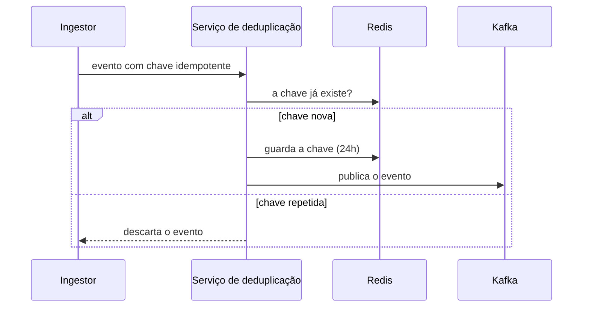

# Serviço de deduplicação de eventos · DD-2026-001

| | |
|---|---|
| **Documento** | DD-2026-001 |
| **Estado** | Rascunho |
| **Autores** | Rafael Nunes |
| **Revisores** | |
| **Criado em** | 2026-11-22 |
| **Última atualização** | 2026-11-22 |

## Motivação

Os produtores reenviam eventos ao pipeline de ingestão quando fazem retry, e o pipeline não descarta o reenvio. No mês passado medimos 4% de eventos duplicados. As duplicatas inflam os relatórios de faturamento, e o financeiro já reclamou duas vezes.

Hoje nenhum componente do caminho entre o ingestor e o Kafka remove duplicatas. Meta desta proposta: baixar as duplicatas de 4% para menos de 0,1%.

## Proposta

Um novo serviço de deduplicação fica entre o ingestor e o Kafka. Para cada evento recebido, o serviço consulta no Redis a chave idempotente do evento. Se a chave não existe, o serviço a guarda com validade de 24 horas e entrega o evento ao Kafka. Se a chave já existe, o serviço descarta o evento.

O ingestor envia cada evento ao serviço de deduplicação em vez de publicá-lo direto no Kafka. O serviço decide entre publicar e descartar com base apenas na chave idempotente, e o Redis guarda as chaves das últimas 24 horas. Os consumidores do Kafka não mudam: só recebem eventos que passaram pelo serviço.

Como o serviço fica antes do Kafka, a deduplicação acontece uma vez, em um só lugar, e vale para todos os consumidores.

## Alternativas consideradas

Esta seção não existe no template. Mantive a ordem das seções do template e a coloquei entre Proposta e Riscos, porque a decisão entre as opções é o que o time de arquitetura vai avaliar.

- **Não fazer nada.** Mantém os 4% de duplicatas e as reclamações do financeiro sobre o faturamento. Descartada pela dor descrita na Motivação.
- **Deduplicar no consumidor.** Cada consumidor teria que reimplementar a deduplicação. Descartada por esse custo repetido.
- **Idempotência nativa do produtor Kafka.** Não cobre o reenvio entre reinícios do produtor, que é um dos casos que queremos eliminar. Descartada por cobertura insuficiente.

## Riscos

- **Latência no caminho crítico.** O serviço adiciona um salto à ingestão, com estimativa de +5 ms de latência. O time aceita esse custo em troca da redução das duplicatas. A estimativa ainda não foi medida.
- **Outros riscos.** O time ainda não discutiu falha do Redis, indisponibilidade do próprio serviço nem chaves que expiram antes de um reenvio tardio. Perguntas abertas lista cada um, com a mitigação a definir.

## Plano de rollout

Fases, critérios de avanço e critério de rollback: ver Perguntas abertas.

## Métricas de sucesso

- Duplicatas abaixo de 0,1% dos eventos (linha de base: 4% no mês passado).
- Latência adicional de ingestão próxima de 5 ms (estimativa da proposta, a confirmar com medição).

## Perguntas abertas

Rafael, estas perguntas ficaram sem resposta porque faltava substância para escrevê-las sem inventar.

Identificação do documento:
1. O número de sequência `001` é provisório, pois não há outros design docs no repositório. Qual é o número correto?
2. Quem são os revisores?

Chave idempotente:
3. Quem gera a chave idempotente: o produtor ou o ingestor? Ela já existe hoje nos eventos?
4. O que acontece com um evento que chega sem chave?
5. Por que 24 horas? O valor cobre a janela máxima de retry dos produtores?

Riscos:
6. Se o Redis ficar indisponível, o serviço publica o evento sem deduplicar (fail-open) ou rejeita o evento (fail-closed)?
7. Se o serviço de deduplicação ficar indisponível, o que o ingestor faz?
8. O serviço publica no Kafka e grava a chave no Redis em passos separados. O que acontece se um passo falhar depois do outro?
9. Como o serviço escala? Como é a instância do Redis (gerenciada ou própria, com ou sem réplica)? Qual o volume de eventos e de chaves que ela precisa suportar?

Rollout:
10. Em que fases o serviço entra em produção (por exemplo, por produtor ou por percentual de tráfego)?
11. Qual critério libera cada fase e qual dispara o rollback?

Métricas:
12. Como mediremos a taxa de duplicatas depois do rollout? Foi o mesmo método dos 4% do mês passado?
13. Em que se baseia a estimativa de +5 ms? Existe um teto de latência aceitável para a ingestão?
14. O faturamento já emitido com duplicatas será corrigido? Isso está dentro ou fora do escopo?
