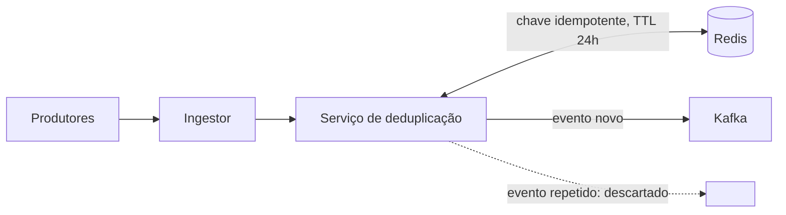

# Serviço de deduplicação de eventos · DD-2026-001

| | |
|---|---|
| **Documento** | DD-2026-001 |
| **Estado** | Rascunho |
| **Autores** | Rafael Nunes |
| **Revisores** | |
| **Criado em** | 2026-11-22 |
| **Última atualização** | 2026-11-22 |

## Motivação

O pipeline de ingestão recebe eventos duplicados dos produtores, que reenviam o mesmo evento em retry. No mês passado medimos 4% de eventos duplicados.

As duplicatas chegam aos relatórios de faturamento e inflam os valores. O financeiro já reclamou duas vezes.

Hoje nada no caminho entre o ingestor e o Kafka descarta repetidos. Cada consumidor recebe a duplicata e a processa como um evento novo.

## Proposta

Criamos um serviço de deduplicação entre o ingestor e o Kafka. O serviço guarda no Redis a chave idempotente de cada evento por 24h e descarta o evento cuja chave já existe.

### Fluxo

1. O ingestor envia o evento ao serviço de deduplicação.
2. O serviço extrai a chave idempotente do evento.
3. O serviço grava a chave no Redis com TTL de 24h, só se ela ainda não existir (operação atômica, `SET NX` com expiração).
4. Se a gravação cria a chave, o evento é novo e o serviço o publica no Kafka.
5. Se a chave já existe, o evento é repetido e o serviço o descarta.

A gravação atômica garante que dois reenvios simultâneos do mesmo evento não passem os dois.

### Alternativas descartadas

- **Deduplicar no consumidor.** Cada consumidor teria que reimplementar a deduplicação. Descartamos pelo custo de manter a mesma lógica em vários lugares.
- **Idempotência nativa do produtor Kafka.** Ela não cobre o reenvio entre reinícios do produtor, que é um dos cenários em que o reenvio acontece. Descartamos porque deixaria duplicatas passarem.

### Trade-off aceito

O serviço é mais um salto no caminho crítico da ingestão. Estimamos +5ms de latência por evento. Aceitamos esse custo em troca de deduplicar em um só ponto, antes do Kafka.

## Riscos

| Risco | Mitigação |
|---|---|
| O Redis fica indisponível e o serviço não consegue decidir se o evento é repetido. | Decisão pendente: descartar nada e deixar passar (fail-open) ou bloquear a ingestão (fail-closed). Ver Perguntas abertas. |
| O serviço de deduplicação cai e para a ingestão, porque está no caminho crítico. | Executar várias instâncias sem estado local, já que o estado fica no Redis. Detalhes de capacidade pendentes. |
| A latência real passa dos +5ms estimados. | Medir a latência na fase de sombra do rollout, antes de o serviço descartar eventos. |
| Um reenvio chega depois de 24h e não é detectado, porque a chave expirou. | Aceito como limite da proposta. A meta de 0,1% vale para a janela de 24h. |
| Dois reenvios simultâneos passam os dois. | Gravação atômica da chave (`SET NX` com expiração), descrita no fluxo. |
| Uma chave idempotente mal definida descarta eventos legítimos ou deixa duplicatas passarem. | Pendente: definir quem gera a chave e como. Ver Perguntas abertas. |

## Plano de rollout

Este plano é uma proposta do autor. Os critérios numéricos de avanço dependem das respostas em Perguntas abertas.

1. **Modo sombra.** O serviço recebe os eventos, consulta e grava no Redis, mas publica tudo no Kafka, inclusive os repetidos. Registra quantos eventos descartaria e a latência que adiciona.
   - Avança quando a taxa de repetidos medida for compatível com os 4% observados e a latência adicionada estiver próxima dos +5ms estimados.
   - Rollback: desligar o serviço. O ingestor volta a publicar direto no Kafka.
2. **Descarte parcial.** O serviço descarta repetidos para uma parcela dos produtores.
   - Avança quando a taxa de duplicatas nessa parcela cair abaixo de 0,1% e nenhum evento legítimo for descartado.
   - Rollback: voltar os produtores da parcela ao modo sombra.
3. **Descarte total.** O serviço descarta repetidos para todos os produtores.
   - Rollback: voltar ao modo sombra.

## Métricas de sucesso

| Métrica | Hoje | Meta |
|---|---|---|
| Taxa de eventos duplicados que chegam ao Kafka | 4% (mês passado) | abaixo de 0,1% |
| Latência adicionada à ingestão | 0 | cerca de +5ms (estimativa) |
| Reclamações do financeiro sobre faturamento inflado por duplicatas | 2 | 0 |

## Perguntas abertas

1. Se o Redis ficar indisponível, o serviço deixa os eventos passarem (fail-open) ou bloqueia a ingestão (fail-closed)? A primeira opção arrisca duplicatas, a segunda arrisca perda de disponibilidade.
2. Quem gera a chave idempotente: o produtor ou o ingestor? Quais campos a compõem?
3. A estimativa de +5ms vale para a média ou para o p99? Existe um limite máximo de latência aceitável na ingestão?
4. Qual o volume de eventos por segundo, e portanto qual o tamanho esperado do Redis para 24h de chaves? O Redis será dedicado ou compartilhado?
5. Reenvios que chegam depois de 24h existem? Se existirem, a janela de 24h precisa aumentar?
6. Quais são os critérios numéricos de avanço entre as fases do rollout e quem aprova cada avanço?
7. Quem são os revisores do documento?
