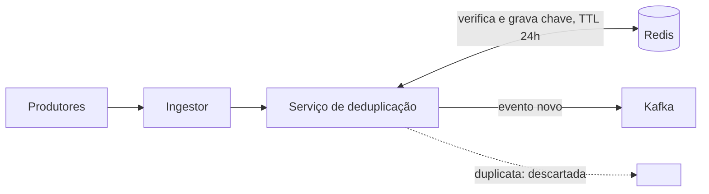

# Serviço de deduplicação de eventos · DD-2026-001

| | |
|---|---|
| **Documento** | DD-2026-001 |
| **Estado** | Rascunho |
| **Autores** | Rafael Nunes |
| **Revisores** | |
| **Criado em** | 2026-11-22 |
| **Última atualização** | 2026-11-22 |

## Motivação

O pipeline de ingestão recebe eventos duplicados dos produtores, que reenviam o mesmo evento quando fazem retry. No mês passado medimos 4% de eventos duplicados.

As duplicatas chegam aos relatórios de faturamento e inflam os valores. O financeiro já reclamou duas vezes.

Hoje nenhuma camada entre o produtor e o consumidor descarta duplicatas. Cada relatório fica exposto ao problema.

## Proposta

Criar um serviço de deduplicação que fica entre o ingestor e o Kafka. O serviço guarda a chave idempotente de cada evento no Redis por 24 horas e descarta todo evento cuja chave já exista.

Fluxo de um evento:

1. O ingestor entrega o evento ao serviço de deduplicação.
2. O serviço lê a chave idempotente do evento e tenta gravá-la no Redis com TTL de 24 horas, só se ela ainda não existir.
3. Se a gravação funciona, o evento é novo: o serviço o publica no Kafka.
4. Se a chave já existe, o evento é duplicata: o serviço o descarta e incrementa um contador de duplicatas descartadas.

A verificação e a gravação da chave acontecem em uma única operação atômica no Redis. Assim, dois reenvios simultâneos do mesmo evento não passam juntos.

### Alternativas consideradas

**Deduplicar no consumidor.** Descartada. Cada consumidor teria de reimplementar a deduplicação, com o custo de manter várias implementações e o risco de um consumidor esquecer de fazê-la.

**Idempotência nativa do produtor Kafka.** Descartada. Ela não cobre o reenvio entre reinícios do produtor, que é um dos casos que geram as duplicatas.

### Trade-off aceito

O serviço entra no caminho crítico da ingestão como mais um salto. Estimamos +5 ms de latência por evento. Aceitamos esse custo em troca de deduplicar em um único ponto, antes do Kafka.

## Riscos

| Risco | Mitigação |
|---|---|
| Redis indisponível: o serviço não consegue verificar a chave. | Decisão pendente entre deixar o evento passar (aceita duplicatas) e rejeitá-lo (arrisca perder evento). Ver Perguntas abertas. |
| O serviço grava a chave, mas a publicação no Kafka falha. O retry do produtor seria descartado como duplicata e o evento se perderia. | Remover a chave quando a publicação falha, ou gravar a chave só depois da confirmação do Kafka. A escolha depende da análise do item acima e fica para a revisão. |
| O serviço de deduplicação vira ponto único de falha no caminho crítico. | Executar várias instâncias sem estado atrás de balanceamento. O estado fica todo no Redis. |
| A latência passa dos +5 ms estimados. | Medir a latência do salto desde a primeira fase do rollout e usá-la como critério de avanço. |
| Reenvio depois de 24 h não é detectado, porque a chave já expirou. | Limitação aceita da proposta. Medimos a taxa de duplicatas que chegam ao Kafka para saber se a janela basta. |
| Evento sem chave idempotente ou com chave mal formada. | Definir o comportamento para esse caso antes do rollout. Ver Perguntas abertas. |

## Plano de rollout

Este plano é uma proposta inicial e precisa de revisão do time.

1. **Modo sombra.** O serviço recebe o tráfego, consulta e grava as chaves no Redis, mas publica todos os eventos no Kafka, inclusive as duplicatas. Ele só registra o que descartaria.
   - Avança quando: a taxa de duplicatas detectada fica próxima dos 4% medidos e a latência adicional fica perto dos +5 ms estimados.
   - Rollback: desligar o serviço. Como ele não descarta nada nesta fase, o rollback não perde eventos.
2. **Descarte em parte do tráfego.** O serviço passa a descartar duplicatas para uma fração dos produtores.
   - Avança quando: nenhum evento legítimo aparece como descartado indevidamente e a latência continua dentro do estimado.
   - Rollback: voltar ao modo sombra.
3. **Descarte em todo o tráfego.**
   - Rollback: voltar ao modo sombra.

A fração de tráfego da fase 2 e a duração de cada fase estão nas Perguntas abertas.

## Métricas de sucesso

| Métrica | Valor atual | Meta |
|---|---|---|
| Eventos duplicados que chegam ao Kafka | 4% (mês passado) | abaixo de 0,1% |
| Latência adicionada à ingestão | não se aplica | cerca de +5 ms por evento (estimativa) |
| Reclamações do financeiro sobre faturamento inflado por duplicatas | 2 | 0 |

## Perguntas abertas

- Qual campo do evento é a chave idempotente? Todos os produtores já o enviam?
- O que o serviço faz quando o Redis está indisponível: deixa o evento passar ou o rejeita?
- O que o serviço faz com um evento sem chave idempotente?
- A janela de 24 h cobre os reenvios reais? Existe produtor que reenvia depois desse prazo?
- Qual a topologia do Redis (instância única, réplicas, cluster) e qual o volume de chaves esperado em 24 h?
- Como o serviço trata a falha de publicação no Kafka depois de gravar a chave?
- Qual a fração de tráfego da fase 2 do rollout e quanto tempo dura cada fase?
- Quem revisa este documento?
