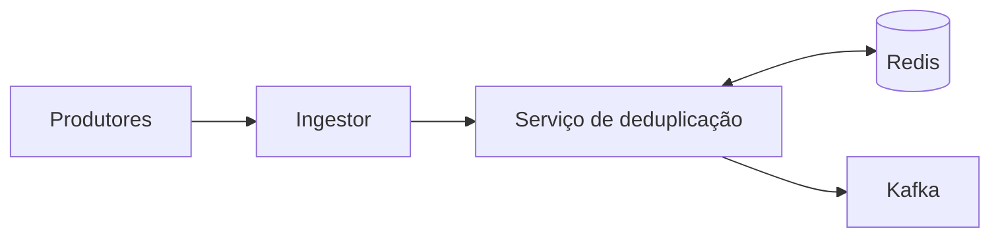

# Serviço de deduplicação de eventos · DD-2026-001

| | |
|---|---|
| **Documento** | DD-2026-001 |
| **Estado** | Rascunho |
| **Autores** | Rafael Nunes |
| **Revisores** | |
| **Criado em** | 2026-11-23 |
| **Última atualização** | 2026-11-23 |

## Motivação

O pipeline de ingestão recebe eventos duplicados dos produtores, que reenviam o mesmo evento quando fazem retry. No mês passado medimos 4% de eventos duplicados. As duplicatas inflam os relatórios de faturamento, e o financeiro já reclamou duas vezes.

## Proposta

Vamos criar um serviço de deduplicação que fica entre o ingestor e o Kafka. Para cada evento recebido, o serviço consulta o Redis usando a chave idempotente do evento. Se a chave já existe, o serviço descarta o evento. Se não existe, o serviço registra a chave no Redis com validade de 24 horas e encaminha o evento ao Kafka.

O ingestor deixa de publicar direto no Kafka e passa a enviar os eventos ao serviço de deduplicação. O serviço decide se um evento é repetido. O Redis guarda as chaves idempotentes por 24 horas, e o Kafka recebe os eventos que o serviço aceitou.

Como a deduplicação acontece antes do Kafka, a lógica existe em um lugar só. A janela de 24 horas significa que um reenvio depois desse prazo não é reconhecido como duplicata.

## Alternativas consideradas

Esta seção não existe no template. Ela registra as alternativas discutidas e fica aqui para que o motivo do descarte não se perca.

- **Deduplicar no consumidor.** Descartada: cada consumidor teria que reimplementar a deduplicação.
- **Idempotência nativa do produtor Kafka.** Descartada: ela não cobre o reenvio entre reinícios do produtor.

## Riscos

- **Latência no caminho crítico.** O serviço adiciona um salto à ingestão, com custo estimado de +5 ms de latência por evento. O time aceitou esse trade-off em troca da deduplicação centralizada.

Os demais riscos ainda não foram levantados e estão em [Perguntas abertas](#perguntas-abertas).

## Plano de rollout

As fases, os critérios de avanço e o rollback ainda não foram definidos e estão em [Perguntas abertas](#perguntas-abertas).

## Métricas de sucesso

- Taxa de eventos duplicados abaixo de 0,1% (baseline: 4% no mês passado).

A forma de medir essa taxa está em [Perguntas abertas](#perguntas-abertas).

## Perguntas abertas

- Como o serviço se comporta quando o Redis está indisponível: descarta, deixa passar ou rejeita eventos? Quais outros riscos a proposta traz e como mitigamos cada um?
- Quem gera a chave idempotente e de quais campos do evento ela é composta?
- O serviço registra a chave antes ou depois de o Kafka confirmar o recebimento do evento?
- Em quais fases o serviço entra em produção, qual critério permite avançar de fase e qual dispara o rollback?
- Como medimos a taxa de duplicatas para comparar com a meta de 0,1%?
- Quem revisa este documento?
