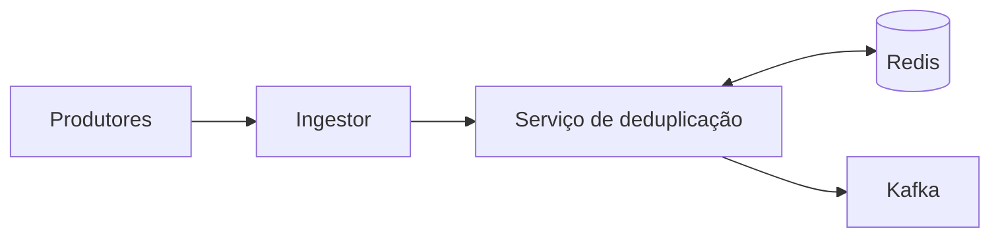

# Serviço de deduplicação de eventos · DD-2026-001

| | |
|---|---|
| **Documento** | DD-2026-001 |
| **Estado** | Rascunho |
| **Autores** | Rafael Nunes |
| **Revisores** | |
| **Criado em** | 2026-11-23 |
| **Última atualização** | 2026-11-23 |

## Motivação

O pipeline de ingestão recebe eventos duplicados dos produtores, que reenviam o mesmo evento quando fazem retry. Em outubro de 2026, 4% dos eventos recebidos eram duplicatas. As duplicatas inflam os relatórios de faturamento, e o financeiro já reclamou duas vezes.

Hoje nenhuma etapa entre o ingestor e o Kafka descarta duplicatas. O problema chega intacto aos consumidores e aos relatórios.

## Proposta

Vamos criar um serviço de deduplicação entre o ingestor e o Kafka. Para cada evento, o serviço consulta no Redis a chave idempotente do evento. Se a chave já existe, o serviço descarta o evento. Se não existe, o serviço registra a chave com validade de 24 horas e encaminha o evento ao Kafka.

O ingestor deixa de publicar direto no Kafka e passa a enviar os eventos ao serviço de deduplicação. O serviço é o único componente que consulta o Redis. O Redis guarda apenas as chaves idempotentes, cada uma por 24 horas. O Kafka recebe só os eventos que o serviço aprovou.

### Trade-off aceito

O serviço adiciona um salto ao caminho crítico da ingestão. Estimamos +5 ms de latência por evento. O time aceita esse custo em troca de eliminar as duplicatas antes que cheguem ao Kafka.

### Alternativas consideradas

- **Deduplicar no consumidor.** Descartada. Cada consumidor teria que reimplementar a deduplicação.
- **Usar a idempotência nativa do produtor Kafka.** Descartada. Ela não cobre o reenvio de um evento entre reinícios do produtor.
- **Não fazer nada.** Mantém os 4% de duplicatas e as distorções nos relatórios de faturamento, que o financeiro já apontou duas vezes.

## Riscos

O único risco estabelecido até aqui é o custo aceito acima: um salto a mais no caminho crítico, com +5 ms estimados de latência. Os demais riscos e suas mitigações estão em [Perguntas abertas](#perguntas-abertas).

## Plano de rollout

Ainda não definido. As decisões pendentes estão em [Perguntas abertas](#perguntas-abertas).

## Métricas de sucesso

- Taxa de eventos duplicados abaixo de 0,1%, a partir dos 4% medidos em outubro de 2026.

O limite aceitável para a latência adicionada está em [Perguntas abertas](#perguntas-abertas).

## Perguntas abertas

- **Riscos:** o que pode dar errado com o serviço e com o Redis, e como mitigamos cada caso? Em particular, o que o serviço faz com o evento quando o Redis não responde?
- **Rollout:** quais são as fases, o critério de avanço entre elas e o critério de rollback?
- **Latência:** a estimativa de +5 ms foi medida ou projetada? Acima de qual valor o custo deixa de ser aceitável?
- **Chave idempotente:** quem gera a chave de cada evento e em que ponto do fluxo ela passa a existir?
- **Revisores:** quem revisa este documento?
