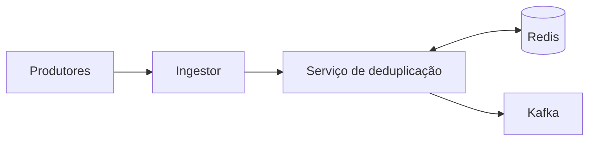

# Serviço de deduplicação de eventos · DD-2026-001

| | |
|---|---|
| **Documento** | DD-2026-001 |
| **Estado** | Rascunho |
| **Autores** | Rafael Nunes |
| **Revisores** | |
| **Criado em** | 2026-11-23 |
| **Última atualização** | 2026-11-23 |

## Motivação

O pipeline de ingestão recebe eventos duplicados dos produtores, que reenviam o mesmo evento quando fazem retry. No mês passado medimos 4% de duplicatas. Essas duplicatas inflam os relatórios de faturamento, e o financeiro já reclamou duas vezes.

## Proposta

Vamos criar um serviço de deduplicação entre o ingestor e o Kafka. Para cada evento, o serviço consulta a chave idempotente no Redis. Se a chave já existe, o serviço descarta o evento. Se não existe, o serviço guarda a chave por 24 horas e o evento segue para o Kafka.

O ingestor deixa de publicar direto no Kafka e entrega os eventos ao serviço de deduplicação. O serviço usa o Redis como memória das chaves já vistas nas últimas 24 horas. Só os eventos novos chegam ao Kafka, então os consumidores recebem o fluxo já sem repetidos e não precisam tratar duplicatas.

### Alternativas consideradas

O template não tem uma seção para alternativas. Esta seção registra o que discutimos e por que cada opção perdeu.

- **Deduplicar no consumidor.** Cada consumidor teria que reimplementar a deduplicação. Descartada por esse custo repetido.
- **Idempotência nativa do produtor Kafka.** Não cobre o reenvio entre reinícios do produtor, que é parte do problema. Descartada.
- **Não fazer nada.** Os 4% de duplicatas continuam chegando aos relatórios de faturamento.

## Riscos

**Latência no caminho crítico.** O serviço adiciona um salto ao caminho crítico da ingestão. Estimamos +5 ms de latência por evento. A equipe aceitou esse custo em troca de resolver a duplicidade em um único ponto.

Os demais riscos e suas mitigações ainda não foram levantados. Ver [Perguntas abertas](#perguntas-abertas).

## Plano de rollout

As fases, os critérios de avanço e o critério de rollback ainda não foram definidos. Ver [Perguntas abertas](#perguntas-abertas).

## Métricas de sucesso

| Métrica | Hoje | Meta |
|---|---|---|
| Taxa de eventos duplicados | 4% (medida no mês passado) | abaixo de 0,1% |

Acompanhamos também a latência adicionada na ingestão. Os +5 ms são uma estimativa a validar, não uma meta.

## Perguntas abertas

1. **Chave idempotente.** Quem gera a chave de cada evento e com qual formato? O que acontece com um evento que chega sem chave?
2. **Riscos.** Além da latência, o que pode dar errado e como mitigamos cada risco? Isso inclui o comportamento do serviço quando o Redis estiver indisponível.
3. **Rollout.** Quais as fases de entrada em produção, o critério para avançar de uma fase e o critério de rollback?
4. **Medição.** Como e onde medimos a taxa de duplicatas para comparar os 4% atuais com a meta de 0,1%? Qual o limite aceitável de latência além da estimativa de +5 ms?
5. **Revisores.** Quem revisa este documento além do time de arquitetura?
