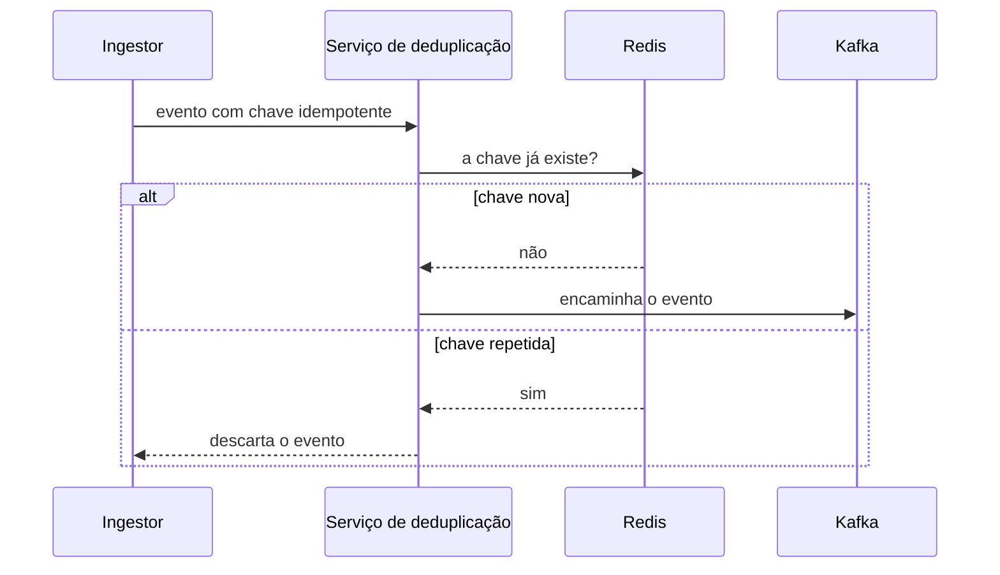

# Serviço de deduplicação de eventos · DD-2026-<seq>

| | |
|---|---|
| **Documento** | DD-2026-<seq> |
| **Estado** | Rascunho |
| **Autores** | Rafael Nunes |
| **Revisores** | |
| **Criado em** | 2026-11-22 |
| **Última atualização** | 2026-11-22 |

## Motivação

O pipeline de ingestão recebe eventos duplicados dos produtores, que reenviam o mesmo evento quando fazem retry. Em outubro de 2026 medimos 4% de eventos duplicados. As duplicatas inflam os relatórios de faturamento, e o financeiro já reclamou duas vezes.

## Proposta

Criar um serviço de deduplicação que fica entre o ingestor e o Kafka. Para cada evento recebido, o serviço consulta a chave idempotente do evento no Redis. Se a chave já existe, o serviço descarta o evento. Se não existe, o serviço guarda a chave por 24 horas e encaminha o evento ao Kafka.

O ingestor continua responsável por receber os eventos dos produtores. O serviço de deduplicação decide se o evento segue para o Kafka. O Redis guarda as chaves já vistas, cada uma por 24 horas.

### Alternativas consideradas

| Alternativa | Resultado | Motivo |
|---|---|---|
| Não fazer nada | ✗ Descartada | Os 4% de duplicatas continuam inflando os relatórios de faturamento. |
| Deduplicar no consumidor | ✗ Descartada | Cada consumidor teria que reimplementar a deduplicação. |
| Idempotência nativa do produtor Kafka | ✗ Descartada | Não cobre o reenvio entre reinícios do produtor. |
| Serviço entre o ingestor e o Kafka, com chaves no Redis por 24h | ✓ Escolhida | Deduplica em um ponto só, antes do Kafka, e cobre os reenvios que a idempotência nativa não cobre. |

### Trade-off aceito

O serviço adiciona um salto no caminho crítico da ingestão. Estimamos +5 ms de latência por evento. Aceitamos esse custo para deduplicar uma vez, antes do Kafka, em vez de em cada consumidor.

## Riscos

- Latência no caminho crítico: todo evento passa por um salto a mais, estimado em +5 ms. A mitigação está em Perguntas abertas.
- Os demais riscos e suas mitigações também estão em Perguntas abertas.

## Plano de rollout

Ainda não definido. As fases, os critérios de avanço e o rollback dependem das respostas em Perguntas abertas.

## Métricas de sucesso

| Métrica | Hoje | Meta |
|---|---|---|
| Eventos duplicados no pipeline | 4% (outubro de 2026) | abaixo de 0,1% |
| Latência adicionada à ingestão | não se aplica | estimada em +5 ms; confirmar com medição |

## Perguntas abertas

Cabeçalho e processo
- Qual é o número sequencial deste documento (DD-2026-\<seq\>)?
- Quem revisa? Arquitetura é o destino do documento, mas faltam os nomes e as áreas impactadas (financeiro, donos dos produtores, donos dos consumidores, infraestrutura do Redis e do Kafka).

Proposta
- O que o serviço faz quando o Redis está indisponível: deixa o evento passar (e aceita duplicatas) ou bloqueia a ingestão?
- O serviço registra a chave antes ou depois de o Kafka confirmar o recebimento? Em qual ordem, e o que acontece com um evento cuja chave foi gravada mas que não chegou ao Kafka?
- Quem gera a chave idempotente: o produtor ou o ingestor? Todos os produtores já enviam uma?
- O Redis é um cluster novo ou um existente? Qual o volume de chaves esperado em 24 horas?
- O serviço roda em várias instâncias? Como ele evita que duas instâncias aceitem o mesmo evento ao mesmo tempo?
- O que acontece com reenvios que chegam depois das 24 horas? A meta de 0,1% considera esse caso?
- O serviço descarta o evento repetido em silêncio ou devolve uma resposta ao ingestor? Existe contagem dos descartes?

Riscos
- Quais outros riscos o time enxerga, e qual a mitigação de cada um?
- A latência de +5 ms cabe no orçamento de latência da ingestão? Qual é esse orçamento?

Rollout
- Como entra em produção: tudo de uma vez ou em fases (por exemplo, modo observação sem descartar, depois por produtor)?
- Qual critério avança cada fase e qual dispara o rollback?

Métricas
- Como medimos o percentual de duplicatas depois do serviço (mesma medição de outubro de 2026)? Em qual janela de tempo a meta de 0,1% é avaliada?
