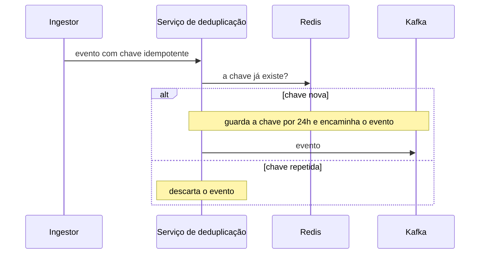

# Serviço de deduplicação de eventos · DD-2026-001

| | |
|---|---|
| **Documento** | DD-2026-001 |
| **Estado** | Rascunho |
| **Autores** | Rafael Nunes |
| **Revisores** | |
| **Criado em** | 2026-11-22 |
| **Última atualização** | 2026-11-22 |

## Motivação

O pipeline de ingestão recebe eventos duplicados dos produtores, que reenviam o mesmo evento quando fazem retry. No mês passado medimos 4% de duplicatas. Elas inflam os relatórios de faturamento, e o financeiro já reclamou duas vezes.

## Proposta

Vamos criar um serviço de deduplicação que fica entre o ingestor e o Kafka. Cada evento carrega uma chave idempotente. O serviço guarda essa chave no Redis por 24 horas e descarta todo evento cuja chave já esteja lá. Só eventos com chave nova seguem para o Kafka.

O ingestor entrega cada evento ao serviço em vez de publicá-lo direto no Kafka. O serviço consulta o Redis. Se a chave não existe, o serviço a guarda com validade de 24 horas e envia o evento ao Kafka. Se existe, o serviço descarta o evento. O diagrama não fixa a ordem entre guardar a chave e publicar no Kafka, nem o que acontece quando o Redis não responde. Essas duas decisões estão em Perguntas abertas.

Como a validade da chave é de 24 horas, o serviço só reconhece reenvios que chegam dentro dessa janela.

### Alternativas consideradas

Este bloco não existe no template. Ele registra as alternativas que discutimos, para que o motivo do descarte fique escrito.

- **Deduplicar no consumidor.** Descartada: cada consumidor teria que reimplementar a deduplicação.
- **Idempotência nativa do produtor Kafka.** Descartada: não cobre reenvio entre reinícios do produtor.
- **Manter o cenário atual.** As duplicatas continuam em 4% e continuam inflando o faturamento.

### Trade-off aceito

O serviço adiciona um salto ao caminho crítico da ingestão. Estimamos +5ms de latência por evento. Aceitamos esse custo em troca de uma deduplicação única, feita antes do Kafka, que nenhum consumidor precisa repetir.

## Riscos

- **Latência no caminho crítico.** O salto extra custa cerca de 5ms por evento (estimativa, ainda não medida). Mitigação: pendente, ver Perguntas abertas.
- **Redis passa a ser dependência da ingestão.** Todo evento consulta o Redis antes de chegar ao Kafka. Mitigação: pendente, ver Perguntas abertas.
- **Duplicatas fora da janela de 24h.** Um reenvio que chega depois de 24 horas da primeira entrega não é reconhecido. Mitigação: pendente, ver Perguntas abertas.

## Plano de rollout

Ainda não definido. As fases, os critérios de avanço e o critério de rollback dependem das respostas em Perguntas abertas.

## Métricas de sucesso

| Métrica | Base | Meta |
|---|---|---|
| Duplicatas no pipeline | 4% (mês passado) | abaixo de 0,1% |
| Latência adicionada à ingestão | não medida | estimativa de +5ms |

## Perguntas abertas

1. Quem são os revisores deste documento?
2. Quem gera a chave idempotente de cada evento (o produtor ou o ingestor), e de que campos ela é composta?
3. O serviço guarda a chave antes ou depois de publicar no Kafka? Se publicar e falhar, a chave fica guardada e o evento se perde?
4. O que o serviço faz quando o Redis está indisponível ou lento: deixa passar os eventos (e aceita duplicatas) ou bloqueia a ingestão?
5. Por que 24 horas? Os reenvios que medimos chegam sempre dentro dessa janela?
6. A latência de +5ms tem um teto aceitável? Em qual percentil medimos?
7. O Redis será dedicado ao serviço ou compartilhado? Qual o volume de eventos por segundo e a memória estimada para 24h de chaves?
8. O serviço roda em múltiplas instâncias? Como duas instâncias recebendo o mesmo evento ao mesmo tempo evitam passar os dois?
9. Como será o rollout: fases, critério de avanço e de rollback? Existe um modo de observação (medir sem descartar) antes de ligar o descarte?
10. Como medimos os 0,1%: em qual ponto do pipeline e com qual definição de duplicata?
11. O que acontece com os eventos descartados: há contagem, log ou nada?
12. Quais equipes além da de ingestão são afetadas (financeiro, donos de produtores e consumidores, plataforma do Redis e do Kafka)?
13. O número do documento (DD-2026-001) está certo? Não há outros documentos em `docs/design/`.
