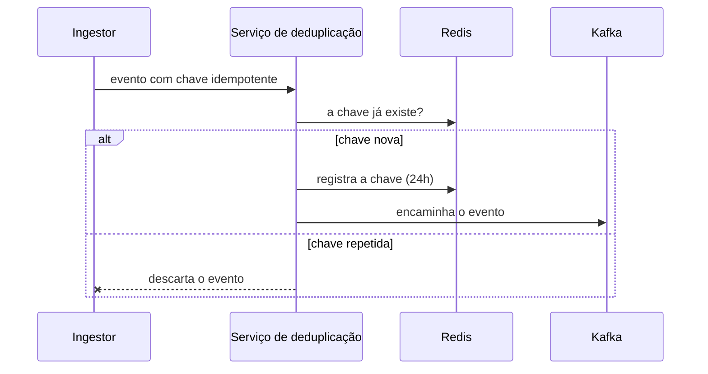

# Serviço de deduplicação de eventos · DD-2026-001

| | |
|---|---|
| **Documento** | DD-2026-001 |
| **Estado** | Rascunho |
| **Autores** | Rafael Nunes |
| **Revisores** | |
| **Criado em** | 2026-11-22 |
| **Última atualização** | 2026-11-22 |

## Motivação

O pipeline de ingestão recebe eventos duplicados dos produtores, que reenviam o mesmo evento quando fazem retry. Em outubro de 2026 medimos 4% de eventos duplicados. As duplicatas inflam os relatórios de faturamento, e o financeiro já reclamou duas vezes.

## Proposta

Criamos um serviço de deduplicação entre o ingestor e o Kafka. Para cada evento recebido, o serviço consulta a chave idempotente do evento no Redis. Se a chave é nova, o serviço a registra e encaminha o evento ao Kafka. Se a chave já existe, o serviço descarta o evento. Cada chave fica guardada no Redis por 24 horas.

O ingestor entrega cada evento ao serviço em vez de publicar direto no Kafka. O serviço decide, com base na chave guardada no Redis, se o evento segue ou não. Só eventos com chave inédita nas últimas 24 horas chegam ao Kafka. Um reenvio que chegue depois de 24 horas passa como evento novo.

### Alternativas consideradas

**Deduplicar no consumidor.** Descartada. Cada consumidor teria que reimplementar a deduplicação.

**Usar a idempotência nativa do produtor Kafka.** Descartada. Ela não cobre o reenvio entre reinícios do produtor.

**Não fazer nada.** Mantém os 4% de duplicatas e a inflação dos relatórios de faturamento.

### Trade-off aceito

O serviço adiciona mais um salto ao caminho crítico da ingestão. Estimamos +5 ms de latência por evento. Aceitamos esse custo em troca de deduplicar em um único lugar, antes do Kafka, para todos os consumidores.

## Riscos

| Risco | Mitigação |
|---|---|
| O serviço entra no caminho crítico da ingestão e acrescenta cerca de 5 ms de latência (estimativa, ainda não medida). | Aceito pela equipe. Validar a estimativa antes do rollout (ver Perguntas abertas). |
| O serviço depende do Redis para decidir cada evento. | A definir (ver Perguntas abertas). |
| A janela é de 24 horas, então um reenvio após esse prazo não é detectado. | A definir (ver Perguntas abertas). |

## Plano de rollout

A definir. As fases, os critérios de avanço e de rollback estão nas Perguntas abertas.

## Métricas de sucesso

| Métrica | Hoje | Meta |
|---|---|---|
| Eventos duplicados no pipeline | 4% (outubro de 2026) | abaixo de 0,1% |
| Latência adicionada à ingestão | não se aplica | estimada em +5 ms (a confirmar por medição) |

## Perguntas abertas

Perguntas para Rafael Nunes, que não estavam respondidas na escrita deste rascunho.

**Rollout**
1. Como o serviço entra em produção? Em fases (por exemplo, por produtor ou por percentual do tráfego), ou de uma vez?
2. Qual é o critério para avançar de uma fase à seguinte, e qual é o critério de rollback?

**Falhas e riscos**
3. O que o serviço faz quando o Redis está indisponível: deixa os eventos passarem (aceitando duplicatas) ou bloqueia a ingestão?
4. O Redis será dedicado a este serviço ou compartilhado? Haverá réplica ou alta disponibilidade?
5. Um reenvio depois de 24 horas é aceitável como duplicata residual? As 24 horas cobrem o maior intervalo de retry dos produtores?

**Chave e métricas**
6. Quem gera a chave idempotente, o produtor ou o ingestor, e todos os produtores já a enviam hoje?
7. Os +5 ms são um limite que não podemos ultrapassar ou apenas uma estimativa? Há um orçamento de latência da ingestão?
8. Como mediremos a taxa de duplicatas depois do lançamento, e a meta de 0,1% vale para qual janela de tempo?

**Impacto e revisão**
9. Quem revisa este documento? Outros times são afetados além do financeiro, dos times produtores e dos times consumidores?
10. A numeração DD-2026-001 está correta? Não há outros documentos em `docs/design/`, então assumi o primeiro número do ano.
