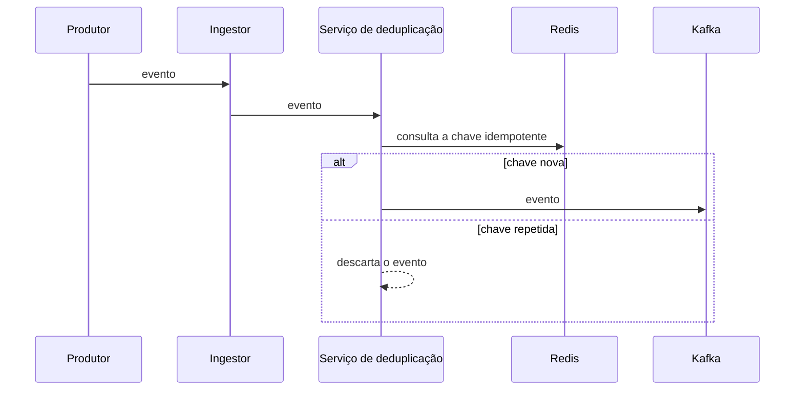

# Serviço de deduplicação de eventos · DD-2026-001

| | |
|---|---|
| **Documento** | DD-2026-001 |
| **Estado** | Rascunho |
| **Autores** | Rafael Nunes |
| **Revisores** | Aguarda resposta (pergunta 1) |
| **Criado em** | 2026-11-22 |
| **Última atualização** | 2026-11-22 |

## Motivação

O pipeline de ingestão recebe eventos duplicados dos produtores, que reenviam o mesmo evento quando fazem retry. Em outubro de 2026 medimos 4% de duplicatas. Elas inflam os relatórios de faturamento, e o financeiro já reclamou duas vezes.

## Proposta

Criamos um serviço de deduplicação entre o ingestor e o Kafka. Cada evento carrega uma chave idempotente. O serviço guarda essa chave no Redis por 24 horas e descarta todo evento cuja chave já esteja lá.

O produtor envia o evento ao ingestor, que o repassa ao serviço de deduplicação. O serviço consulta a chave idempotente do evento no Redis. Se a chave é nova, ele guarda a chave com validade de 24 horas e encaminha o evento ao Kafka. Se a chave já existe, ele descarta o evento.

Como a validade da chave é de 24 horas, um reenvio que chegue depois dessa janela não é reconhecido como duplicata. Esse limite é parte da proposta.

O serviço entra no caminho crítico da ingestão. Estimamos +5 ms de latência por evento, e a equipe aceita esse custo em troca da redução de duplicatas.

## Alternativas consideradas

O template não tem lugar para alternativas, então esta seção foi acrescentada entre Proposta e Riscos.

**Não fazer nada.** Mantém os 4% de duplicatas e as reclamações do financeiro sobre o faturamento.

**Deduplicar no consumidor.** Descartada. Cada consumidor teria que reimplementar a deduplicação.

**Idempotência nativa do produtor Kafka.** Descartada. Ela não cobre o reenvio entre reinícios do produtor, e esse é um dos cenários de duplicata que queremos eliminar.

**Serviço entre o ingestor e o Kafka (escolhida).** Resolve a deduplicação em um único ponto, para todos os consumidores. Em troca, adiciona um salto ao caminho crítico da ingestão, com +5 ms estimados.

## Riscos

**Latência no caminho crítico.** O serviço é mais um salto entre o ingestor e o Kafka. A estimativa é de +5 ms por evento. A mitigação e o limite máximo aceitável aguardam resposta (pergunta 5).

Outros riscos, como a indisponibilidade do Redis ou do próprio serviço, aguardam resposta (pergunta 2).

## Plano de rollout

Aguarda resposta (pergunta 4).

## Métricas de sucesso

| Métrica | Hoje | Meta |
|---|---|---|
| Taxa de eventos duplicados | 4% (outubro de 2026) | Abaixo de 0,1% |

A latência adicional estimada é de +5 ms. Ela ainda não tem meta formal (pergunta 5).

## Perguntas abertas

1. Quem revisa este documento? O time de arquitetura precisa constar no cabeçalho? O número de sequência DD-2026-001 também precisa de confirmação, pois não há outros documentos no repositório.
2. Quais riscos e mitigações a equipe vê? Em especial: o que o serviço faz se o Redis estiver indisponível (descarta, deixa passar ou rejeita o evento)? E o que acontece com a chave se o evento falhar ao ser gravado no Kafka depois de a chave ser registrada?
3. De onde vem a chave idempotente de cada evento? O produtor a gera, ou o serviço a deriva do conteúdo?
4. Como o serviço entra em produção? Quais fases, com que critério de avanço e de rollback?
5. Qual é o limite máximo de latência adicional aceitável no ingestor, além dos +5 ms estimados? Como e onde vamos medi-la?
6. Como medimos a taxa de duplicatas depois do lançamento? Usamos o mesmo método dos 4% medidos em outubro?
