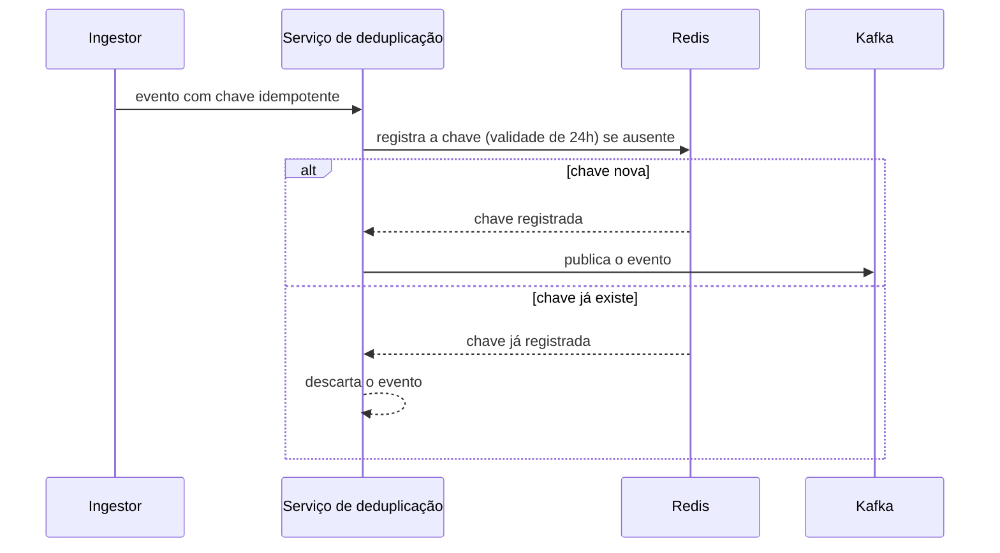

# Serviço de deduplicação de eventos · DD-2026-001

| | |
|---|---|
| **Documento** | DD-2026-001 |
| **Estado** | Rascunho |
| **Autores** | Rafael Nunes |
| **Revisores** | |
| **Criado em** | 2026-11-23 |
| **Última atualização** | 2026-11-23 |

## Motivação

Os produtores reenviam eventos quando fazem retry, e o pipeline de ingestão recebe essas cópias como se fossem eventos novos. No mês anterior a este documento, medimos 4% de eventos duplicados. As duplicatas inflam os relatórios de faturamento, e o financeiro já reclamou duas vezes.

Hoje nenhum componente do pipeline descarta as cópias antes que cheguem ao Kafka. Fazer nada mantém o erro nos relatórios de faturamento.

## Proposta

Criamos um serviço de deduplicação que fica entre o ingestor e o Kafka. Para cada evento recebido, o serviço consulta no Redis a chave idempotente do evento. Se a chave não existe, o serviço a grava com validade de 24 horas e encaminha o evento ao Kafka. Se a chave já existe, o serviço descarta o evento.

O ingestor continua responsável por receber os eventos dos produtores e passa a entregá-los ao serviço de deduplicação, não mais direto ao Kafka. O serviço decide se o evento é novo a partir da chave idempotente guardada no Redis. O Redis guarda cada chave por 24 horas, então o serviço reconhece como repetido um evento cuja chave entrou nessa janela. O Kafka só recebe eventos que o serviço considerou novos.

### Alternativas consideradas

- **Deduplicar no consumidor.** Cada consumidor teria que reimplementar a deduplicação. Descartada.
- **Usar a idempotência nativa do produtor Kafka.** Ela não cobre o reenvio que acontece entre reinícios do produtor. Descartada.
- **Não fazer nada.** Mantém 4% de duplicatas e o erro nos relatórios de faturamento. Descartada.

### Trade-off aceito

O serviço adiciona um salto ao caminho crítico da ingestão. Estimamos +5 ms de latência por evento. A equipe aceita esse custo em troca de resolver a deduplicação num ponto único, antes do Kafka.

## Riscos

- **Latência no caminho crítico.** O novo salto custa cerca de +5 ms (estimativa, ainda não medida). É um custo aceito, descrito em "Trade-off aceito".

Os demais riscos (falhas do novo serviço e do Redis, por exemplo) ainda não foram levantados. Ver Perguntas abertas.

## Plano de rollout

Ainda não definido. Ver Perguntas abertas.

## Métricas de sucesso

- Taxa de eventos duplicados abaixo de 0,1% (hoje, 4%).
- Latência adicional da ingestão: estimativa de +5 ms. O limite aceitável ainda precisa ser definido (ver Perguntas abertas).

## Perguntas abertas

**Riscos**

1. O que acontece com a ingestão se o serviço de deduplicação ou o Redis ficar indisponível? O ingestor para, descarta ou envia direto ao Kafka?
2. Como o serviço garante que gravar a chave no Redis e publicar no Kafka não deixem o estado inconsistente? Se o serviço grava a chave e falha antes de publicar, o reenvio do produtor é descartado e o evento se perde.
3. Quais outros riscos a equipe enxerga (capacidade do Redis, perda de dados do Redis, escala do serviço)?

**Rollout**

4. Em quais fases o serviço entra em produção (por exemplo, por produtor ou por percentual de tráfego)?
5. Qual o critério para avançar de uma fase para a seguinte?
6. Qual o critério e o procedimento de rollback?

**Métricas**

7. Como e onde medimos a taxa de duplicatas para comprovar a meta de 0,1%?
8. Qual o limite de latência adicional que consideramos aceitável, e quem mede o valor real após o rollout?

**Proposta**

9. Como o produtor gera a chave idempotente de cada evento, e quem garante que ela é estável entre reenvios?
10. Reenvios que chegam depois da janela de 24 horas ficam fora da deduplicação. Isso é aceitável?
11. Qual o impacto no faturamento dos eventos duplicados já gravados no histórico? O financeiro precisa de correção retroativa?
12. Quais tecnologias e protocolos o serviço usa (linguagem, comunicação entre ingestor e serviço, forma de implantação)? O diagrama os omite de propósito.

**Documento**

13. Quem revisa este documento? O campo "Revisores" está vazio.
14. O número DD-2026-001 foi assumido por não haver outros documentos em `docs/design/`. Confirme ou indique o número correto.
