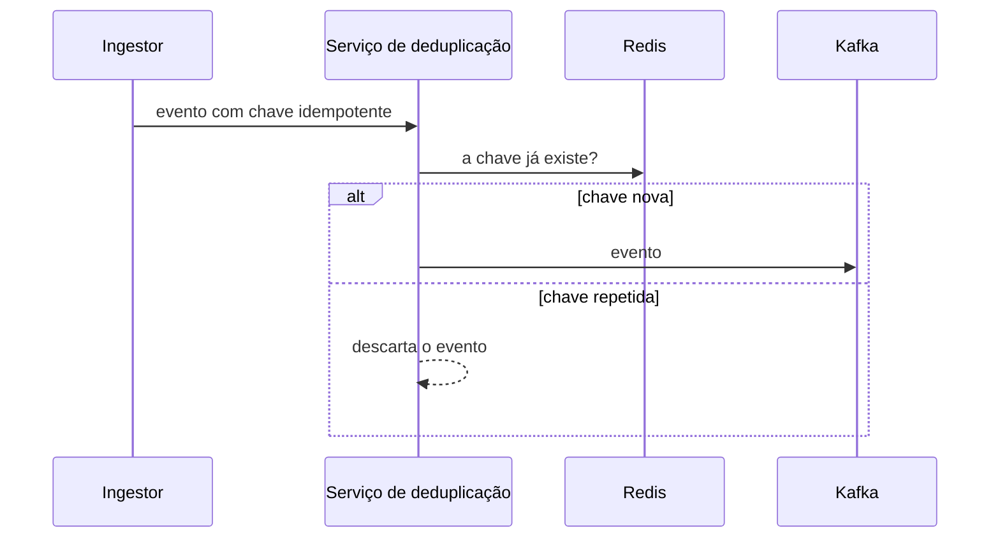

# Serviço de deduplicação de eventos · DD-2026-001

| | |
|---|---|
| **Documento** | DD-2026-001 |
| **Estado** | Rascunho |
| **Autores** | Rafael Nunes |
| **Revisores** | |
| **Criado em** | 2026-11-23 |
| **Última atualização** | 2026-11-23 |

## Motivação

O pipeline de ingestão recebe eventos duplicados dos produtores, que reenviam o mesmo evento em retry. No mês passado (outubro de 2026) medimos 4% de duplicatas. Os eventos duplicados inflam os relatórios de faturamento, e o financeiro já reclamou duas vezes.

## Proposta

Vamos criar um serviço de deduplicação entre o ingestor e o Kafka. Para cada evento recebido, o serviço consulta no Redis a chave idempotente do evento. Se a chave já existe, o serviço descarta o evento. Se não existe, o serviço encaminha o evento ao Kafka. O Redis guarda cada chave por 24 horas.

O ingestor entrega cada evento ao serviço de deduplicação em vez de entregá-lo direto ao Kafka. O serviço decide se o evento é novo ou repetido com base no Redis e só encaminha os novos. O Kafka passa a receber apenas eventos cuja chave não apareceu nas últimas 24 horas, então os consumidores não precisam tratar duplicatas.

### Trade-off aceito

O serviço adiciona um salto no caminho crítico da ingestão. Estimamos +5 ms de latência por evento. Aceitamos esse custo em troca de eliminar a duplicata antes de ela chegar ao Kafka e aos relatórios de faturamento.

## Alternativas consideradas

Esta seção não existe no template. Ela registra as alternativas discutidas pelo time e fica aqui para preservar a ordem das seções do template.

- **Não mudar nada.** O pipeline segue com os 4% de duplicatas medidos, e os relatórios de faturamento continuam inflados.
- **Deduplicar no consumidor.** Descartada, porque cada consumidor teria que reimplementar a deduplicação.
- **Usar a idempotência nativa do produtor Kafka.** Descartada, porque ela não cobre o reenvio entre reinícios do produtor.

## Riscos

- **Latência no caminho crítico.** O novo salto custa cerca de +5 ms por evento (estimativa, ainda não medida). O time aceitou esse custo.

Os demais riscos (comportamento quando o Redis ou o serviço ficam indisponíveis, por exemplo) ainda não foram levantados. Estão em [Perguntas abertas](#perguntas-abertas).

## Plano de rollout

O plano de fases, critérios de avanço e de rollback ainda não existe. Está em [Perguntas abertas](#perguntas-abertas).

## Métricas de sucesso

- Taxa de duplicatas abaixo de 0,1% (hoje 4%, medida em outubro de 2026).
- Latência adicional na ingestão: estimativa de +5 ms, a confirmar na medição.

## Perguntas abertas

1. **Revisores.** Quem revisa este documento além do time de arquitetura?
2. **Chave idempotente.** Quem gera a chave de cada evento (produtor ou ingestor)? Todos os produtores já enviam uma chave estável entre reenvios?
3. **Janela de 24h.** Por que 24 horas? Ela cobre a maior janela de retry dos produtores? Duplicatas que chegam depois dela passam?
4. **Falha do Redis.** Se o Redis estiver indisponível, o serviço deixa os eventos passarem (risco de duplicata) ou os bloqueia (risco de perder disponibilidade da ingestão)?
5. **Falha do serviço.** O que acontece com a ingestão se o serviço de deduplicação cair? Ele é um ponto único de falha? Como escala?
6. **Ordem e atomicidade.** O serviço registra a chave antes ou depois de publicar no Kafka? Se publicar falhar depois de registrar a chave, o retry do produtor é descartado como duplicata e o evento se perde?
7. **Redis.** Usaremos um Redis existente ou um novo? Qual o dimensionamento esperado (eventos por segundo, memória para 24h de chaves)?
8. **Latência.** De onde vem a estimativa de +5 ms? Existe um orçamento de latência da ingestão que ela precisa respeitar?
9. **Medição da meta.** Como medimos os 0,1% (mesma metodologia dos 4%)? Em que prazo após o rollout?
10. **Rollout.** Em quantas fases entra em produção (por produtor, por tipo de evento, por percentual de tráfego)? Qual o critério de avanço e de rollback?
11. **Riscos.** Que outros riscos o time enxerga, e quais as mitigações?
12. **Impacto em outras equipes.** Quais times (produtores, consumidores, financeiro, infraestrutura) precisam ser avisados ou revisar?
13. **Numeração.** `docs/design/` não tinha outros documentos, então usei DD-2026-001. Confirma?
