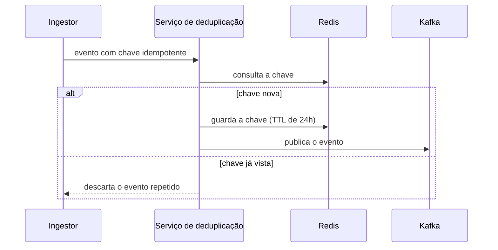

# Serviço de deduplicação de eventos · DD-2026-001

| | |
|---|---|
| **Documento** | DD-2026-001 |
| **Estado** | Rascunho |
| **Autores** | Rafael Nunes |
| **Revisores** | |
| **Criado em** | 2026-11-23 |
| **Última atualização** | 2026-11-23 |

## Motivação

O pipeline de ingestão recebe eventos duplicados dos produtores, que reenviam o mesmo evento quando fazem retry. No mês passado medimos 4% de eventos duplicados. As duplicatas inflam os relatórios de faturamento, e o financeiro já reclamou duas vezes por causa disso.

## Proposta

Criar um serviço de deduplicação que fica entre o ingestor e o Kafka. Para cada evento recebido, o serviço consulta a chave idempotente do evento no Redis. Se a chave já existe, o serviço descarta o evento. Se não existe, o serviço guarda a chave no Redis por 24 horas e entrega o evento ao Kafka.

O ingestor continua recebendo os eventos dos produtores, mas deixa de publicar direto no Kafka e passa a enviar cada evento ao serviço de deduplicação. O serviço decide, com base na chave idempotente guardada no Redis, se o evento segue para o Kafka ou se é descartado. Só os eventos com chave nova chegam ao Kafka, então os consumidores recebem o fluxo já sem repetições e não precisam tratar duplicatas. O Redis guarda cada chave por 24 horas, e o serviço usa essa janela para reconhecer reenvios.

### Alternativas consideradas

**Deduplicar no consumidor.** Cada consumidor teria que implementar a própria deduplicação. Descartamos porque cada consumidor teria que reimplementar a lógica.

**Usar a idempotência nativa do produtor Kafka.** Descartamos porque ela não cobre o reenvio entre reinícios do produtor.

### Trade-off aceito

O serviço adiciona mais um salto no caminho crítico da ingestão. Estimamos +5ms de latência por evento. Aceitamos esse custo para atingir a meta de duplicatas.

## Riscos

O risco aceito até aqui é a latência adicional de cerca de 5ms no caminho crítico (ver Trade-off aceito). Os demais riscos e suas mitigações ainda não foram levantados; ver as perguntas 6 e 7 em Perguntas abertas.

## Plano de rollout

Ainda não definido; ver a pergunta 8 em Perguntas abertas.

## Métricas de sucesso

- Taxa de eventos duplicados abaixo de 0,1% (hoje 4%, medida no mês passado).

Como medimos a taxa e quais outras métricas acompanhamos: ver a pergunta 9 em Perguntas abertas.

## Perguntas abertas

1. Qual é o número da sequência deste documento? Usei `DD-2026-001` porque não há outros documentos em `docs/design/`.
2. Quem revisa este documento? O campo Revisores está vazio.
3. De onde vem a chave idempotente? Quem a gera (produtor, ingestor) e ela já existe hoje em todos os eventos?
4. O que o serviço faz quando o Redis está indisponível: deixa os eventos passarem ou os bloqueia?
5. Por que 24 horas? O que acontece com um reenvio que chega depois da janela?
6. Que outros riscos existem além da latência (consistência entre a consulta e o registro da chave, capacidade do Redis, disponibilidade do novo serviço) e como cada um é mitigado?
7. O estimado de +5ms foi medido ou é uma projeção? Há um limite de latência que o pipeline não pode ultrapassar?
8. Como o serviço entra em produção: em fases, com qual critério de avanço e qual critério de rollback?
9. Como medimos a taxa de duplicatas para verificar a meta de 0,1%, e em qual período? Queremos metas ou alertas para latência e disponibilidade do serviço?
10. Quais times são afetados (produtores, consumidores, financeiro) e algum deles precisa aprovar ou mudar algo?
11. Quem opera o serviço e qual é a tecnologia de implementação?
12. Consideramos não fazer nada? Se sim, por que foi descartado?
