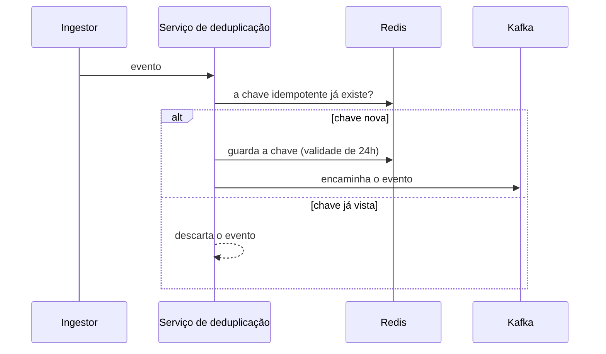

# Serviço de deduplicação de eventos · DD-2026-001

| | |
|---|---|
| **Documento** | DD-2026-001 |
| **Estado** | Rascunho |
| **Autores** | Rafael Nunes |
| **Revisores** | A definir ([pergunta 1](#perguntas-abertas)) |
| **Criado em** | 2026-11-23 |
| **Última atualização** | 2026-11-23 |

## Motivação

O pipeline de ingestão recebe eventos duplicados dos produtores. A duplicata nasce do reenvio: quando um produtor faz retry, o mesmo evento chega mais de uma vez. No mês passado medimos 4% de duplicatas.

Essas duplicatas inflam os relatórios de faturamento. O financeiro já reclamou duas vezes.

## Proposta

### Visão geral

Vamos construir um serviço de deduplicação que fica entre o ingestor e o Kafka. Para cada evento, o serviço consulta a chave idempotente do evento no Redis. Se a chave ainda não existe, o serviço guarda a chave com validade de 24h e encaminha o evento ao Kafka. Se a chave já existe, o serviço descarta o evento como repetido.

O custo aceito é mais um salto no caminho crítico da ingestão, com latência adicional estimada em 5ms.

### Fluxo

O ingestor entrega cada evento ao serviço de deduplicação, e o serviço encaminha ao Kafka apenas os eventos novos. O serviço usa o Redis como memória das chaves vistas nas últimas 24h: uma chave presente no Redis significa que o evento já passou pelo serviço nesse período.

O diagrama mostra a decisão (guardar a chave e encaminhar, ou descartar), não a ordem exata entre gravar a chave no Redis e publicar no Kafka. Essa ordem ainda não foi definida ([pergunta 4](#perguntas-abertas)).

### Custo aceito

- ✓ A deduplicação acontece em um ponto só, antes do Kafka. Os consumidores não precisam reimplementá-la.
- ✓ Cobre o reenvio entre reinícios do produtor, caso que a idempotência nativa do produtor Kafka não cobre.
- ✗ Mais um salto no caminho crítico da ingestão. Estimamos +5ms de latência por evento. É uma estimativa, ainda não medida ([pergunta 6](#perguntas-abertas)).

### Alternativas descartadas

| Alternativa | Por que foi descartada |
|---|---|
| Não fazer nada | As duplicatas seguem em 4% e continuam inflando os relatórios de faturamento, que já geraram duas reclamações do financeiro. |
| Deduplicar no consumidor | Cada consumidor teria que reimplementar a deduplicação. |
| Idempotência nativa do produtor Kafka | Não cobre o reenvio entre reinícios do produtor. |
| **Serviço de deduplicação entre ingestor e Kafka (escolhida)** | Deduplica em um ponto só e cobre reinícios do produtor, ao custo de um salto a mais na ingestão. |

## Riscos

| Risco | Mitigação |
|---|---|
| Latência adicional de ~5ms (estimada) no caminho crítico da ingestão, por causa do salto extra | Não definida ([pergunta 6](#perguntas-abertas)) |

O time aceitou esse custo como trade-off da proposta. Os demais riscos ainda não foram levantados ([pergunta 5](#perguntas-abertas)).

## Plano de rollout

Fases, critério de avanço e critério de rollback ainda não foram definidos ([pergunta 7](#perguntas-abertas)).

## Métricas de sucesso

| Métrica | Hoje | Meta |
|---|---|---|
| Taxa de eventos duplicados | 4% (mês passado) | Abaixo de 0,1% |

A forma de medir a taxa depois da entrada do serviço está na [pergunta 8](#perguntas-abertas).

## Perguntas abertas

1. **Revisores.** Quem deve revisar este documento, e de quais áreas? Candidatos pelas áreas que a proposta toca: quem opera o Kafka, quem opera o Redis, o time do ingestor e o financeiro, que consome os relatórios de faturamento.
2. **Origem da chave idempotente.** De onde vem a chave de cada evento? Os produtores já enviam uma chave, ou o serviço precisa derivá-la do conteúdo do evento? Se for derivada, de quais campos?
3. **Janela de 24h.** Por que 24h? Existe algum dado sobre o intervalo entre o envio original e o reenvio que sustente esse valor?
4. **Ordem das operações.** O serviço grava a chave no Redis antes ou depois de publicar no Kafka? O que acontece com o evento quando uma das duas operações falha no meio?
5. **Riscos.** Além da latência, que riscos a proposta traz, e como cada um será mitigado? O template exige mitigação por risco.
6. **Latência.** Como chegamos à estimativa de +5ms? Existe um teto de latência aceitável para a ingestão, e o que fazemos se a medição real passar dele?
7. **Rollout.** O serviço entra de uma vez ou em fases (por produtor, por percentual de tráfego)? Qual o critério para avançar de fase e qual o caminho de rollback?
8. **Medição.** Como os 4% de duplicatas foram medidos no mês passado? A mesma medição vai comprovar a meta de 0,1%? Em qual janela de tempo a meta vale?
9. **Escopo.** Algo fica explicitamente de fora deste trabalho, por exemplo corrigir os relatórios de faturamento já inflados por duplicatas passadas?
