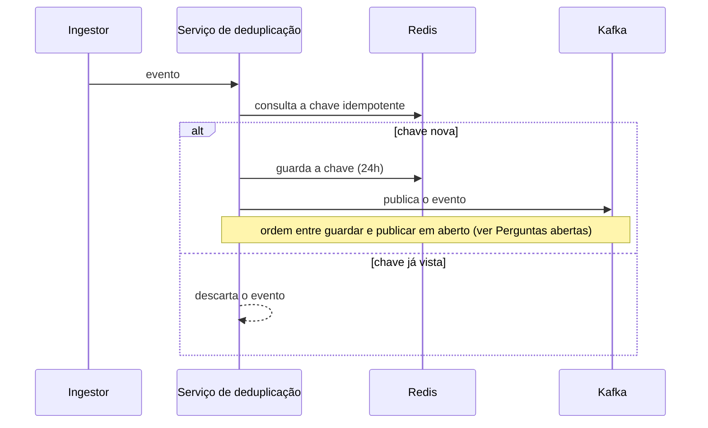

# Serviço de deduplicação de eventos · DD-2026-001

| | |
|---|---|
| **Documento** | DD-2026-001 |
| **Estado** | Rascunho |
| **Autores** | Rafael Nunes |
| **Revisores** | |
| **Criado em** | 2026-11-23 |
| **Última atualização** | 2026-11-23 |

## Motivação

O pipeline de ingestão recebe eventos duplicados dos produtores. A duplicação nasce do reenvio em retry: quando um produtor tenta de novo, o mesmo evento chega mais de uma vez ao ingestor.

Em outubro de 2026 medimos 4% de duplicatas. Essas duplicatas inflam os relatórios de faturamento, e o financeiro já reclamou duas vezes.
## Proposta

Vamos construir um serviço de deduplicação que fica entre o ingestor e o Kafka. Para cada evento, o serviço consulta a chave idempotente do evento (o identificador que se repete em todas as cópias de um mesmo evento) no Redis. Se a chave ainda não existe, o serviço guarda a chave no Redis por 24 horas e publica o evento no Kafka. Se a chave já existe, o evento é um reenvio e o serviço o descarta.

O serviço de deduplicação é o componente novo: ele recebe os eventos do ingestor e decide, evento a evento, se publica ou descarta. O Redis guarda as chaves já vistas, e cada chave expira 24 horas depois de gravada; um reenvio que chegue dentro dessa janela é descartado.
### Trade-off aceito

- ✓ A deduplicação acontece em um único lugar, antes do Kafka, e nenhum consumidor precisa tratar duplicatas por conta própria.
- ✓ O serviço reconhece reenvios mesmo quando o produtor reinicia entre uma tentativa e outra, caso que a idempotência nativa do produtor Kafka não cobre.
- ✗ A ingestão ganha mais um salto no caminho crítico. Estimamos +5 ms de latência, e o time aceitou esse custo em troca da redução de duplicatas.

## Alternativas consideradas

| Alternativa | Por que perdeu |
|---|---|
| Não fazer nada | Mantém os 4% de duplicatas, que seguem inflando os relatórios de faturamento que o financeiro já contestou duas vezes. |
| Deduplicar no consumidor | Cada consumidor teria que reimplementar a deduplicação. Descartada. |
| Idempotência nativa do produtor Kafka | Não cobre o reenvio entre reinícios do produtor. Descartada. |
| **Serviço de deduplicação entre ingestor e Kafka (escolhida)** | Resolve em um ponto só, cobre reinícios do produtor; custa um salto a mais na ingestão (ver [Trade-off aceito](#trade-off-aceito)). |

## Riscos

O único custo levantado até aqui é o salto a mais no caminho crítico, que o time aceitou como trade-off (ver [Trade-off aceito](#trade-off-aceito)). Os riscos de falha da proposta e as mitigações de cada um ainda não foram levantados; estão em [Perguntas abertas](#perguntas-abertas).

## Plano de rollout

As fases de entrada em produção, os critérios de avanço e o caminho de rollback ainda não foram definidos (ver [Perguntas abertas](#perguntas-abertas)).

## Métricas de sucesso

- Duplicatas abaixo de 0,1%, contra os 4% medidos em outubro de 2026.

## Perguntas abertas

1. **Revisores.** Quem revisa este documento, e de quais áreas? O financeiro, que reportou o problema, deve estar entre eles?
2. **Chave idempotente.** De onde vem a chave de cada evento: todo produtor já envia um identificador estável entre retries, ou o serviço precisa derivar a chave do conteúdo do evento? Algum produtor hoje não envia chave?
3. **Janela de 24 horas.** Por que 24 horas? Existe dado sobre o intervalo entre o envio original e o último reenvio? O que acontece com um reenvio que chegue depois da janela?
4. **Ordem entre guardar a chave e publicar.** O serviço grava a chave antes ou depois de publicar no Kafka, e a consulta e a gravação precisam ser atômicas? Isso define o que acontece quando uma das duas etapas falha.
5. **Riscos e mitigações.** Que falhas o time já identificou nesta proposta (no serviço, no Redis, na publicação no Kafka) e como mitiga cada uma? Em caso de falha, o serviço deve deixar passar o evento ou bloqueá-lo?
6. **Rollout.** O serviço entra em produção de uma vez ou em fases (por produtor, por percentual de tráfego, em modo só observação)? Qual o critério para avançar de fase e como se faz o rollback?
7. **Medição das duplicatas.** Como os 4% foram medidos e sobre qual base? A meta de 0,1% vai ser verificada com o mesmo método?
8. **Latência.** A estimativa de +5 ms se refere a qual percentil? Existe um teto de latência que, se ultrapassado, invalida a proposta ou dispara rollback?
9. **Impacto em outros times.** Quem opera o Redis e o Kafka, e esses times precisam revisar a carga nova? Quem é dono do ingestor que muda de destino?
