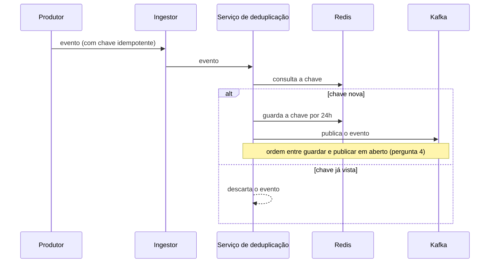

# Serviço de deduplicação de eventos · DD-2026-001

| | |
|---|---|
| **Documento** | DD-2026-001 |
| **Estado** | Rascunho |
| **Autores** | Rafael Nunes |
| **Revisores** | |
| **Criado em** | 2026-11-23 |
| **Última atualização** | 2026-11-23 |

## Motivação

Os produtores reenviam eventos quando fazem retry, e esses reenvios chegam ao pipeline de ingestão como eventos duplicados. Em outubro de 2026 medimos 4% de duplicatas.

As duplicatas inflam os relatórios de faturamento. O time financeiro já reclamou duas vezes.

## Proposta

### Visão geral

Vamos construir um serviço de deduplicação que fica entre o ingestor e o Kafka. Para cada evento, o serviço consulta a chave idempotente do evento no Redis. Se a chave ainda não está lá, o serviço guarda a chave por 24 horas e encaminha o evento ao Kafka. Se a chave já está lá, o serviço descarta o evento.

Assim a deduplicação acontece em um ponto só, antes de o evento chegar ao Kafka.

### Fluxo

O produtor envia o evento ao ingestor, que o repassa ao serviço de deduplicação. O serviço usa o Redis como registro das chaves vistas nas últimas 24 horas: uma chave nova é registrada e o evento segue para o Kafka; uma chave já registrada indica um reenvio, e o serviço descarta o evento.
A ordem exata entre gravar a chave e publicar no Kafka, e a origem da chave idempotente, ainda estão em aberto (ver [Perguntas abertas](#perguntas-abertas)).

### Trade-offs

- ✓ Um único ponto de deduplicação: nenhum consumidor precisa implementar a própria lógica.
- ✓ Cobre reenvios feitos depois de um reinício do produtor, dentro da janela de 24h, caso que a idempotência nativa do produtor Kafka não cobre.
- ✗ Mais um salto no caminho crítico da ingestão. Estimamos +5ms de latência, e a equipe aceitou esse custo.

### Alternativas consideradas

| Alternativa | Por que não | Situação |
|---|---|---|
| Não fazer nada | Mantém os 4% de duplicatas que inflam os relatórios de faturamento, motivo das duas reclamações do financeiro. | ✗ Descartada |
| Deduplicar no consumidor | Cada consumidor teria que reimplementar a deduplicação. | ✗ Descartada |
| Idempotência nativa do produtor Kafka | Não cobre reenvio entre reinícios do produtor. | ✗ Descartada |
| Serviço de deduplicação entre o ingestor e o Kafka, com chaves no Redis por 24h | Ver [Trade-offs](#trade-offs). | ✓ Escolhida |

## Riscos

A equipe registrou até agora um custo aceito, a latência adicional descrita em [Trade-offs](#trade-offs), e ainda não levantou riscos nem mitigações para esta proposta. Esta seção será preenchida com as respostas das [Perguntas abertas](#perguntas-abertas).

## Plano de rollout

Ainda não definido: fases, critério de avanço e critério de rollback estão nas [Perguntas abertas](#perguntas-abertas).

## Métricas de sucesso

| Métrica | Hoje | Meta |
|---|---|---|
| Taxa de eventos duplicados | 4% (outubro de 2026) | abaixo de 0,1% |

## Perguntas abertas

**Cabeçalho**

1. Quem deve revisar o documento, e de quais áreas (arquitetura, infraestrutura, financeiro, times dos produtores)?
2. Este é o primeiro design doc no repositório, por isso usei DD-2026-001. Existe uma sequência mantida fora do repositório que eu deva continuar?

**Proposta**

3. De onde vem a chave idempotente? O produtor define a chave e envia em algum campo do evento? Todos os produtores já enviam essa chave?
4. O serviço grava a chave no Redis antes ou depois de publicar no Kafka? O que acontece com a chave se a publicação no Kafka falhar?
5. O que o serviço faz com o evento quando não consegue consultar o Redis?
6. Por que 24 horas? Existe algum dado sobre o intervalo máximo entre um evento e seu reenvio?
7. O Redis é uma instância existente ou nova? Qual time vai operar o serviço e o Redis?
8. Corrigir as duplicatas já gravadas e os relatórios de faturamento passados faz parte deste trabalho ou fica fora do escopo?

**Riscos**

9. Que riscos a equipe vê nesta proposta, e como pretende mitigar cada um?

**Plano de rollout**

10. Como o serviço entra em produção? Em fases (por produtor, por percentual de tráfego)? Qual o critério para avançar de fase e qual o critério e o procedimento de rollback?

**Métricas de sucesso**

11. Como a taxa de 4% foi medida, e vamos medir a meta de 0,1% da mesma forma e na mesma janela (mensal)?
12. Como chegamos à estimativa de +5ms? Existe um teto de latência que, se ultrapassado, torna a proposta inaceitável e deveria virar métrica de sucesso?
