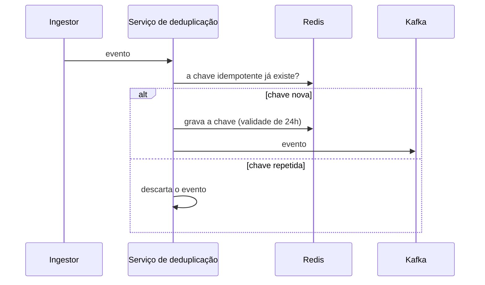

# Serviço de deduplicação de eventos · DD-2026-001

| | |
|---|---|
| **Documento** | DD-2026-001 |
| **Estado** | Rascunho |
| **Autores** | Rafael Nunes |
| **Revisores** | |
| **Criado em** | 2026-11-23 |
| **Última atualização** | 2026-11-23 |

## Motivação

Os produtores reenviam eventos quando fazem retry, e o pipeline de ingestão recebe essas cópias como se fossem eventos novos. No mês passado medimos 4% de eventos duplicados. As duplicatas inflam os relatórios de faturamento, e o financeiro já reclamou duas vezes.

Hoje nada no caminho entre o ingestor e o Kafka descarta repetidos, então cada duplicata chega aos consumidores e aos relatórios.

**Meta:** reduzir as duplicatas para menos de 0,1% dos eventos.

## Proposta

Um novo serviço de deduplicação fica entre o ingestor e o Kafka. Para cada evento recebido, o serviço consulta a chave idempotente do evento no Redis. Se a chave já existe, o serviço descarta o evento. Se não existe, o serviço grava a chave no Redis com validade de 24 horas e entrega o evento ao Kafka.

O ingestor envia cada evento ao serviço em vez de enviá-lo direto ao Kafka. O serviço decide se o evento é novo consultando o Redis. Eventos novos seguem para o Kafka, e repetidos morrem no serviço, antes de chegar a qualquer consumidor. A janela de 24 horas define até quando um reenvio ainda é reconhecido como duplicata.

O serviço entra no caminho crítico da ingestão. Esse é o custo aceito da proposta: estimamos **+5 ms** de latência por evento.

## Alternativas consideradas

Este template não tem uma seção para alternativas. Ela foi acrescentada aqui, entre Proposta e Riscos, para registrar por que as outras opções perderam.

- **Deduplicar no consumidor.** Descartada. Cada consumidor teria que reimplementar a deduplicação.
- **Idempotência nativa do produtor Kafka.** Descartada. Ela não cobre o reenvio entre reinícios do produtor, que é parte do problema.
- **Não fazer nada.** Mantém os 4% de duplicatas e as distorções no faturamento. O documento não registra uma discussão explícita desta opção (ver Perguntas abertas).

## Riscos

| Risco | Mitigação |
|---|---|
| O serviço adiciona um salto ao caminho crítico da ingestão, com latência estimada de +5 ms por evento. A equipe aceitou esse custo em troca da deduplicação central. | A definir (ver Perguntas abertas). |

Outros riscos ainda não foram levantados (ver Perguntas abertas).

## Plano de rollout

Ainda não definido. As fases, os critérios de avanço e os critérios de rollback estão nas Perguntas abertas.

## Métricas de sucesso

| Métrica | Base atual | Meta |
|---|---|---|
| Eventos duplicados no pipeline | 4% (medido no mês passado) | abaixo de 0,1% |
| Latência adicionada na ingestão | n/a | estimativa de +5 ms (a validar após a implantação) |

## Perguntas abertas

Rafael não estava disponível para responder durante a redação. As perguntas abaixo precisam de resposta antes de o documento sair de Rascunho.

**Metas e escopo**
1. Há um limite de latência que a ingestão não pode ultrapassar? Se houver, o +5 ms cabe nele?
2. O que fica fora do escopo desta proposta?
3. Quais eventos passam pelo serviço: todos os tipos ou só alguns? De onde vem a chave idempotente de cada evento (o produtor a envia ou o ingestor a gera)?

**Alternativas**
4. A equipe discutiu "não fazer nada" (por exemplo, deduplicar só nos relatórios de faturamento)? Se sim, por que perdeu?
5. Por que 24 horas de janela? Há dado sobre o intervalo máximo entre um evento e seu reenvio?

**Riscos**
6. Que outros riscos a equipe enxerga nesta proposta e como pretende mitigá-los?
7. Como a equipe pretende reduzir ou monitorar o +5 ms de latência?

**Rollout**
8. Em quais fases o serviço entra em produção?
9. Qual critério permite avançar de uma fase para a próxima?
10. Qual critério dispara o rollback, e como o rollback é feito?

**Métricas**
11. Como a taxa de duplicatas será medida depois da implantação (mesma metodologia dos 4%)? Em que prazo a meta de 0,1% deve ser atingida?

**Revisão**
12. Quem revisa este documento (time de arquitetura, financeiro, donos dos produtores)? Quais outras equipes são afetadas, como as donas do ingestor, do Kafka e do Redis?
