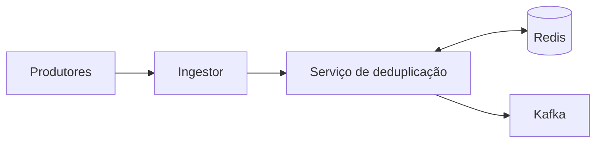

# Serviço de deduplicação de eventos · DD-2026-001

| | |
|---|---|
| **Documento** | DD-2026-001 |
| **Estado** | Rascunho |
| **Autores** | Rafael Nunes |
| **Revisores** | A definir (ver Perguntas abertas) |
| **Criado em** | 2026-11-23 |
| **Última atualização** | 2026-11-23 |

## Motivação

Os produtores reenviam eventos quando fazem retry, e o pipeline de ingestão recebe essas cópias como se fossem eventos novos. No mês passado medimos 4% de eventos duplicados. As duplicatas chegam aos relatórios de faturamento e inflam os valores. O financeiro já reclamou duas vezes.

## Proposta

Criamos um serviço de deduplicação entre o ingestor e o Kafka. Para cada evento recebido, o serviço consulta no Redis a chave idempotente do evento. Se a chave já existe, o serviço descarta o evento. Se não existe, o serviço guarda a chave no Redis por 24 horas e deixa o evento seguir para o Kafka.

O ingestor deixa de publicar direto no Kafka e passa a entregar os eventos ao serviço de deduplicação. O serviço usa o Redis como registro das chaves já vistas, com retenção de 24h. Só os eventos com chave inédita chegam ao Kafka, então todos os consumidores recebem o fluxo já sem duplicatas e nenhum deles precisa implementar deduplicação própria.

O custo aceito é um salto a mais no caminho crítico da ingestão. Estimamos +5ms de latência por evento.

### Alternativas consideradas

- **Deduplicar no consumidor.** Descartada. Cada consumidor teria que reimplementar a deduplicação.
- **Idempotência nativa do produtor Kafka.** Descartada. Ela não cobre o reenvio que acontece entre reinícios do produtor.
- **Não fazer nada.** Mantém os 4% de duplicatas nos eventos e nos relatórios de faturamento.

## Riscos

| Risco | Mitigação |
|---|---|
| O serviço adiciona um salto ao caminho crítico da ingestão, com estimativa de +5ms de latência. A equipe aceitou esse custo em troca da redução de duplicatas. | Ainda não definida (ver Perguntas abertas). |

Os demais riscos ainda não foram levantados com o autor (ver Perguntas abertas).

## Plano de rollout

Ainda não definido: fases, critério de avanço e critério de rollback dependem das respostas em Perguntas abertas.

## Métricas de sucesso

| Métrica | Hoje | Meta |
|---|---|---|
| Eventos duplicados | 4% (medido no mês passado) | Abaixo de 0,1% |

A latência adicional estimada é de +5ms. É uma estimativa do custo aceito, não uma meta.

## Perguntas abertas

1. **Revisores.** Quem revisa este documento, e de quais áreas (por exemplo financeiro, quem opera o Kafka e o Redis)?
2. **Chave idempotente.** Quem gera a chave de cada evento e como? Todos os produtores já a enviam hoje?
3. **Janela de 24h.** Por que 24h? Reenvios que chegam depois da janela passam como eventos novos. Isso é aceitável?
4. **Riscos e mitigações.** Além da latência, que outros riscos o time enxerga? Por exemplo, o que o serviço deve fazer se não conseguir consultar o Redis? Como o time pretende mitigar o custo de +5ms, e de onde vem essa estimativa?
5. **Rollout.** Em quais fases o serviço entra em produção? Qual critério permite avançar de fase e qual dispara o rollback?
6. **Medição.** Como medimos a taxa de duplicatas depois do serviço (mesmo método dos 4%?) e em que prazo esperamos chegar abaixo de 0,1%?
7. **Alternativa "não fazer nada".** Houve discussão sobre conviver com as duplicatas ou corrigi-las só nos relatórios de faturamento? Se sim, por que perdeu?
8. **Numeração.** DD-2026-001 foi escolhido porque não há outros documentos em `docs/design/`. A sequência está correta?
