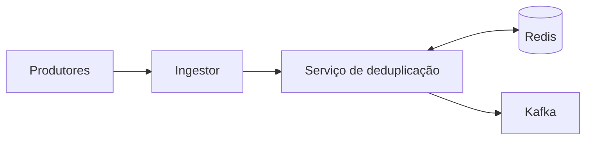

# Serviço de deduplicação de eventos · DD-2026-001

| | |
|---|---|
| **Documento** | DD-2026-001 |
| **Estado** | Rascunho |
| **Autores** | Rafael Nunes |
| **Revisores** | |
| **Criado em** | 2026-11-23 |
| **Última atualização** | 2026-11-23 |

## Motivação

O pipeline de ingestão recebe eventos duplicados dos produtores, que reenviam o mesmo evento quando fazem retry. No mês passado medimos 4% de duplicatas. Elas inflam os relatórios de faturamento, e o financeiro já reclamou duas vezes.

## Proposta

Criamos um serviço de deduplicação que fica entre o ingestor e o Kafka. Para cada evento recebido, o serviço consulta a chave idempotente do evento no Redis. Se a chave já existe, o serviço descarta o evento. Se não existe, o serviço guarda a chave por 24 horas e o evento segue para o Kafka.

Os produtores continuam enviando ao ingestor como hoje. O ingestor passa a entregar os eventos ao serviço de deduplicação em vez de publicá-los direto no Kafka. O serviço usa o Redis como registro das chaves já vistas, cada uma com validade de 24 horas, e só encaminha ao Kafka o que não é repetido. Os consumidores do Kafka recebem um fluxo já deduplicado e não precisam tratar duplicatas.

### Custo aceito

O serviço adiciona um salto no caminho crítico da ingestão. Estimamos +5 ms de latência por evento. Aceitamos esse custo em troca de eliminar as duplicatas num ponto único, antes do Kafka.

### Alternativas consideradas

O template não tem uma seção para alternativas. Adicionamos esta subseção para registrar o porquê da escolha.

- **Deduplicar no consumidor.** Descartada. Cada consumidor teria que reimplementar a deduplicação.
- **Idempotência nativa do produtor Kafka.** Descartada. Ela não cobre o reenvio entre reinícios do produtor.

## Riscos

| Risco | Mitigação |
|---|---|
| Latência de +5 ms (estimada) no caminho crítico da ingestão, por causa do salto adicional. | Custo aceito pelo time. Não há mitigação prevista. |

Outros riscos aguardam levantamento nas [Perguntas abertas](#perguntas-abertas).

## Plano de rollout

O plano de rollout (fases, critério de avanço e de rollback) ainda precisa ser definido. Ver [Perguntas abertas](#perguntas-abertas).

## Métricas de sucesso

| Métrica | Base (mês passado) | Meta |
|---|---|---|
| Taxa de eventos duplicados | 4% | abaixo de 0,1% |

## Perguntas abertas

Riscos
1. O que acontece com os eventos se o Redis ficar indisponível ou perder dados? O serviço deve bloquear a ingestão, deixar passar eventos sem deduplicar ou fazer outra coisa?
2. Quais outros riscos o time enxerga nesta proposta, e qual a mitigação de cada um?
3. A janela de 24 h é suficiente? O que acontece com um reenvio que chega depois dela?

Design
4. Qual é a chave idempotente de um evento e quem a gera (produtor ou ingestor)? Todos os produtores já a enviam hoje?
5. Em que ordem o serviço grava a chave no Redis e publica no Kafka? Se o serviço falhar entre os dois passos, o evento pode ser perdido ou duplicado, e é preciso decidir qual dos dois é aceitável.
6. Como o serviço se comporta com instâncias em paralelo e com dois eventos iguais chegando ao mesmo tempo?
7. Quem opera o serviço e o Redis (time, dimensionamento, capacidade)?

Rollout
8. Como o serviço entra em produção: em fases ou de uma vez, por produtor ou por tópico? Qual o critério para avançar de fase e qual o gatilho de rollback?

Métricas
9. Como mediremos a taxa de duplicatas (os 4% e a meta de 0,1%), e a partir de que prazo após o rollout a meta deve ser atingida?
10. Os +5 ms são uma estimativa. Existe um limite de latência a partir do qual o time consideraria o custo inaceitável? Como mediremos a latência real?

Contexto
11. Quem deve revisar este documento além do time de arquitetura?
12. Fazer nada foi avaliado como alternativa? Se sim, o que pesou contra (por exemplo, o impacto financeiro das duplicatas)?
