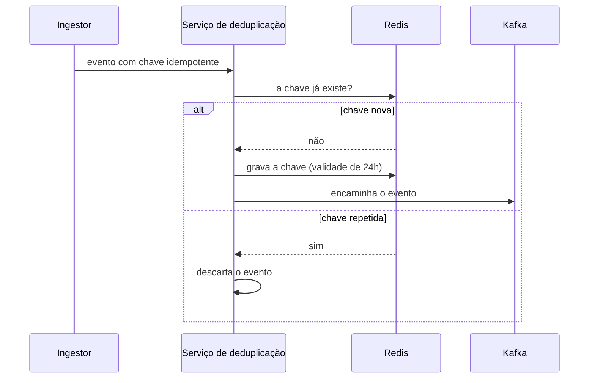

# Serviço de deduplicação de eventos · DD-2026-001

| | |
|---|---|
| **Documento** | DD-2026-001 |
| **Estado** | Rascunho |
| **Autores** | Rafael Nunes |
| **Revisores** | |
| **Criado em** | 2026-11-23 |
| **Última atualização** | 2026-11-23 |

## Motivação

O pipeline de ingestão recebe eventos duplicados dos produtores, que reenviam o mesmo evento quando fazem retry. Em outubro de 2026 medimos 4% de eventos duplicados. Essas duplicatas inflam os relatórios de faturamento, e o financeiro já reclamou duas vezes.

## Proposta

Criamos um serviço de deduplicação que fica entre o ingestor e o Kafka. Para cada evento recebido, o serviço consulta no Redis a chave idempotente do evento. Se a chave não existe, ele a grava com validade de 24 horas e encaminha o evento ao Kafka. Se a chave já existe, o evento é um reenvio e o serviço o descarta.

O ingestor entrega cada evento ao serviço em vez de publicá-lo direto no Kafka. O serviço decide, a partir da chave guardada no Redis, se o evento segue para o Kafka ou se é descartado. A janela de 24 horas define até quando um reenvio ainda é reconhecido como duplicata.
### Alternativas consideradas

O template não tem uma seção para alternativas. Esta subseção fica aqui, dentro de Proposta, para que o time de arquitetura veja por que a escolha foi essa.

- **Deduplicar no consumidor.** Descartada. Cada consumidor teria que reimplementar a deduplicação.
- **Usar a idempotência nativa do produtor Kafka.** Descartada. Ela não cobre o reenvio que acontece entre reinícios do produtor.

## Riscos

| Risco | Mitigação |
|---|---|
| O serviço adiciona um salto no caminho crítico da ingestão, com latência estimada de +5 ms por evento. | Trade-off aceito pelo time em troca da redução de duplicatas. Nenhuma mitigação definida até aqui. |

## Plano de rollout

Ainda não definimos as fases, os critérios de avanço nem o critério de rollback. Ver [Perguntas abertas](#perguntas-abertas).

## Métricas de sucesso

| Métrica | Hoje | Meta |
|---|---|---|
| Eventos duplicados | 4% (outubro de 2026) | abaixo de 0,1% |

A latência adicional de +5 ms é uma estimativa, ainda não uma medição.

## Perguntas abertas

1. **Rollout.** Em quantas fases o serviço entra em produção? Qual critério permite avançar de uma fase para a próxima, e qual dispara o rollback?
2. **Falha do Redis.** O que o serviço faz com um evento quando não consegue consultar o Redis: encaminha, descarta ou recusa? Qual o impacto de cada escolha nos duplicados e na perda de eventos?
3. **Latência.** Existe um teto aceitável para a latência adicional, além da estimativa de +5 ms? Quem mede e em que ponto do pipeline?
4. **Medição das duplicatas.** Como e onde medimos o percentual de duplicatas, para comparar os 4% atuais com a meta de 0,1%? Em qual janela de tempo?
5. **Janela de 24h.** Por que 24 horas? Os reenvios que causam duplicatas chegam todos dentro dessa janela?
6. **Chave idempotente.** Quem gera a chave de cada evento (produtor ou ingestor) e como ela é composta?
7. **Do nada.** Discutimos conviver com as duplicatas e corrigi-las no lado do faturamento? Se sim, por que perdeu?
8. **Impactados.** Além do financeiro, quais times são afetados (produtores, consumidores, plataforma que opera o Redis)? Algum precisa revisar este documento?
9. **Revisores e numeração.** Quem revisa este documento? DD-2026-001 é mesmo o próximo número da sequência, já que a pasta não tinha outros documentos?
