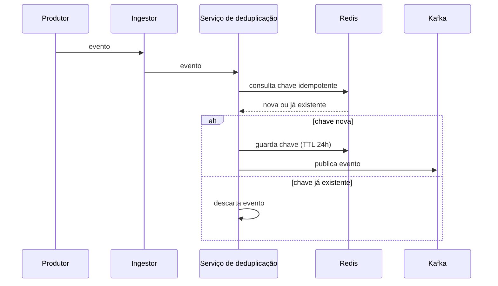

# Serviço de deduplicação de eventos · DD-2026-001

| | |
|---|---|
| **Documento** | DD-2026-001 |
| **Estado** | Rascunho |
| **Autores** | Rafael Nunes |
| **Revisores** | |
| **Criado em** | 2026-11-23 |
| **Última atualização** | 2026-11-23 |

## Motivação

O pipeline de ingestão recebe eventos duplicados dos produtores, que reenviam o mesmo evento quando fazem retry. No mês passado medimos 4% de duplicatas. Elas inflam os relatórios de faturamento, e o financeiro já reclamou duas vezes.

## Proposta

Criamos um serviço de deduplicação que fica entre o ingestor e o Kafka. Para cada evento, o serviço consulta a chave idempotente no Redis. Se a chave já existe, o serviço descarta o evento. Se não existe, o serviço guarda a chave com validade de 24 horas e deixa o evento seguir para o Kafka.

O produtor envia o evento ao ingestor, e o ingestor o entrega ao serviço de deduplicação em vez de publicar direto no Kafka. O serviço decide com base na chave guardada no Redis: evento com chave nova segue para o Kafka, evento com chave repetida é descartado. A janela de 24 horas é o tempo em que uma chave continua valendo. Um reenvio depois desse prazo não é reconhecido como duplicata.

### Alternativas consideradas

- **Deduplicar no consumidor.** Cada consumidor teria que reimplementar a deduplicação. Descartamos.
- **Idempotência nativa do produtor Kafka.** Ela não cobre o reenvio entre reinícios do produtor, que é parte do problema. Descartamos.
- **Não fazer nada.** Mantém 4% de duplicatas nos relatórios de faturamento e as reclamações do financeiro. O doc não trata essa opção em detalhe (ver Perguntas abertas).

Este bloco não existe no template. Foi adicionado dentro de Proposta para registrar por que a solução escolhida venceu, sem alterar a ordem das seções do template.

## Riscos

- **Latência no caminho crítico.** O serviço é mais um salto entre o ingestor e o Kafka. Estimamos +5ms de latência por evento. A equipe aceitou esse custo em troca da redução de duplicatas. A estimativa ainda não foi medida.

Os demais riscos (indisponibilidade do Redis, perda de chaves, janela de 24h) ainda não foram discutidos e estão em Perguntas abertas.

## Plano de rollout

Ainda não definido. As fases, os critérios de avanço e o plano de rollback estão em Perguntas abertas.

## Métricas de sucesso

- Duplicatas abaixo de 0,1% dos eventos (linha de base: 4% no mês passado).

A latência adicionada (+5ms estimados) deve ser acompanhada como custo, mas ainda não tem limite definido (ver Perguntas abertas).

## Perguntas abertas

Motivação e proposta
- Qual é a chave idempotente de cada evento? Quem a gera, o produtor ou o ingestor?
- Como o serviço se comporta quando o Redis está indisponível: deixa os eventos passarem (duplicatas voltam) ou bloqueia a ingestão?
- Qual é o comportamento do serviço sob concorrência, quando dois reenvios do mesmo evento chegam ao mesmo tempo? A consulta e o registro da chave são uma operação atômica?
- Como a medição dos 4% foi feita, e como vamos medir os 0,1%?
- Por que 24h? Os reenvios que medimos acontecem dentro dessa janela?

Riscos
- O que acontece se o serviço de deduplicação cair? Ele é um ponto único de falha no caminho crítico?
- Qual é o dimensionamento esperado do Redis (volume de chaves em 24h) e o risco de perder chaves (reinício, eviction)?
- Qual é o limite aceitável de latência, e o +5ms foi medido ou só estimado?

Rollout
- Em quais fases o serviço entra em produção (por exemplo, por produtor ou por tópico)? Qual é o critério de avanço e como fazemos rollback?

Alternativas e impacto
- Quais times além do de ingestão são afetados (financeiro, consumidores, infraestrutura do Redis e do Kafka)? Quem revisa este doc?
- Há alguma razão adicional, além das duas já registradas, para não deixar tudo como está?

Metas
- A meta de 0,1% vale para duplicatas medidas onde: no Kafka, nos relatórios de faturamento ou ambos?
