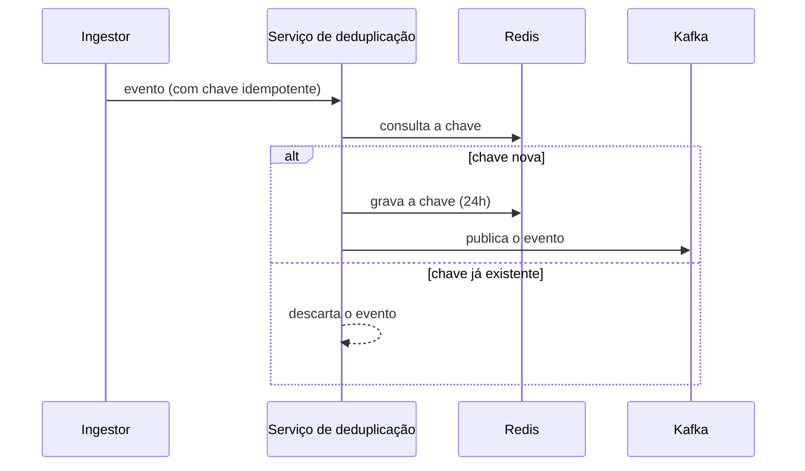

# Serviço de deduplicação de eventos · DD-2026-001

| | |
|---|---|
| **Documento** | DD-2026-001 |
| **Estado** | Rascunho |
| **Autores** | Rafael Nunes |
| **Revisores** | |
| **Criado em** | 2026-11-23 |
| **Última atualização** | 2026-11-23 |

## Motivação

O pipeline de ingestão recebe eventos duplicados dos produtores, que reenviam o mesmo evento quando fazem retry. No mês passado medimos 4% de duplicatas. Elas inflam os relatórios de faturamento, e o financeiro já reclamou duas vezes.

Hoje nada no caminho entre o ingestor e o Kafka descarta repetidos. A meta é levar as duplicatas a menos de 0,1%.

## Proposta

Criamos um serviço de deduplicação entre o ingestor e o Kafka. Para cada evento recebido, o serviço consulta no Redis a chave idempotente do evento. Se a chave é nova, ela é gravada com validade de 24 horas e o evento segue para o Kafka. Se a chave já existe, o serviço descarta o evento.

O ingestor deixa de publicar direto no Kafka e passa a entregar cada evento ao serviço. O serviço decide entre publicar e descartar, usando o Redis como memória das chaves já vistas. A janela de 24 horas define o alcance da deduplicação: um reenvio que chegue depois de 24h do evento original não é reconhecido como repetido.

### Trade-off aceito

O serviço adiciona um salto ao caminho crítico da ingestão. Estimamos +5 ms de latência por evento. Aceitamos esse custo em troca de eliminar as duplicatas num único ponto, antes do Kafka.

### Alternativas consideradas

Este template não tem seção de alternativas, então ela fica aqui, dentro da Proposta.

- **Deduplicar no consumidor.** Descartada. Cada consumidor teria que reimplementar a deduplicação.
- **Idempotência nativa do produtor Kafka.** Descartada. Ela não cobre o reenvio entre reinícios do produtor.
- **Não fazer nada.** Mantém os 4% de duplicatas e as distorções no faturamento. Não é aceitável para o financeiro, que já reclamou duas vezes.

## Riscos

- **Latência no caminho crítico.** O novo salto custa cerca de +5 ms por evento (estimativa, ainda não medida). Mitigação: medir em staging antes do rollout (ver Plano de rollout).
- **Dependência do Redis na ingestão.** Todo evento passa pela consulta ao Redis, então a disponibilidade do Redis passa a afetar a ingestão. A mitigação depende de uma decisão ainda aberta (ver Perguntas abertas).
- **Janela de 24h.** Duplicatas que chegam depois de 24h do evento original não são detectadas. Mitigação: nenhuma proposta por enquanto (ver Perguntas abertas).

## Plano de rollout

Ainda não definido. As fases, os critérios de avanço e o critério de rollback estão nas Perguntas abertas.

## Métricas de sucesso

- Taxa de duplicatas: de 4% (medida no mês passado) para menos de 0,1%.
- Latência adicional da ingestão: em torno de +5 ms, a confirmar por medição. O limite aceitável está nas Perguntas abertas.

## Perguntas abertas

Rafael, estas perguntas ficaram sem resposta. Nenhuma seção acima assume a resposta de qualquer uma delas.

**Rollout**
1. Em quantas fases o serviço entra em produção (por exemplo, por produtor, por percentual de tráfego ou em modo sombra)?
2. Qual critério faz uma fase avançar para a próxima?
3. Qual critério dispara o rollback, e como se faz (desligar o serviço, voltar o ingestor a publicar direto no Kafka)?

**Riscos**
4. O que o serviço faz quando o Redis está indisponível: publica o evento sem deduplicar ou rejeita o evento? Qual dos dois o time prefere?
5. Duplicatas que chegam depois de 24h são aceitáveis? Existe dado sobre quanto tempo separa um reenvio do evento original?
6. A consulta e a gravação da chave precisam ser atômicas, para que dois reenvios simultâneos não passem juntos? Como o serviço garante isso?

**Métricas**
7. Qual é o limite aceitável de latência adicional? Os +5 ms são a medida esperada ou o teto?
8. Como medimos a taxa de duplicatas depois do rollout (mesma fonte dos 4% do mês passado)?

**Proposta**
9. Quem define a chave idempotente de cada evento: o produtor ou o ingestor? O que acontece com um evento que chega sem chave?
10. O serviço é stateless fora do Redis, e quantas instâncias rodam? Quem é o dono operacional do Redis e do serviço?
11. A ordem dos eventos no Kafka precisa ser preservada? O serviço interfere nisso?

**Documento**
12. Quem são os revisores do time de arquitetura?
13. O número DD-2026-001 está correto? `docs/design/` só tinha o `TEMPLATE.md`, então assumi o primeiro da sequência.
