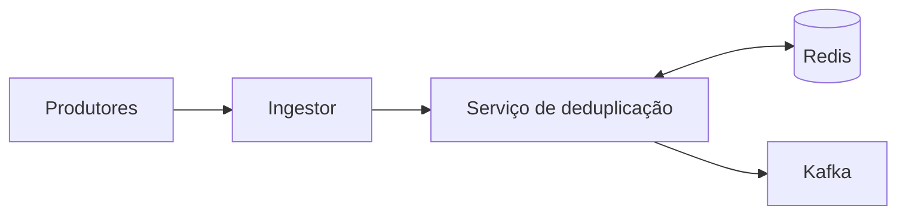

# Serviço de deduplicação de eventos · DD-2026-001

| | |
|---|---|
| **Documento** | DD-2026-001 |
| **Estado** | Rascunho |
| **Autores** | Rafael Nunes |
| **Revisores** | |
| **Criado em** | 2026-11-23 |
| **Última atualização** | 2026-11-23 |

## Motivação

O pipeline de ingestão recebe eventos duplicados dos produtores, que reenviam o mesmo evento quando fazem retry. Em outubro de 2026, 4% dos eventos recebidos eram duplicatas.

As duplicatas inflam os relatórios de faturamento. O financeiro já reclamou duas vezes por causa disso.

## Proposta

Criar um serviço de deduplicação entre o ingestor e o Kafka. Para cada evento recebido, o serviço consulta a chave idempotente do evento no Redis. Se a chave já existe, o serviço descarta o evento. Se não existe, o serviço guarda a chave no Redis com validade de 24 horas e encaminha o evento ao Kafka.

Os produtores continuam enviando ao ingestor, e o ingestor passa a entregar os eventos ao serviço de deduplicação em vez de publicá-los direto no Kafka. O serviço é o único componente que consulta o Redis. O Kafka e seus consumidores só recebem eventos que o serviço deixou passar, então os consumidores não precisam implementar deduplicação.

A janela de 24 horas é o alcance da deduplicação: o serviço reconhece como repetido um evento cuja chave foi vista nas últimas 24 horas.

### Alternativas consideradas

O template não tem uma seção para alternativas, então ela fica aqui, entre a proposta e os riscos.

- **Deduplicar no consumidor.** Descartada. Cada consumidor teria que reimplementar a deduplicação.
- **Idempotência nativa do produtor Kafka.** Descartada. Ela não cobre o reenvio entre reinícios do produtor, que é um dos casos que geram as duplicatas.

### Trade-off aceito

O serviço adiciona um salto ao caminho crítico da ingestão. A estimativa é de +5 ms de latência. O time aceita esse custo em troca de remover as duplicatas em um único ponto, antes do Kafka.

## Riscos

| Risco | Mitigação |
|---|---|
| Latência de ingestão aumenta por causa do salto extra (estimativa de +5 ms) | Aceito como custo da proposta. A estimativa ainda precisa ser confirmada na medição do rollout. |

Os demais riscos da proposta (indisponibilidade do Redis, do próprio serviço, falha entre registrar a chave e publicar no Kafka) ainda não foram analisados. Estão em [Perguntas abertas](#perguntas-abertas).

## Plano de rollout

O plano ainda não foi definido. As fases, os critérios de avanço e de rollback estão em [Perguntas abertas](#perguntas-abertas).

## Métricas de sucesso

| Métrica | Base | Meta |
|---|---|---|
| Taxa de eventos duplicados | 4% (outubro de 2026) | abaixo de 0,1% |

Além da meta, o time acompanha a latência adicionada à ingestão, que a estimativa inicial coloca em +5 ms.

## Perguntas abertas

1. **Revisores.** Quem revisa este documento? O time de arquitetura só aceita docs neste formato, e o campo está vazio.
2. **Chave idempotente.** Quem gera a chave de cada evento: o produtor ou o ingestor? Todos os produtores já enviam uma chave hoje?
3. **Ordem de operações.** O serviço registra a chave no Redis antes ou depois de publicar no Kafka? Se o Kafka falhar depois do registro, o reenvio do produtor seria descartado como duplicata e o evento se perderia.
4. **Redis indisponível.** O que o serviço faz quando não alcança o Redis: deixa os eventos passarem (aceitando duplicatas) ou rejeita (aceitando perda ou backpressure)?
5. **Disponibilidade do serviço.** Como o serviço roda em produção (número de instâncias, comportamento em falha)? Ele entra no caminho crítico, então sua indisponibilidade para a ingestão inteira.
6. **Orçamento de latência.** Existe um limite máximo de latência para a ingestão? Os +5 ms cabem nele?
7. **Medição.** Como vamos medir a taxa de duplicatas para confirmar a meta de 0,1%? A medição de 4% de outubro usou qual método, e dá para repeti-la?
8. **Plano de rollout.** Em quais fases o serviço entra em produção? Qual o critério para avançar de uma fase à outra e qual o critério de rollback?
9. **Capacidade do Redis.** Qual o volume de eventos por dia, para dimensionar o Redis com retenção de 24 horas?
10. **Não fazer nada.** Houve avaliação formal de manter o cenário atual (por exemplo, corrigir só nos relatórios de faturamento)? Se sim, vale registrar em Alternativas consideradas.
